<section class="cover">
<div class="cover-band">CLUBFLOW · TÀI LIỆU KỸ THUẬT</div>
<h1 class="cover-title">Hướng dẫn giao diện prototype<br>và tích hợp backend</h1>
<p class="cover-sub">Walkthrough có ảnh chụp từ ứng dụng React đang chạy, sơ đồ điều hướng,
ma trận màn hình → service → API và checklist tích hợp.</p>
<table class="cover-meta">
<tr><th>Phạm vi</th><td>Frontend React (UI-first prototype, dữ liệu mock) và kế hoạch nối với backend Express + PostgreSQL</td></tr>
<tr><th>Đối tượng đọc</th><td>Nhóm sinh viên phát triển ClubFlow, đặc biệt là thành viên làm API và cơ sở dữ liệu</td></tr>
<tr><th>Nguồn sự thật</th><td>Mã nguồn hiện tại trong <code>client/src</code>, <code>docs/frontend/INTEGRATION.md</code>, <code>docs/requirements/</code>, <code>specs/001-frontend-ui/</code></td></tr>
<tr><th>Ảnh chụp</th><td>Bộ ảnh của năm màn hình nghiệp vụ được chụp ngày 15/11/2026 từ <code>http://localhost:3000</code> bằng Microsoft Edge headless; ảnh Sign In kiểu hộp thoại là bằng chứng lịch sử trước UI-8, không còn là luồng hiện tại</td></tr>
<tr><th>Đồng bộ tài liệu</th><td>16/11/2026 · đối chiếu mã nguồn sau UI-8 (Sign In và My Profile)</td></tr>
</table>
<div class="cover-note"><strong>Lưu ý quan trọng.</strong> Giao diện React và các tương tác đã được xây dựng, nhưng mọi dữ liệu
đều là dữ liệu hư cấu trong bộ nhớ trình duyệt. Chưa có API nghiệp vụ, chưa có xác thực thật, chưa lưu trữ bền vững.
Tài liệu này phân biệt rõ phần nào là thật, phần nào là mô phỏng.</div>
</section>

<section class="toc-page">
<h2 class="toc-title">Mục lục</h2>
<!--TOC-->
</section>

# Chương 1 — Giới thiệu ClubFlow {#ch1}

## 1.1 Mục đích và bài toán

ClubFlow là ứng dụng web hỗ trợ một câu lạc bộ sinh viên chạy **một đợt tuyển thành viên** từ đầu đến cuối: Ban tuyển dụng (Executive) tạo và công bố chiến dịch, sinh viên (Applicant) nộp hồ sơ cho từng vị trí, Ban tuyển dụng sàng lọc CV, xếp lịch phỏng vấn không xung đột, người phỏng vấn (Interviewer) gửi đánh giá, và cuối cùng Ban tuyển dụng ghi nhận, công bố kết quả Pass/Fail cho từng hồ sơ.

Bài toán thực tế mà ClubFlow giải quyết là các đợt tuyển thường được quản lý bằng biểu mẫu, bảng tính và tin nhắn rời rạc. Điều đó gây ra các lỗi điển hình: đếm nhầm số hồ sơ và số ứng viên, một sinh viên bị xếp hai buổi phỏng vấn trùng giờ, người phỏng vấn thấy ghi chú nội bộ không dành cho họ, hoặc kết quả bị lộ trước khi công bố. Các quy tắc nghiệp vụ BR-01…BR-14 trong `docs/requirements/BUSINESS_RULES.md` mô tả chính xác những ràng buộc này.

## 1.2 Phạm vi prototype hiện tại

Frontend hiện là một **prototype React được chuẩn bị để tích hợp backend** (feature `specs/001-frontend-ui`, tasks T001–T098 đã hoàn thành). Phạm vi giao diện gồm **năm màn hình nghiệp vụ và hai màn hình tài khoản dùng chung**: Sign In và My Profile. Cả bảy đều có thể sử dụng với dữ liệu demo; mọi lệnh gọi dữ liệu đi qua lớp `services`, nên điểm thay thế chính khi tích hợp là thân hàm service và provider xác thực.

| Thành phần | Trạng thái | Ghi chú |
|---|---|---|
| Giao diện React (5 màn hình nghiệp vụ + 2 màn hình tài khoản) | **Đã triển khai** | Atomic Design, responsive 360 px → desktop |
| Tương tác mock (đăng nhập, hồ sơ, lọc, quyết định, xếp lịch, công bố…) | **Đã triển khai** | Chạy trên store trong bộ nhớ; tải lại trang khôi phục fixture của kịch bản và chỉ giữ lựa chọn account/scenario |
| Dữ liệu và service mock | **Đã triển khai** | `client/src/mocks/`, thân hàm trong `client/src/services/` |
| `apiClient` (HTTP, Bearer token, ánh xạ lỗi) | **Đã triển khai, chưa dùng cho nghiệp vụ** | Chỉ `GET /health` đang gọi thật |
| Xác thực, phân quyền thật | **Chưa triển khai** | `/login` kiểm credential hư cấu; `DemoSessionContext`, `AuthGate`, `RoleGate` chỉ mô phỏng UI, không phải bảo mật |
| API nghiệp vụ, lưu trữ PostgreSQL | **Chưa triển khai** | Backend mới có scaffold và `/api/health` |
| Quy tắc nghiệp vụ phía server (BR-01…BR-14) | **Chưa triển khai** | Mock chỉ mô phỏng để UI hiển thị đúng |

## 1.3 Công nghệ

| Lớp | Công nghệ (theo `AGENTS.md`) |
|---|---|
| Frontend | React, Vite, React Router, Atomic Design, Vitest, React Testing Library, ESLint |
| Backend | Node.js, Express, PostgreSQL (`pg`), JWT, Multer, Cloudinary, Vitest |
| Phát triển | Docker (PostgreSQL), GitHub Spec Kit, Jira; một file `.env` duy nhất ở thư mục gốc |

## 1.4 Cái gì là mock, cái gì là thật

- **Thật:** mã React, định tuyến, component, kiểm tra hợp lệ phía client (`utils/validation.js`), `apiClient`, kiểm tra sức khỏe API ở footer (`useApiHealth` → `GET /api/health`, hiển thị *API connected* / *API unavailable*).
- **Mock:** credential và phiên đăng nhập (`authService`, `DemoSessionContext`), hồ sơ cá nhân, kịch bản demo với đồng hồ cố định, toàn bộ dữ liệu chiến dịch/hồ sơ/lịch/đánh giá/kết quả, kiểm tra quyền và khóa BR-14 trong `mocks/guards.js`, tính trạng thái lịch trong `mocks/derive.js`. Không có JWT, cookie phiên hay persistence thật.
- **Thanh Demo** dưới header chỉ tồn tại cho mục đích trình diễn; phải gỡ hoặc ẩn trong bản production (chương 13).

## 1.5 Kiến trúc hiện tại và kiến trúc mục tiêu

<div class="diagram">
<div class="dg-title">Hiện tại (prototype)</div>
<div class="flow">
<div class="box page">React Pages<small>pages/*.jsx</small></div><div class="arr">→</div>
<div class="box hook">Hooks<small>hooks/*.js</small></div><div class="arr">→</div>
<div class="box svc">Services (thân mock)<small>services/*.js</small></div><div class="arr">→</div>
<div class="box mock">Mock store trong bộ nhớ<small>mocks/store.js · fixtures · scenarios</small></div>
</div>
<div class="dg-title">Mục tiêu (sau tích hợp)</div>
<div class="flow">
<div class="box page">React Pages</div><div class="arr">→</div>
<div class="box hook">Hooks</div><div class="arr">→</div>
<div class="box svc">Services (thân gọi API)</div><div class="arr">→</div>
<div class="box api">apiClient<small>services/apiClient.js</small></div><div class="arr">→</div>
<div class="box be">Express backend<small>Route → Validator → Controller → Service → Repository</small></div><div class="arr">→</div>
<div class="box db">PostgreSQL</div>
</div>
<div class="dg-legend"><span class="sw stable"></span>Giữ nguyên: Pages, Hooks, chữ ký hàm service &nbsp; <span class="sw change"></span>Thay đổi: thân hàm service, DemoSessionContext → auth provider &nbsp; <span class="sw new"></span>Mới: API backend, CSDL</div>
</div>

Lớp thay đổi khi tích hợp là **thân các hàm trong `client/src/services/`** (từ đọc `mocks/store.js` sang gọi `apiClient`) và **`DemoSessionContext`** (sang provider xác thực thật). Pages, hooks, component và chữ ký hàm service được giữ ổn định; nếu API trả dữ liệu khác hình dạng, service phải ánh xạ lại để trang không phải sửa.

# Chương 2 — Tổng quan các màn hình {#ch2}

## 2.1 Danh mục màn hình

Định tuyến được khai báo trong `client/src/routes/AppRoutes.jsx` và `routes/paths.js`. Tab là **tham số truy vấn** `?tab=` trên cùng một route, không phải route riêng.

| Màn hình (`<h1>`) | URL | Vai trò | Mục đích chính | Thao tác chính | Liên quan | Trạng thái |
|---|---|---|---|---|---|---|
| Applicant Portal | `/` (`?tab=campaign∣apply∣mine∣notifications`) | Khách, Ứng viên | Xem chiến dịch công khai, nộp hồ sơ, theo dõi hồ sơ, thông báo | Apply Now, Submit Application, Đánh dấu tất cả đã đọc | — | UI + mock |
| Create Recruitment Campaign | `/executive/campaign` | Ban tuyển dụng | Soạn, xem trước, công bố chiến dịch; quản lý vị trí | Lưu bản nháp, Xem trước, Công bố chiến dịch, Lưu thay đổi | Application Review | UI + mock |
| Application Review — CV Screening | `/executive/review?tab=screening` | Ban tuyển dụng | Thống kê, tìm/lọc, xem chi tiết, Shortlist/Loại, xuất CSV | Review, Lưu ghi chú, Loại hồ sơ, Shortlist Candidate, Xuất CSV | Campaign, Scheduling | UI + mock |
| Application Review — Final Results | `/executive/review?tab=results` | Ban tuyển dụng | Xem đánh giá, ghi nhận Pass/Fail, công bố | View Assessment, Record Pass/Fail, Publish Results | Scheduling | UI + mock |
| Interview Scheduling | `/executive/scheduling` | Ban tuyển dụng | Lịch nháp, xử lý Conflict/Unassigned, xác nhận, xuất lịch | Tạo lại lịch nháp, Giải quyết/Sửa/+ Gán khung giờ, Lưu thay đổi, Duyệt & xác nhận lịch, Xuất lịch | Application Review | UI + mock |
| Interviewer Workspace | `/interviewer` | Người phỏng vấn | Xem buổi được phân công, chi tiết ứng viên, gửi đánh giá | Chọn, Submit Assessment | — | UI + mock |
| Sign In | `/login` | Khách; tài khoản đã đăng nhập bị chuyển khỏi trang | Đăng nhập bằng credential hư cấu được cấp sẵn | Đăng nhập, hiện/ẩn mật khẩu, quay về Applicant Portal | Route đích dự định hợp lệ | UI + mock |
| My Profile | `/profile` | Ban tuyển dụng, Ứng viên, Người phỏng vấn | Xem hồ sơ và sửa họ tên hiển thị/email | Chỉnh sửa, Lưu thay đổi, Hủy thay đổi | Account menu | UI + mock |
| Không tìm thấy trang | mọi URL khác | Tất cả | Thông báo 404 phía client | — | — | UI |

## 2.2 Màn hình, tab, hộp thoại, panel và trạng thái

- **Màn hình (screen):** bảy route sản phẩm có `<h1>` riêng: năm màn hình nghiệp vụ và hai màn hình tài khoản. Route `*` là trang 404 hỗ trợ, không tính vào bảy màn hình.
- **Tab:** phần con của một màn hình, chọn bằng `?tab=` (Applicant Portal có 4 tab; Application Review có 2 tab *A CV Screening* và *B Final Results*). URL thay đổi nên có thể chia sẻ/tải lại.
- **Hộp thoại (dialog, `organisms/Modal`, `ConfirmDialog`):** lớp phủ có focus trap, Esc để đóng: Xem trước chiến dịch, xác nhận Công bố/Loại hồ sơ/Shortlist/Publish Results/Tạo lại lịch/Xác nhận lịch/Gửi đánh giá, sửa một hàng lịch. **Sign In hiện là trang `/login`, không phải hộp thoại.**
- **Panel chi tiết (`ApplicationDetail`, `InterviewDetailCard`):** không phải drawer trượt; hiện **bên cạnh danh sách** trên desktop và xếp bên dưới trên màn hình hẹp.
- **Trạng thái UI:** loading (spinner `AsyncContent`), lỗi + *Thử lại*, rỗng (`EmptyState`), hạn chế quyền (`RoleGate`), chỉ đọc (sau xác nhận lịch).

## 2.3 Điều khiển dùng chung


<p class="meta">Route <code>/</code> · Khách · Kịch bản “Đang nhận hồ sơ” · 1280 px</p>

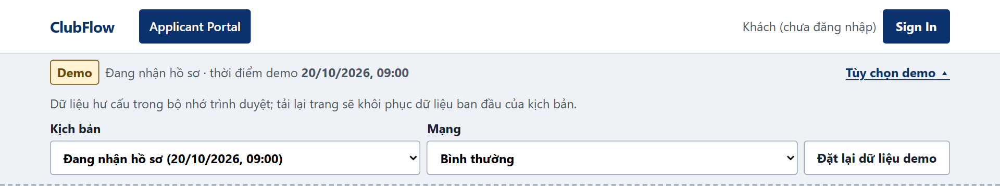

<p class="meta">Route <code>/</code> · Khách · “Đang nhận hồ sơ” · 1280 px. Năm kịch bản: <em>Chiến dịch còn là bản nháp</em> (05/10/2026 09:00), <em>Đã công bố, chưa mở đơn</em> (10/10), <em>Đang nhận hồ sơ</em> (20/10), <em>Đã đóng đơn · duyệt hồ sơ và xếp lịch</em> (31/10, mặc định), <em>Lịch đã xác nhận · sau phỏng vấn</em> (05/11 13:00).</p>

<div class="two">


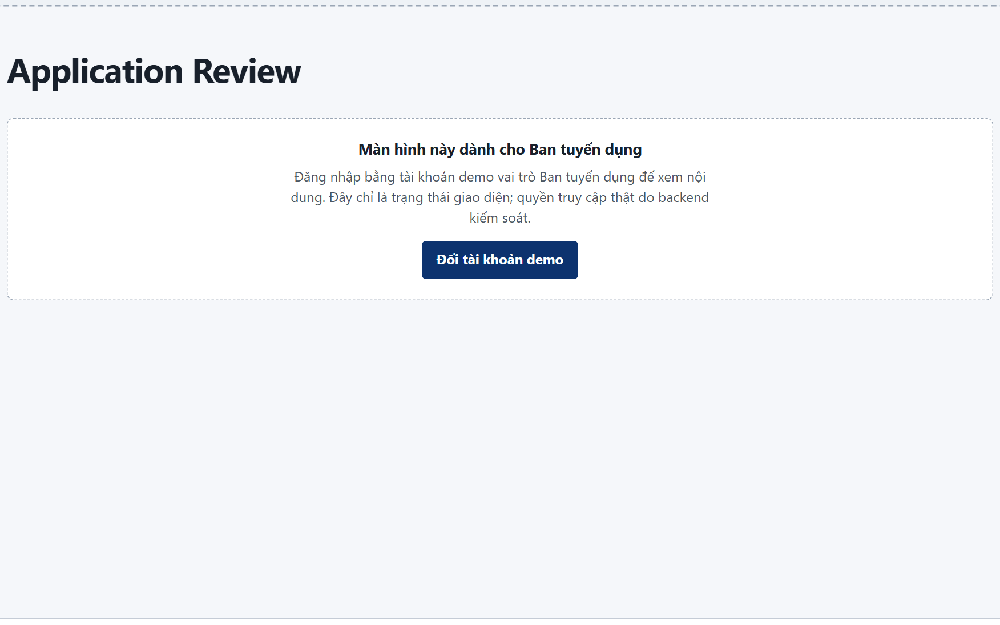

</div>

<p class="meta">Hình 2.3 chỉ lưu lịch sử giao diện trước UI-8 và không mô tả luồng đang chạy. Hình 2.4: <code>/executive/review</code> · Nguyễn Minh Anh (Ứng viên) · “Đã đóng đơn”. RoleGate chỉ định hình giao diện, <strong>không phải kiểm soát truy cập</strong>.</p>

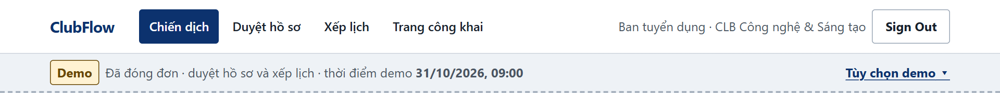

<p class="meta">Route <code>/executive/campaign</code> · Ban tuyển dụng · “Đã đóng đơn” · 1280 px</p>

Tài khoản demo (`mocks/fixtures.js`): Ban tuyển dụng `exec-recruitment`; người phỏng vấn `iv-hamy` (Hà My, User Experience Design) và `iv-giahuy` (Gia Huy, Content Creation); ứng viên `ap-minhanh`, `ap-quocbao`, `ap-khanhlinh`, `ap-baongoc`, `ap-thaovy`, `ap-haidang`. Tất cả đều hư cấu. Trang `/login` công khai ba credential mẫu cho ba vai trò, cùng mật khẩu phát triển `ClubFlowDemo!`; đây không phải credential production.

# Chương 3 — Sơ đồ điều hướng {#ch3}

## 3.1 Liên kết điều hướng thực tế theo vai trò

Header chỉ hiện các mục trong `NAV_BY_ROLE` (`routes/navigation.js`). Khách mở route được bảo vệ sẽ tới `/login` với `location.state.from`. Sau khi đăng nhập, `postSignInDestination` chỉ khôi phục đường dẫn nằm trong allow-list của đúng vai trò; nếu không thì chuyển tới trang chủ vai trò (`HOME_BY_ROLE`). Sign Out luôn quay về `/`. Ngoài các redirect xác thực này, các nút “Mở …”, “Tiếp tục tới …”, “← Về …” là liên kết người dùng bấm.

<div class="diagram nav">
<div class="lane"><div class="lane-h">Khách</div>
<div class="flow wrap"><div class="box page">/ · tab Campaign</div><div class="arr">→ Apply Now / Đăng nhập →</div><div class="box page">/login</div><div class="arr">→ credential hợp lệ →</div><div class="box auto">Route dự định hợp lệ hoặc trang chủ vai trò</div></div></div>
<div class="lane"><div class="lane-h">Ứng viên</div>
<div class="flow wrap"><div class="box page">/ ?tab=campaign</div><div class="arr">⇄ tab</div><div class="box page">?tab=apply</div><div class="arr">⇄ tab</div><div class="box page">?tab=mine</div><div class="arr">⇄ tab</div><div class="box page">?tab=notifications</div></div>
<div class="note">Gửi hồ sơ thành công: <b>ở lại tab Apply</b>, hiện thông báo; người dùng tự mở tab My Applications.</div></div>
<div class="lane"><div class="lane-h">Ban tuyển dụng</div>
<div class="flow wrap"><div class="box page">Chiến dịch<small>/executive/campaign</small></div><div class="arr">“Mở Application Review →”</div><div class="box page">Duyệt hồ sơ<small>?tab=screening ⇄ ?tab=results</small></div><div class="arr">“Tiếp tục tới Interview Scheduling →”</div><div class="box page">Xếp lịch<small>/executive/scheduling</small></div></div>
<div class="note">Ngược lại: “← Về hồ sơ” (Scheduling → Review), “← Về chiến dịch” (Review → Campaign). Header luôn có 4 mục; “Trang công khai” mở <code>/</code>. Liên kết “Mở Application Review →” chỉ hiện khi chiến dịch đã công bố.</div></div>
<div class="lane"><div class="lane-h">Người phỏng vấn</div>
<div class="flow wrap"><div class="box page">Interviewer Workspace<small>/interviewer</small></div><div class="arr">“Chọn” một buổi →</div><div class="box page">Chi tiết + Interview Assessment<small>cùng trang</small></div></div></div>
<div class="lane"><div class="lane-h">Đổi vai trò (demo)</div>
<div class="flow wrap"><div class="box page">Bất kỳ trang</div><div class="arr">Đăng xuất →</div><div class="box auto">/ (Khách)</div><div class="arr">Đăng nhập →</div><div class="box page">/login</div><div class="arr">→</div><div class="box auto">route hợp lệ của vai trò</div></div>
<div class="note">Mở URL được bảo vệ khi là Khách → <code>/login</code>. Đã đăng nhập nhưng sai vai trò → RoleGate hiển thị trạng thái hạn chế. DemoBar còn bộ chọn account trực tiếp chỉ để phát triển.</div></div>
</div>

## 3.2 Hộp thoại theo màn hình

| Màn hình | Nút mở hộp thoại | Hộp thoại | Sau khi xác nhận |
|---|---|---|---|
| Sign In | — | Không dùng hộp thoại; đây là trang `/login` | Tới route dự định hợp lệ hoặc trang chủ vai trò |
| Campaign | Xem trước / Xem toàn bộ bản xem trước | Xem trước chiến dịch | Đóng, ở lại trang |
| Campaign | Công bố chiến dịch | Công bố chiến dịch? | Ở lại; hiện “Đã công bố chiến dịch (mô phỏng)” |
| Review · Screening | Loại hồ sơ | Loại hồ sơ CF-xxx? | Ở lại; panel chi tiết cập nhật |
| Review · Results | Publish Results | Công bố kết quả? | Ở lại; “Đã công bố …” |
| Scheduling | Tạo lại lịch nháp | Tạo lại lịch nháp? (nút “Thay thế lịch nháp”) | Ở lại; lịch nháp được thay |
| Scheduling | Giải quyết / Sửa / + Gán khung giờ | Sửa phân công / Gán khung giờ · CF-xxx | Ở lại; trạng thái hàng tính lại |
| Scheduling | Duyệt & xác nhận lịch | Xác nhận lịch phỏng vấn? | Ở lại; lịch chuyển Confirmed, chỉ đọc |

## 3.3 Phụ thuộc quy trình (không phải liên kết)

Các bước sau là **điều kiện nghiệp vụ**, không phải nút điều hướng: chiến dịch phải công bố thì ứng viên mới nộp được; hồ sơ phải *Qua vòng CV* mới vào lịch; lịch phải *Confirmed* thì ứng viên và người phỏng vấn mới thấy buổi phỏng vấn; phải có đánh giá mới ghi nhận được Pass/Fail; phải công bố thì ứng viên mới thấy kết quả. Trong prototype, việc chuyển giữa các giai đoạn thời gian được mô phỏng bằng **Kịch bản** trên thanh Demo.

# Chương 4 — Campaign Management {#ch4}

{.tall}

<p class="meta">Route <code>/executive/campaign</code> · Ban tuyển dụng · “Chiến dịch còn là bản nháp” · 1280 px</p>

## 4.1 Thông tin chung

| Mục | Nội dung |
|---|---|
| Route / vai trò | `/executive/campaign` · Ban tuyển dụng (RoleGate `executive`) |
| Mục đích | Bước 1/3: soạn thông tin chiến dịch, ban–vị trí–chỉ tiêu, cấu hình phỏng vấn; xem trước; công bố |
| File | `pages/CampaignManagementPage.jsx`; organisms `CampaignDetailsCard`, `PositionsEditor`, `InterviewSetupCard`, `CampaignPreview`, `ConfirmDialog`; molecules `StepIndicator`, `Timeline` |
| Hook / service | `hooks/useCampaign.js` → `campaignService.getCampaign()`, `saveDraft(draft)`, `publish(draft)`, `removePosition(positionId)` |
| Dữ liệu mock | `mocks/fixtures.js` (`BASE.campaign`, `departments`, `positions`, `slots`), trạng thái theo `mocks/scenarios.js` |

**Bố cục:** tiêu đề với các nút hành động; `StepIndicator` 3 bước (Tạo chiến dịch → Duyệt hồ sơ → Xếp lịch phỏng vấn); mốc thời gian (mở đơn, đóng đơn, phỏng vấn); cột trái *Thông tin chiến dịch* và *Ban và vị trí tuyển*; cột phải *Chuẩn bị phỏng vấn* và *Xem trước chiến dịch* (chỉ đọc).

**Trường hiển thị:** Tên chiến dịch, Câu lạc bộ chủ trì, Mô tả chiến dịch, Ngày mở đơn, Ngày đóng đơn, Hướng dẫn ứng tuyển; mỗi vị trí: Ban (Department), Tên vị trí (Position), Chỉ tiêu, Mô tả công việc, Yêu cầu; phỏng vấn: Ngày phỏng vấn, Khung giờ ứng viên chọn (09:00–12:00 / 13:00–17:00), Thời lượng mỗi ca (15/20/30 phút).

<div class="two">


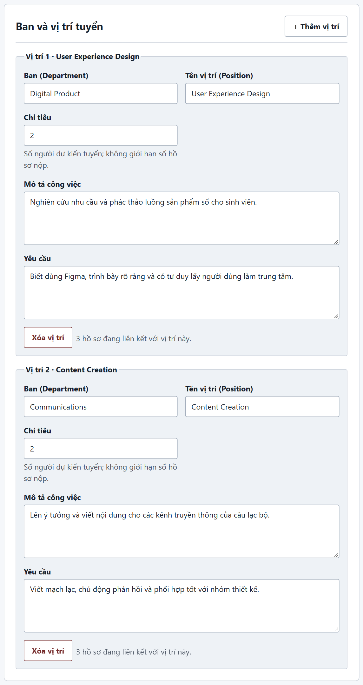

</div>

<p class="meta">Hình 4.2: “bản nháp”. Hình 4.3: “Đã đóng đơn” — mỗi vị trí ghi “3 hồ sơ đang liên kết với vị trí này”. Sau UI-7, toàn bộ cấu hình đã khóa ngay từ khi Published theo hướng nhóm chọn cho Q-03; số hồ sơ liên kết vẫn giải thích thêm ràng buộc BR-04.</p>

## 4.2 Hành động

- **Lưu bản nháp** (`saveDraft`): lưu mà không công bố. Sau khi công bố nút đổi thành **Lưu thay đổi**.
- **Xem trước** (hộp thoại `CampaignPreview`): nội dung ứng viên sẽ thấy.
- **Công bố chiến dịch** (`publish(draft)`): kiểm tra BR-01, mở hộp thoại xác nhận, rồi đổi trạng thái sang *Đã công bố*.
- **+ Thêm vị trí / Xóa vị trí** (`removePosition`): xóa bị chặn khi vị trí có hồ sơ (BR-04).

<div class="two">


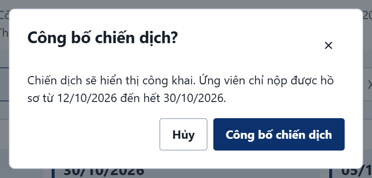

</div>

## 4.3 Kiểm tra hợp lệ

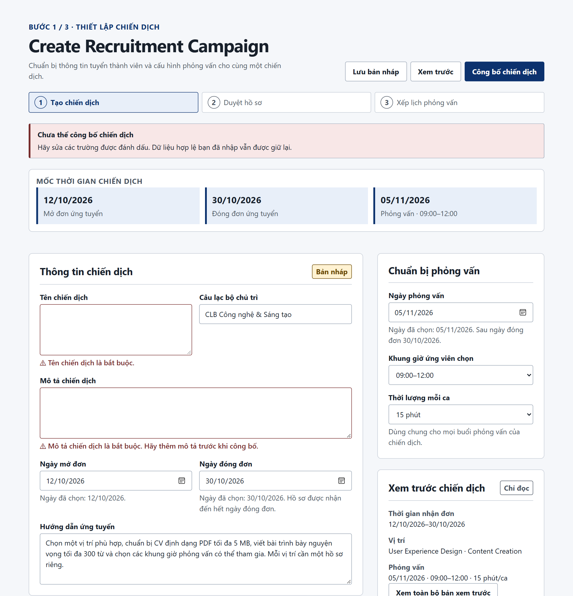{.tall}

<p class="meta">Route <code>/executive/campaign</code> · Ban tuyển dụng · “bản nháp” · 1280 px. Hai trường đã được xóa trống trước khi bấm.</p>

Phía client, `utils/validation.js` kiểm tra trường bắt buộc, ngày mở trước ngày đóng, ngày phỏng vấn sau ngày đóng, ít nhất một vị trí và chỉ tiêu là số nguyên dương (BR-01). Đây chỉ là **phản hồi nhanh**; backend **bắt buộc** kiểm tra lại toàn bộ trong service khi công bố, vì request có thể bỏ qua UI.

## 4.4 Trạng thái quan trọng

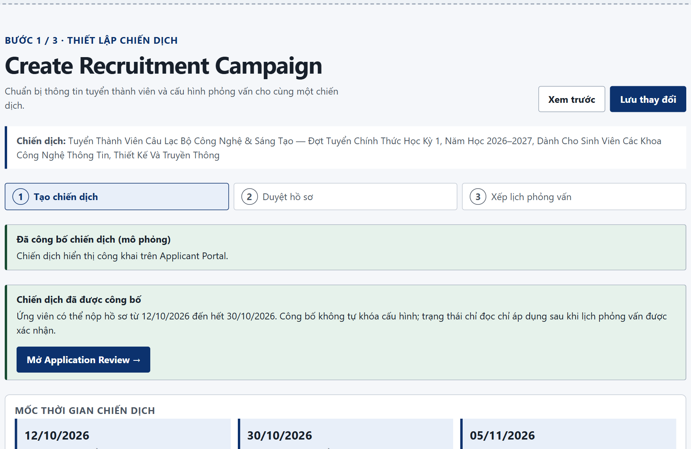

<p class="meta">Cùng phiên làm việc từ Hình 4.5 · Ban tuyển dụng · “bản nháp” → đã công bố trong bộ nhớ demo · 1280 px</p>

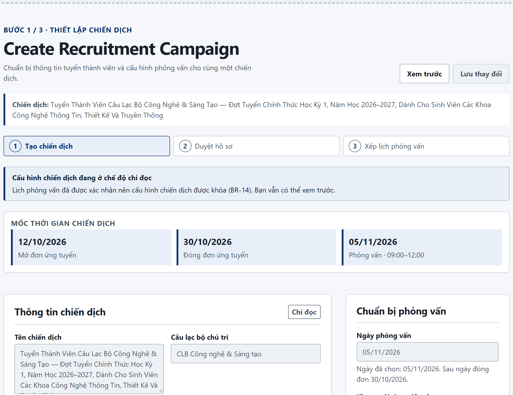{.tall}

<p class="meta">Route <code>/executive/campaign</code> · Ban tuyển dụng · “Lịch đã xác nhận · sau phỏng vấn” · 1280 px</p>

Lưu ý thực tế trong UI sau UI-7: **công bố khóa toàn bộ cấu hình chiến dịch ngay lập tức**; trang chỉ còn Xem trước. Đây là quyết định tạm thời do nhóm chọn cho **Q-03**, vẫn chờ Product Owner xác nhận. BR-14 tiếp tục yêu cầu khóa sau khi lịch được xác nhận.

## 4.5 Cách truy cập và điều hướng

**Điểm bắt đầu:** Khách ở `/`. **Bước 1:** bấm *Đăng nhập* ở header, nhập credential Executive trên `/login` → ứng dụng chuyển tới `/executive/campaign`. **Bước 2:** sửa trường, bấm *Lưu bản nháp* hoặc *Xem trước*. **Bước 3:** bấm *Công bố chiến dịch* → hộp thoại → *Công bố chiến dịch*; cấu hình chuyển sang chỉ đọc. **Bước 4:** bấm *Mở Application Review →* hoặc mục *Duyệt hồ sơ* trên header. Hành động làm thay đổi trạng thái: *Công bố chiến dịch*, *Xóa vị trí*, *Lưu*.

## 4.6 Trách nhiệm backend

Lưu bản nháp và chiến dịch đã công bố; kiểm tra BR-01 khi công bố; chỉ trả chiến dịch đã công bố cho khách (BR-02); chặn xóa vị trí có hồ sơ bằng ràng buộc khóa ngoại và kiểm tra service (BR-04); thực thi khóa từ Published nếu Q-03 được duyệt và luôn từ chối thay đổi sau xác nhận lịch theo BR-14; `getCampaign()` chỉ dành cho Executive.

**Loading, empty, error và giới hạn:** `useCampaign` + `AsyncContent` xử lý loading/lỗi và Thử lại. Form giữ dữ liệu hợp lệ khi validation thất bại; xóa vị trí có hồ sơ trả conflict. Prototype chỉ có một campaign, không persistence, không xử lý request đồng thời và khóa ngay từ Published theo quyết định Q-03 tạm thời.

# Chương 5 — Application Review {#ch5}

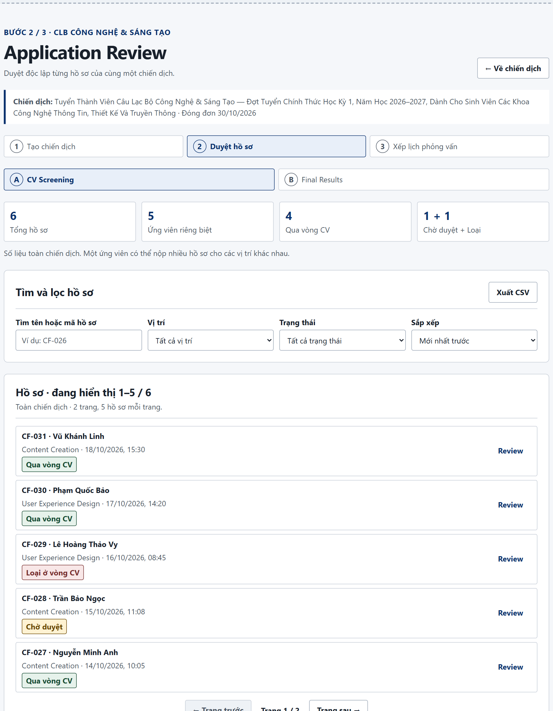{.tall}

<p class="meta">Route <code>/executive/review?tab=screening</code> · Ban tuyển dụng · “Đã đóng đơn · duyệt hồ sơ và xếp lịch” · 1280 px</p>

## 5.1 Tab A — CV Screening

| Mục | Nội dung |
|---|---|
| File | `pages/ApplicationReviewPage.jsx` (`ScreeningPanel`); organisms `ApplicationFilters`, `ApplicationList`, `ApplicationDetail`; molecules `StatCard`, `Pagination` |
| Hook | `useApplications(query)` → `applicationService.list(query)` + `getStats(query)`; `useApplicationDetail(id)` → `get(id)`; ngữ cảnh chiến dịch từ `useCampaign()` (tải một lần ở cấp trang) |
| Hành động | `applicationActions.saveNote`, `setScreening`, `exportCsv` |

**Thống kê:** *Tổng hồ sơ* 6, *Ứng viên riêng biệt* 5, *Qua vòng CV* 4, *Chờ duyệt + Loại* 1 + 1. Hồ sơ (application) và ứng viên (applicant) là hai thực thể khác nhau (BR-06): Nguyễn Minh Anh nộp **CF-026** (User Experience Design) và **CF-027** (Content Creation), nên 6 hồ sơ nhưng chỉ 5 người.

**Tìm kiếm, lọc, sắp xếp, phân trang:** tìm theo tên hoặc mã, không phân biệt dấu; lọc theo Vị trí và Trạng thái; sắp xếp *Mới nhất trước / Cũ nhất trước*; 5 hồ sơ mỗi trang. Khi lọc, tiêu đề ghi rõ “Theo bộ lọc” để không lẫn với số liệu toàn chiến dịch.

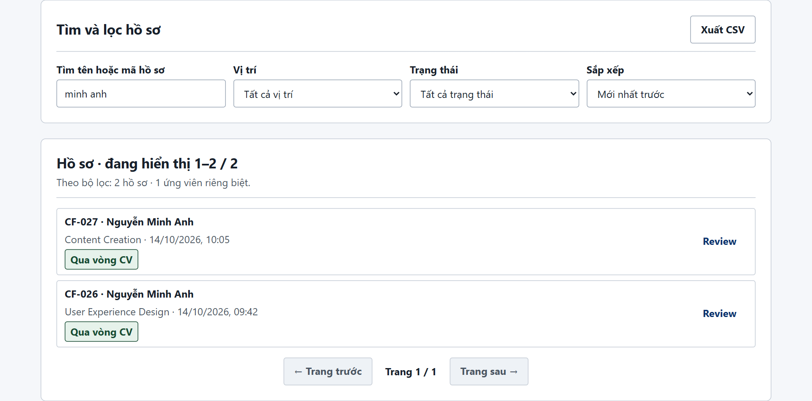

<p class="meta">Route <code>/executive/review?tab=screening</code> · Ban tuyển dụng · “Đã đóng đơn” · 1280 px</p>

**Chi tiết hồ sơ:** bấm *Review* trên một hàng → panel chi tiết bên cạnh danh sách: vị trí, thời gian nộp/duyệt, khung giờ có thể tham gia, mã số sinh viên, email, khoa, năm (snapshot lúc nộp), liên kết *Mở CV mẫu hư cấu (PDF)*, bài trình bày nguyện vọng (SOP), **Ghi chú nội bộ · chỉ Ban tuyển dụng nhìn thấy** với nút *Lưu ghi chú*, và hai nút *Loại hồ sơ* / *Shortlist Candidate*. Mọi hồ sơ dùng chung một file CV hư cấu `/demo/fictional-sample-cv.pdf`.

<div class="two">

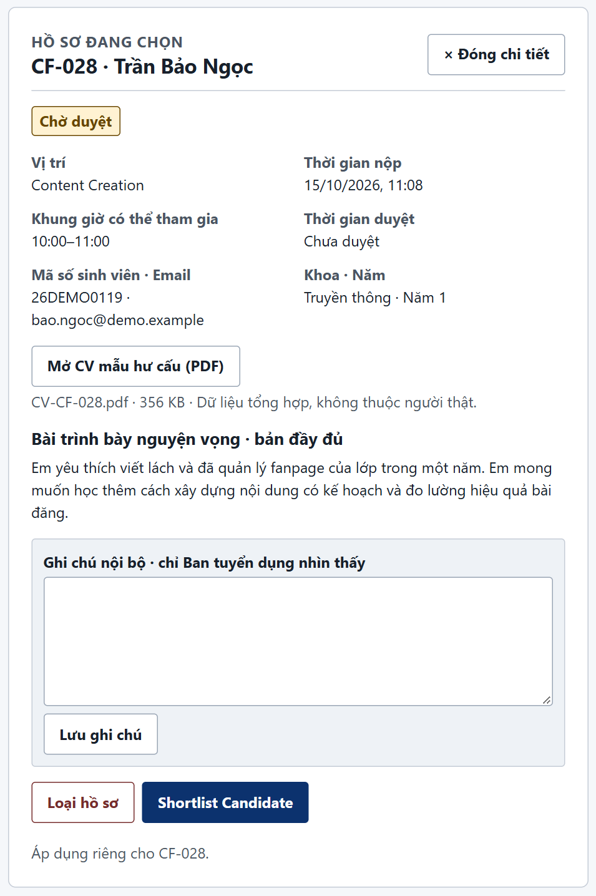


</div>

<p class="meta">Route <code>/executive/review?tab=screening</code> · Ban tuyển dụng · “Đã đóng đơn” · 1280 px. Thay đổi chỉ tồn tại trong bộ nhớ demo.</p>

{.narrow}

**Quyết định theo từng hồ sơ (BR-07):** Shortlist hoặc Loại chỉ đổi hồ sơ đang chọn. Prototype chỉ cho quyết định hồ sơ đang *Chờ duyệt* (việc đảo quyết định chưa được nguồn yêu cầu xác định). Sau khi lịch được xác nhận, quyết định bị khóa (BR-14).

**Xuất CSV** (`exportCsv(query)`): theo bộ lọc hiện tại, chỉ các cột được phép (mã hồ sơ, ứng viên, MSSV, email, vị trí, thời gian nộp, trạng thái), **không** có ghi chú nội bộ và CV (BR-09). File được tạo trong trình duyệt (`utils/csv.js` → `downloadText`).

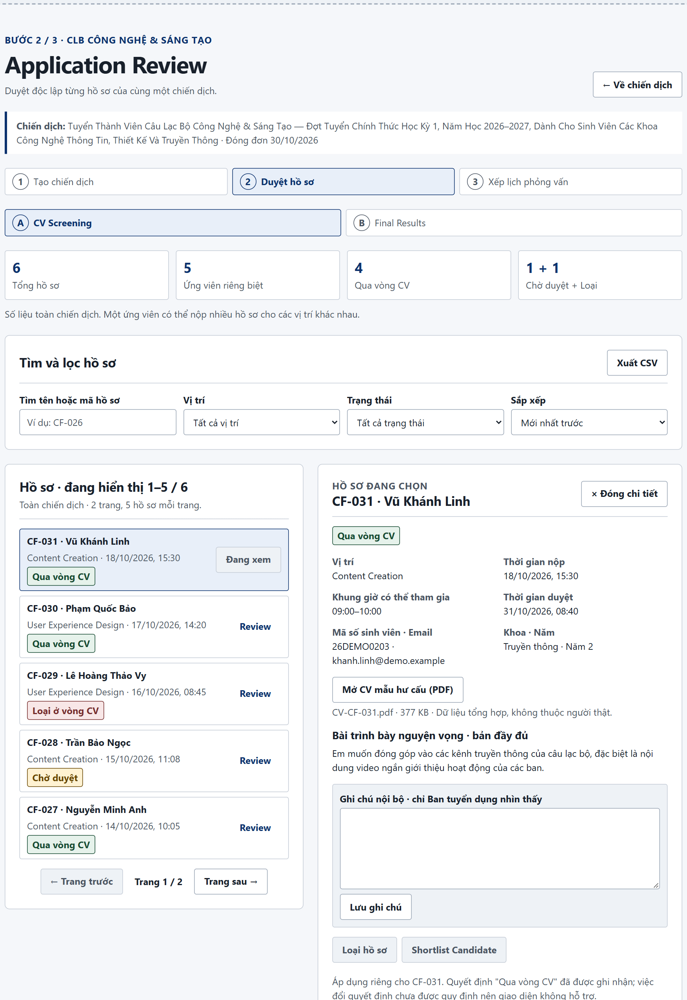{.tall}

<p class="meta">Route <code>/executive/review?tab=screening</code> · Ban tuyển dụng · “Đã đóng đơn” · 1280 px</p>

## 5.2 Tab B — Final Results

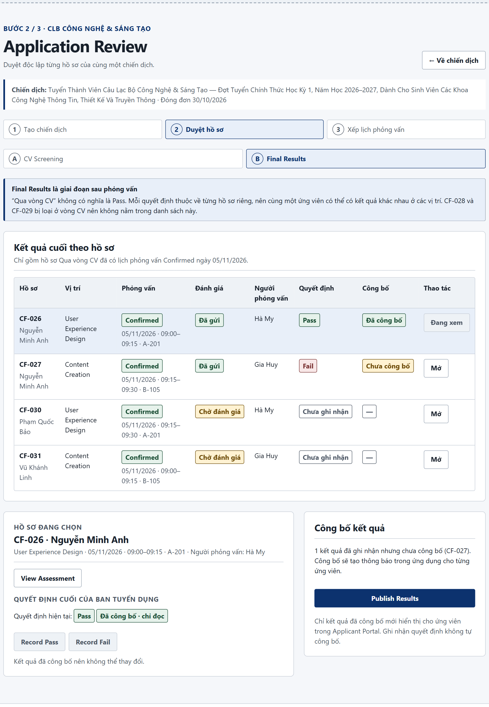{.tall}

<p class="meta">Route <code>/executive/review?tab=results</code> · Ban tuyển dụng · “Lịch đã xác nhận · sau phỏng vấn” · 1280 px</p>

| Mục | Nội dung |
|---|---|
| File | `ApplicationReviewPage.jsx` (`ResultsPanel`); organisms `FinalResultsTable`, `FinalDecisionPanel`, `PublishResultsCard` |
| Hook | `useFinalResults()` → `resultService.list()`; `useAssessment(applicationId, enabled)` → `getAssessment(applicationId)`; `resultActions.record`, `publishRecorded` |

Bảng chỉ gồm hồ sơ *Qua vòng CV* có lịch *Confirmed*. Mỗi hàng: phỏng vấn, trạng thái đánh giá (*Đã gửi / Chờ đánh giá*), người phỏng vấn, quyết định (*Pass / Fail / Chưa ghi nhận*), công bố (*Đã công bố / Chưa công bố*). **View Assessment** mở rộng ngay trong panel (không phải hộp thoại). **Record Pass / Record Fail** cần đánh giá đã gửi và bị khóa sau khi công bố. **Publish Results** công bố mọi kết quả đã ghi nhận nhưng chưa công bố và tạo một thông báo trong ứng dụng cho mỗi hồ sơ.

<div class="two">

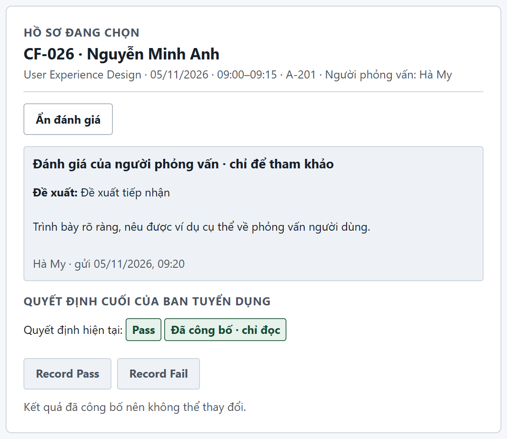

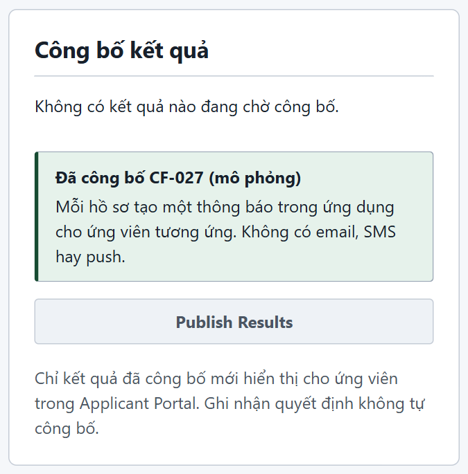

</div>

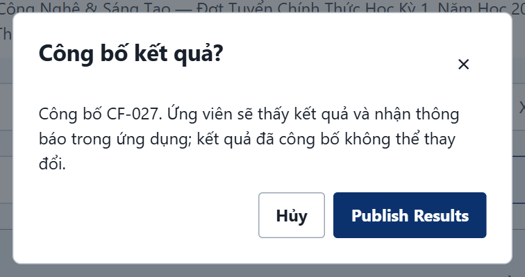{.narrow}

**Qua vòng CV khác với Pass (BR-08):** *Qua vòng CV* chỉ nghĩa là đủ điều kiện xếp lịch; lịch *Confirmed* chỉ là cuộc hẹn; **Pass/Fail là quyết định cuối riêng của từng hồ sơ**. Cùng một ứng viên có thể Pass ở CF-026 và Fail ở CF-027. Kết quả chưa công bố không bao giờ được gửi tới ứng viên.

## 5.3 Cách truy cập và điều hướng

**Điểm bắt đầu:** Ban tuyển dụng ở Campaign. **Bước 1:** bấm *Duyệt hồ sơ* trên header (hoặc *Mở Application Review →*). **Bước 2:** tab *A CV Screening* mở mặc định. **Bước 3:** lọc/tìm, bấm *Review* trên một hồ sơ. **Bước 4:** *Shortlist Candidate* hoặc *Loại hồ sơ* (hộp thoại). **Bước 5:** bấm *Tiếp tục tới Interview Scheduling →* (thủ công). Sau phỏng vấn: mở tab *B Final Results*, chọn *Mở* trên một hàng, *View Assessment*, *Record Pass/Fail*, rồi *Publish Results*.

## 5.4 Trách nhiệm backend

Lọc, sắp xếp, phân trang phía server; đếm hồ sơ và ứng viên riêng (BR-06); `setScreening` chỉ đổi một hồ sơ và bị khóa sau xác nhận (BR-07, BR-14); ghi chú riêng tư chỉ Executive đọc; CSV theo bộ lọc với trường được phép (BR-09); CV qua endpoint có kiểm tra quyền; `record` cần đánh giá đã gửi và không đổi sau công bố; `publishRecorded` tạo thông báo trong cùng giao dịch.

**Loading, empty, error và giới hạn:** hai tab có loader/lỗi độc lập; danh sách lọc không có kết quả và Final Results chưa có lịch/row dùng `EmptyState`. Detail chỉ hiện khi ID dữ liệu khớp selection hiện tại, tránh thao tác nhầm khi request chậm. Mock không có tải CV riêng tư thật, không gửi email và không cung cấp reversal/override cho screening, assessment hay kết quả đã công bố.

# Chương 6 — Interview Scheduling {#ch6}

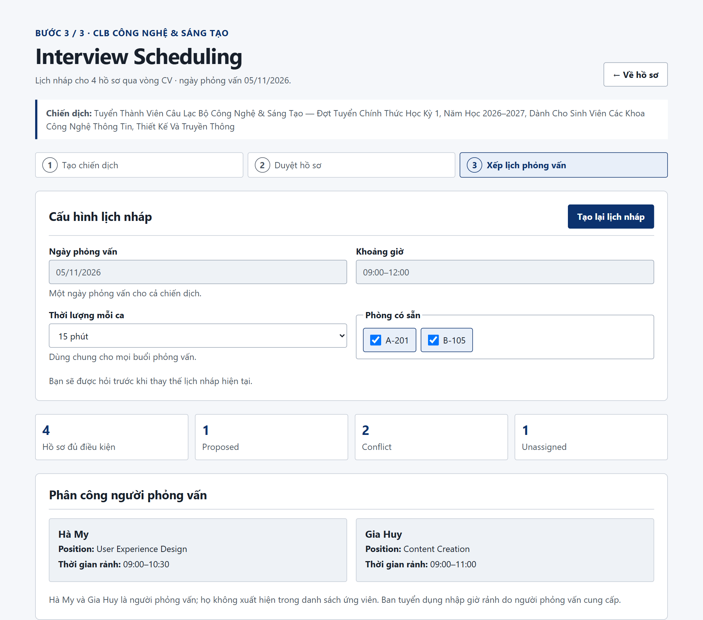{.tall}

<p class="meta">Route <code>/executive/scheduling</code> · Ban tuyển dụng · “Đã đóng đơn · duyệt hồ sơ và xếp lịch” · 1280 px</p>

## 6.1 Thông tin chung

| Mục | Nội dung |
|---|---|
| File | `pages/InterviewSchedulingPage.jsx`; organisms `ScheduleSettingsCard`, `InterviewerAssignmentsCard`, `ScheduleTable`, `ScheduleRowDialog`, `ConfirmationChecklist`, `ConfirmDialog` |
| Hook | `useSchedule()` → `scheduleService.getSchedule()` + `campaignService.getCampaign()` |
| Service | `generateDraft()`, `updateSettings({ roomIds })`, `updateRow(applicationId, { start, interviewerId, roomId })`, `saveDraft()`, `confirm()`, `exportTimetable()` |
| Đầu vào | 4 hồ sơ *Qua vòng CV*; ngày 05/11/2026, khung 09:00–12:00; ca 15/20/30 phút; phòng A-201, B-105; Hà My (UX, rảnh 09:00–10:30), Gia Huy (Content, rảnh 09:00–11:00); giờ rảnh ứng viên |

## 6.2 Trạng thái hàng lịch

- **Proposed:** phù hợp giờ rảnh, người phỏng vấn và phòng.
- **Conflict:** chồng giờ với hồ sơ khác cùng **ứng viên**, cùng **người phỏng vấn** hoặc cùng **phòng** (BR-11).
- **Unassigned:** không tìm được tổ hợp hợp lệ, kèm lý do; hồ sơ **vẫn** Qua vòng CV, không bị loại (BR-12).
- **Confirmed:** sau khi xác nhận; chỉ đọc (BR-14).

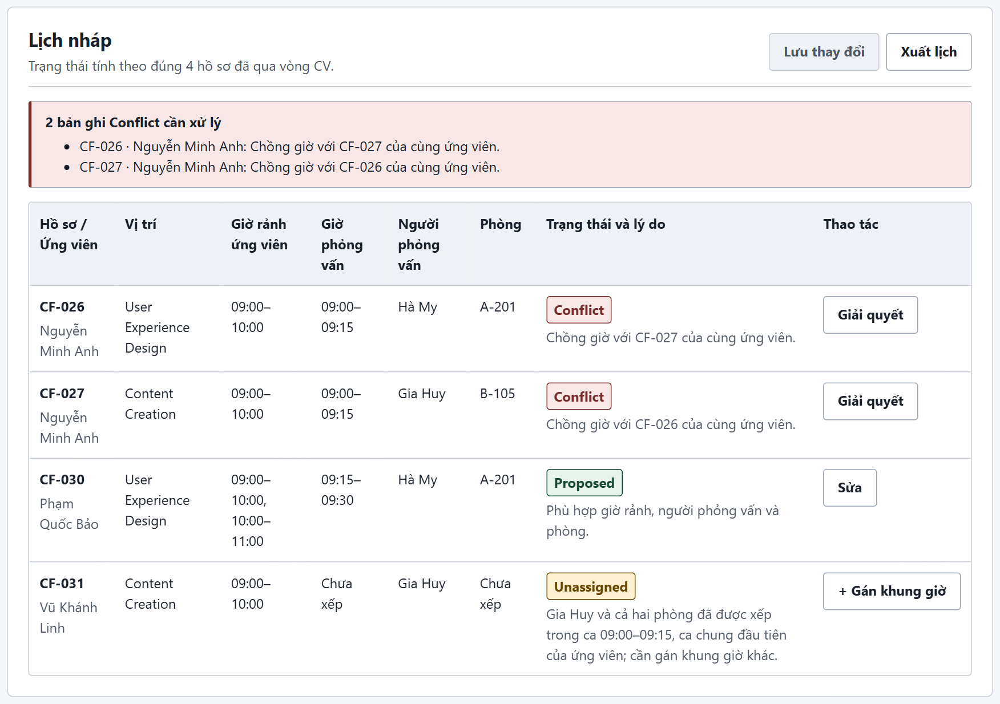

<p class="meta">Route <code>/executive/scheduling</code> · Ban tuyển dụng · “Đã đóng đơn” · 1280 px</p>


<p class="meta">Route <code>/executive/scheduling</code> · Ban tuyển dụng · “Đã đóng đơn” · 1280 px</p>

## 6.3 Chỉnh tay, lưu, tạo lại

- **Giải quyết** (hàng Conflict), **Sửa** (hàng Proposed), **+ Gán khung giờ** (hàng Unassigned) mở `ScheduleRowDialog` với *Ca phỏng vấn*, *Người phỏng vấn* (chỉ người được phân công cho vị trí), *Phòng*, nút *Cập nhật ca*. Sau mỗi lần cập nhật, toàn bộ lịch nháp được tính lại.
- **Lưu thay đổi** (`saveDraft`) lưu lịch nháp; badge “Có thay đổi chưa lưu” nhắc người dùng.
- **Tạo lại lịch nháp** (`generateDraft`) luôn hỏi trước khi thay thế lịch hiện tại.
- **Xuất lịch** (`exportTimetable`) tải CSV trong trình duyệt; vẫn dùng được sau xác nhận.

<div class="two">


</div>

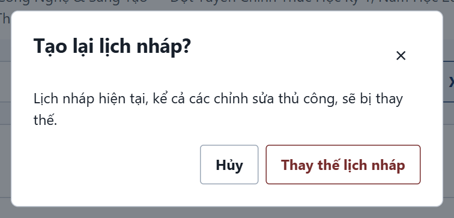{.narrow}

## 6.4 Điều kiện xác nhận


`ConfirmationChecklist` hiển thị bốn điều kiện của BR-13: đã đóng đơn, mọi hồ sơ đã được duyệt, không còn Conflict, mọi hồ sơ Qua vòng CV có đúng một ca. Khi không có hồ sơ nào Qua vòng CV, trang hiện trạng thái rỗng và bỏ qua bước xác nhận.

Một luồng thực tế đã chạy trong ứng dụng để có Hình 6.8–6.10: trong cùng một phiên, Loại hồ sơ CF-028 ở Application Review, bấm *Xếp lịch* trên header, chuyển CF-027 sang 09:15–09:30 (B-105) và CF-031 sang 09:30–09:45.


{.narrow}

<p class="meta">Hình 6.8–6.10: <code>/executive/review</code> → <code>/executive/scheduling</code> · Ban tuyển dụng · “Đã đóng đơn” · 1280 px. Ảnh dừng ở hộp thoại; trạng thái sau xác nhận được minh họa bằng kịch bản “confirmed” (Hình 6.11).</p>

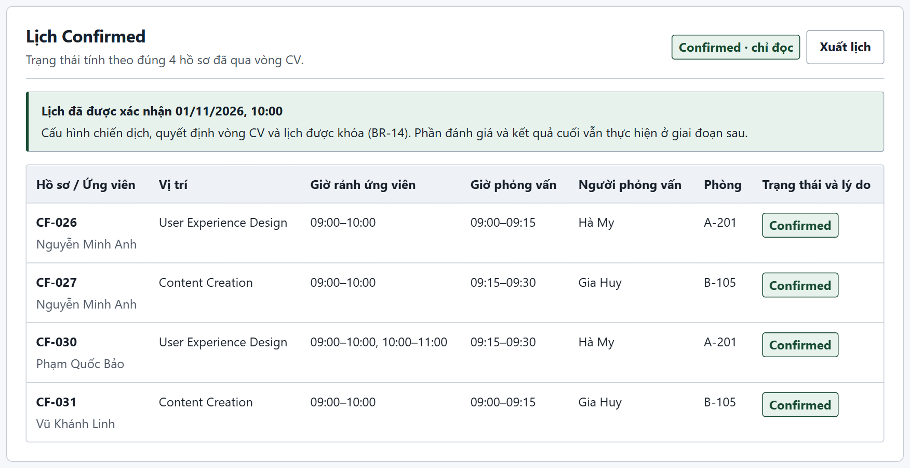

<p class="meta">Route <code>/executive/scheduling</code> · Ban tuyển dụng · “Lịch đã xác nhận · sau phỏng vấn” · 1280 px</p>

## 6.5 Vòng đời lịch và ranh giới mock / backend

<div class="diagram">
<div class="flow wrap"><div class="box page">Chưa có lịch</div><div class="arr">Tạo lịch nháp →</div><div class="box svc">Draft<small>Proposed / Conflict / Unassigned</small></div><div class="arr">chỉnh tay ⟲ · Lưu thay đổi ⟲ · Tạo lại (hỏi trước) ⟲</div><div class="box hook">Đủ điều kiện BR-13</div><div class="arr">Duyệt & xác nhận →</div><div class="box db">Confirmed<small>chỉ đọc, BR-14</small></div></div>
</div>

| Khía cạnh | Prototype hiện tại | Backend phải làm |
|---|---|---|
| Sinh lịch nháp | `generateDraft()` trả **lịch tham chiếu cố định** từ fixtures; **không có thuật toán first-fit trong React** | Thuật toán “first available valid combination” (slot + interviewer + room), thứ tự ổn định (Q-01) |
| Tính trạng thái | `mocks/derive.js` → `evaluateSchedule()` chạy lại sau mỗi chỉnh sửa để demo nhất quán (O(n²), chỉ là stand-in) | Kiểm tra BR-10/BR-11 sau mỗi chỉnh sửa; khoảng nửa mở `start1 < end2 && start2 < end1` |
| Kiểm tra form | Dialog chỉ đưa ra lựa chọn hợp lệ; service mock trả `fieldErrors` | Validator + service kiểm tra mọi request |
| Xác nhận | `confirm()` kiểm tra lại BR-13 trên store | Kiểm tra lại BR-13 trong **một giao dịch**, khóa dữ liệu liên quan, chống xác nhận đồng thời |
| Khóa sau xác nhận | `mocks/guards.js` → `assertNotLockedBySchedule` | Guard trên **mọi** đường ghi: chiến dịch, hồ sơ, quyết định CV, lịch |

## 6.6 Cách truy cập và điều hướng

**Điểm bắt đầu:** Ban tuyển dụng ở Application Review. **Bước 1:** bấm *Tiếp tục tới Interview Scheduling →* hoặc *Xếp lịch* trên header. **Bước 2:** xem danh sách Conflict (alert đỏ) và cột “Trạng thái và lý do”. **Bước 3:** bấm *Giải quyết* / *Sửa* / *+ Gán khung giờ* → hộp thoại → *Cập nhật ca*. **Bước 4:** *Lưu thay đổi*. **Bước 5:** khi checklist đạt, *Duyệt & xác nhận lịch* → hộp thoại → xác nhận. **Bước 6:** sau phỏng vấn, mở *Duyệt hồ sơ* → tab *Final Results* (thủ công). *← Về hồ sơ* quay lại Application Review.

**Loading, empty, error và giới hạn:** `useSchedule` tải schedule và campaign song song; `AsyncContent` xử lý loading/lỗi. Không có Shortlisted thì dùng nhánh bỏ qua xác nhận; lỗi field của row hiện trong dialog và điều kiện BR-13 chưa đạt hiện trong checklist/alert. Frontend không sinh lịch: `generateDraft()` chỉ sắp và trả fixture tham chiếu; first-fit, concurrency, ownership và khóa sau xác nhận thuộc backend.

# Chương 7 — Applicant Portal {#ch7}

{.tall}

<p class="meta">Route <code>/</code> · Khách · “Đang nhận hồ sơ” · 1280 px</p>

## 7.1 Thông tin chung

| Mục | Nội dung |
|---|---|
| File | `pages/ApplicantPortalPage.jsx`; organisms `PublicCampaignPanel`, `ApplicationForm`, `MyApplicationsTable`, `NotificationList`; molecules `FileField`, `ChoiceGroup`, `PositionCard`, `Tabs` |
| Hook | `useApplicantPortal(isApplicant)` → `portalService.getPublicCampaign()`, `listMyApplications()`, `listNotifications()` (ứng viên: tải song song) |
| Hành động | `portalService.submitApplication(formData)`, `markNotificationsRead()` |
| Route / vai trò | `/` với `?tab=campaign∣apply∣mine∣notifications`; Campaign công khai cho Guest/mọi role, ba tab cá nhân chỉ dùng được bởi Applicant |

**Tab `campaign`:** mốc thời gian, trạng thái nhận hồ sơ theo giai đoạn (chưa mở / đang nhận / đã đóng), mô tả, hướng dẫn, các ban và vị trí với chỉ tiêu. Chiến dịch bản nháp không bao giờ hiển thị (BR-02). Khách bấm *Apply Now* được chuyển tới `/login` và giữ `/` làm đích dự định.

**Tab `apply`:** Guest thấy gate đăng nhập; role không phải Applicant thấy trạng thái hạn chế; Applicant thấy form. Form bị vô hiệu hóa ngoài phase `open`, nhưng vẫn hiển thị để giải thích trạng thái.

**Tab `mine`:** chỉ hiển thị hồ sơ thuộc account Applicant hiện tại; screening, lịch đã xác nhận và kết quả đã công bố là ba cột mốc riêng. Không có hồ sơ thì hiện `EmptyState` và liên kết tới Apply khi đang mở đơn.

**Tab `notifications`:** chỉ hiển thị thông báo của account hiện tại và chỉ từ kết quả đã công bố; badge là số chưa đọc, có thao tác đánh dấu tất cả đã đọc. Không có notification thì hiện trạng thái rỗng.

## 7.2 Nộp hồ sơ

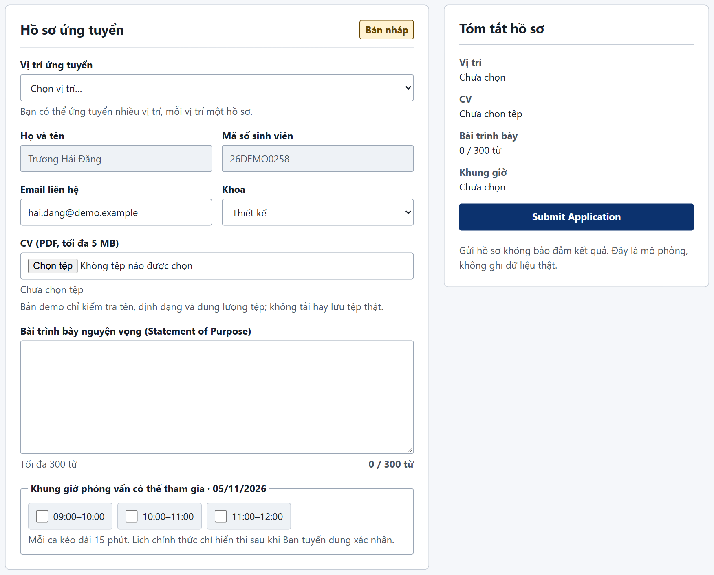{.tall}

<p class="meta">Route <code>/?tab=apply</code> · Trương Hải Đăng (Ứng viên) · “Đang nhận hồ sơ” · 1280 px</p>

Biểu mẫu cố định: *Vị trí ứng tuyển*; *Họ và tên*, *Mã số sinh viên* (chỉ đọc từ tài khoản); *Email liên hệ*, *Khoa* (có thể sửa và được lưu thành snapshot của hồ sơ); *CV (PDF, tối đa 5 MB)*; *Bài trình bày nguyện vọng* với bộ đếm “0 / 300 từ”; *Khung giờ phỏng vấn có thể tham gia* (09:00–10:00, 10:00–11:00, 11:00–12:00). Nút *Submit Application* nằm ở thẻ *Tóm tắt hồ sơ*.

<div class="two">

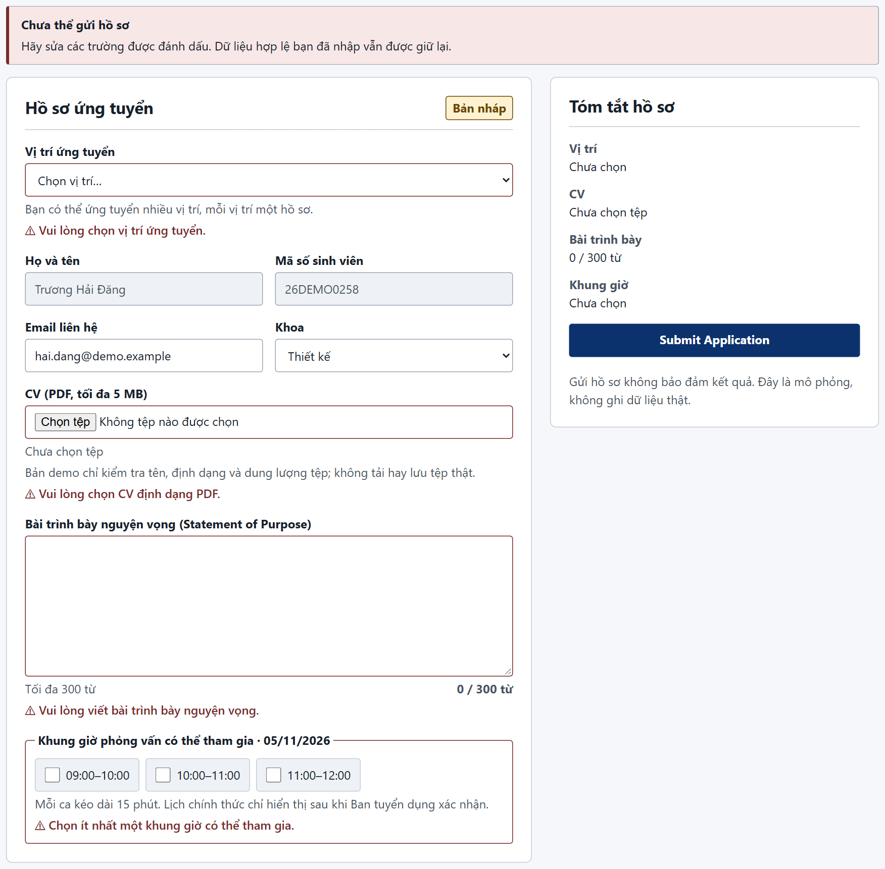

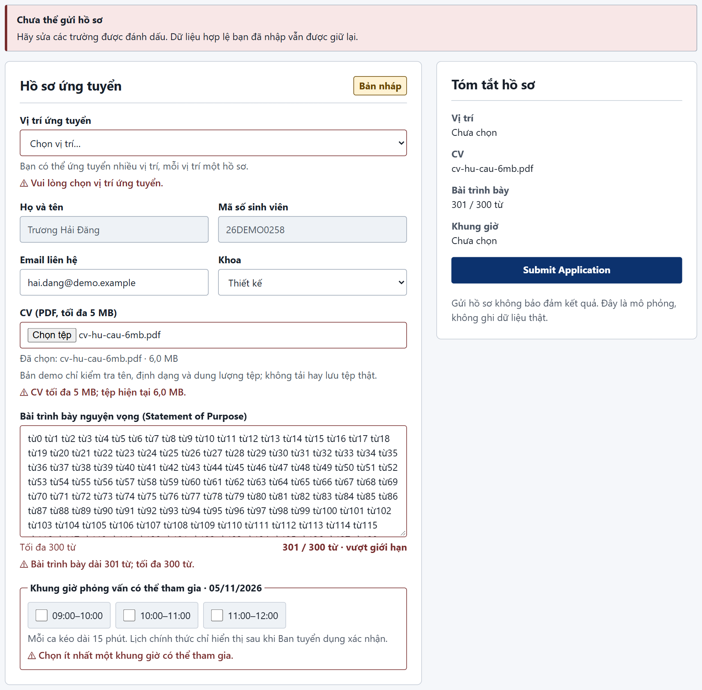

</div>

<p class="meta">Route <code>/?tab=apply</code> · Trương Hải Đăng · “Đang nhận hồ sơ” · 1280 px. File CV là tệp hư cấu tạo trong trình duyệt (<code>cv-hu-cau-6mb.pdf</code>).</p>

<div class="two">


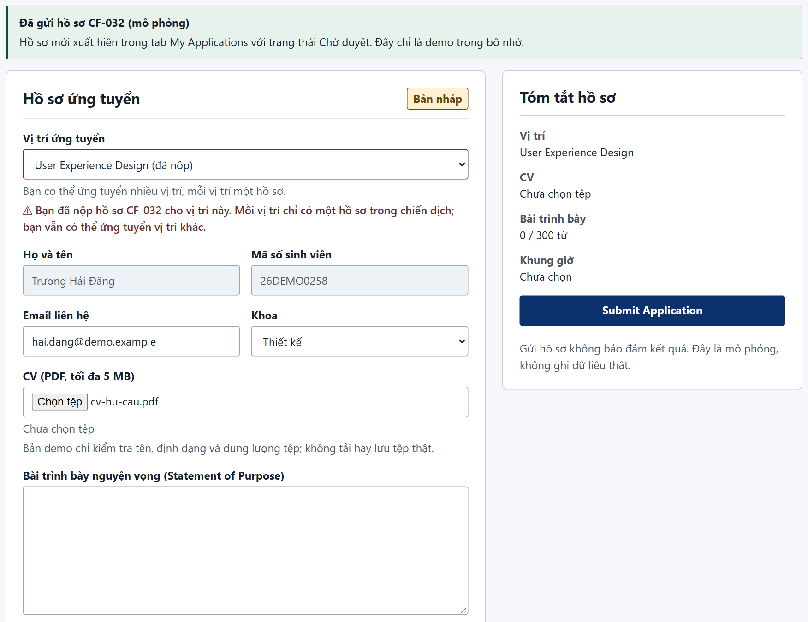

</div>

Prototype chỉ giữ **tên và kích thước** file CV; không có file nào được tải lên. Xác thực thật, upload file và lưu trữ bền vững đều cần backend.

## 7.3 My Applications và Notifications

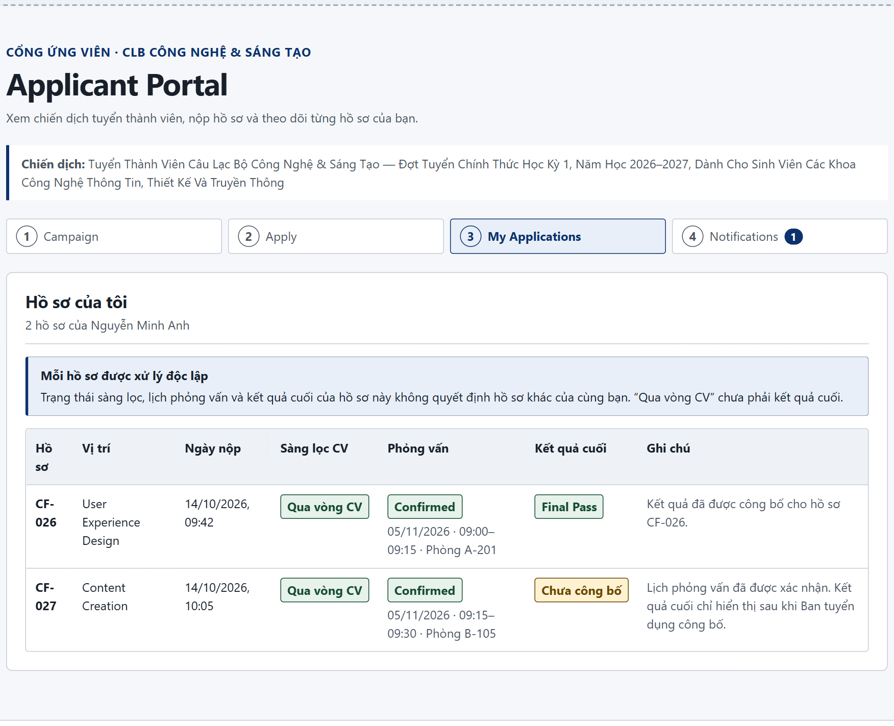{.tall}

<p class="meta">Route <code>/?tab=mine</code> · Nguyễn Minh Anh · “Lịch đã xác nhận · sau phỏng vấn” · 1280 px</p>

<div class="two">

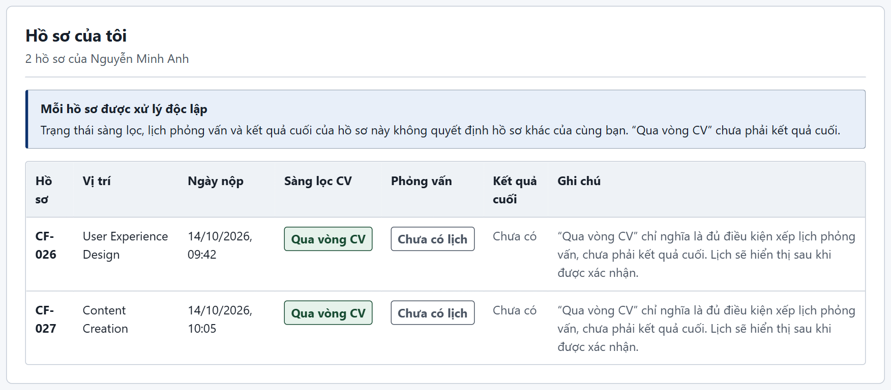

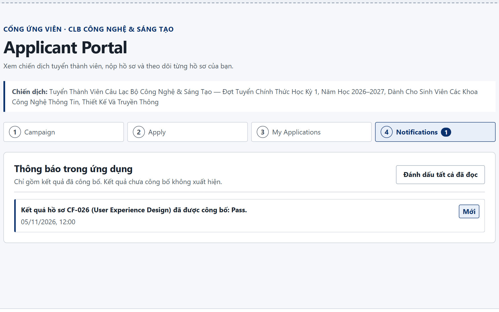

</div>

Mỗi hồ sơ được xử lý độc lập. Buổi phỏng vấn chỉ hiện sau khi lịch được xác nhận; kết quả chỉ hiện sau khi công bố. Thông báo là thông báo trong ứng dụng, không có email/SMS/push. Nếu *Đánh dấu tất cả đã đọc* thất bại, trang hiện cảnh báo lỗi.

**Loading, error và giới hạn:** hook tải public campaign cho Guest; với Applicant, public campaign, own applications và notifications tải song song. `AsyncContent` xử lý loading/lỗi. Prototype chỉ giữ metadata CV, không upload file; không sửa/rút hồ sơ đã nộp; duplicate cùng Applicant + Campaign + Position trả conflict trỏ tới hồ sơ cũ; profile đổi sau đó không sửa snapshot đã nộp.

## 7.4 Cách truy cập và điều hướng

**Điểm bắt đầu:** Khách ở `/`. **Bước 1:** xem tab *Campaign*. **Bước 2:** *Apply Now* → `/login` → nhập credential Applicant → trở lại `/` nếu đó là đích dự định hợp lệ. **Bước 3:** mở tab *Apply*, điền và *Submit Application* (thay đổi trạng thái). **Bước 4:** mở tab *My Applications* thủ công để thấy hồ sơ “Chờ duyệt”. **Bước 5:** khi có kết quả công bố, tab *Notifications* có số đếm; *Đánh dấu tất cả đã đọc*.

# Chương 8 — Interviewer Workspace {#ch8}

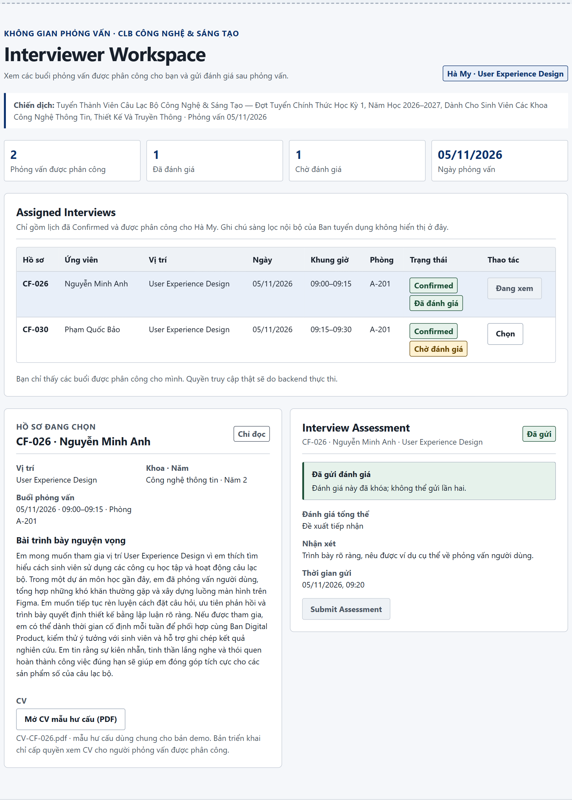{.tall}

<p class="meta">Route <code>/interviewer</code> · Hà My (Người phỏng vấn) · “Lịch đã xác nhận · sau phỏng vấn” · 1280 px</p>

## 8.1 Thông tin chung

| Mục | Nội dung |
|---|---|
| File | `pages/InterviewerWorkspacePage.jsx`; organisms `AssignedInterviewsTable`, `InterviewDetailCard`, `AssessmentForm` |
| Hook | `useAssignedInterviews()` → `interviewerService.listAssignedInterviews()` (kèm `campaignName`, `interviewDate`); `useInterviewDetail(id)` → `getInterview(id)`; `interviewerActions.submitAssessment(interviewId, { recommendation, notes })` |

Danh sách chỉ gồm buổi **Confirmed** được phân công cho người đang đăng nhập (Hà My: CF-026, CF-030). Chi tiết gồm vị trí, khoa–năm (snapshot), buổi phỏng vấn, SOP, liên kết CV hư cấu. **Ghi chú nội bộ của Ban tuyển dụng không bao giờ hiển thị**; trang này cũng không gọi `getCampaign()` (chỉ dành cho Executive).

<div class="two">


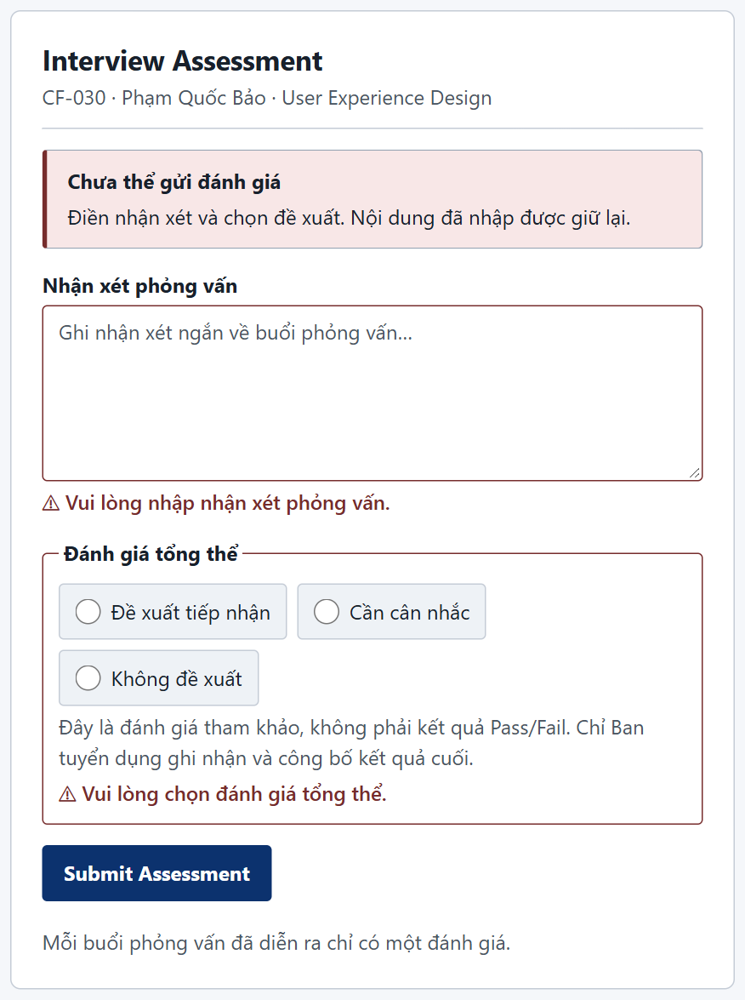

</div>

{.narrow}

## 8.2 Trạng thái

- **Đã gửi:** chỉ đọc (Hình 8.1, 8.4).
- **Chưa diễn ra:** buổi phỏng vấn sắp tới bị khóa (“Chưa thể đánh giá”), được kiểm thử tự động.
- **Rỗng:** lịch chưa xác nhận → “Chưa có buổi phỏng vấn nào được phân công cho bạn” (Hình 8.5).
- **Hạn chế:** vai trò khác mở `/interviewer` → RoleGate.


<p class="meta">Route <code>/interviewer</code> · Hà My · “Đã đóng đơn · duyệt hồ sơ và xếp lịch” · 1280 px</p>

**Ranh giới phân quyền:** người phỏng vấn chỉ truy cập buổi được phân công và thông tin ứng viên được phép; CV phải qua endpoint kiểm tra phân công. Theo hướng nhóm chọn cho Q-04, nhận xét là bắt buộc và đề xuất `Pass` / `Fail` / không nêu là tùy chọn, chỉ để tham khảo; quyết định Pass/Fail thuộc Ban tuyển dụng. Q-04 vẫn chờ Product Owner xác nhận.

## 8.3 Cách truy cập và điều hướng

**Điểm bắt đầu:** Khách ở `/`. **Bước 1:** mở `/login`, nhập credential của Hà My → **tự chuyển** tới `/interviewer`. **Bước 2:** bấm *Chọn* trên một buổi (tên nút đọc là “Chọn CF-030 · Phạm Quốc Bảo”). **Bước 3:** điền *Nhận xét phỏng vấn*, chọn đề xuất tùy chọn, *Submit Assessment* và xác nhận (thay đổi trạng thái). Không có liên kết sang màn hình khác; người phỏng vấn không thấy menu Executive.

**Loading, error và giới hạn:** danh sách và detail có loader/lỗi/Thử lại; không có interview Confirmed của chính account thì hiện `EmptyState`. Detail chỉ render khi `interviewId` khớp selection hiện tại. Assessment chỉ mở sau khi buổi kết thúc, notes bắt buộc, submit một lần rồi khóa; không sửa availability, không xem interview của người khác, không xem private note và không quyết định kết quả cuối.

# Chương 8A — Sign In (UI-8) {#ch8a}

## 8A.1 Phạm vi và hành vi

| Mục | Nội dung |
|---|---|
| Mục đích | Cung cấp luồng đăng nhập dùng chung cho các tài khoản đã được cấp sẵn; thay thế hoàn toàn `SignInDialog` trong UX sản phẩm |
| Route / vai trò | `/login` · Khách; tài khoản đã đăng nhập không xem form mà được chuyển tới route đích hợp lệ hoặc trang chủ vai trò |
| Query parameter | Không có. Route dự định được giữ trong React Router `location.state.from`, không đặt trong URL |
| Bố cục | `MainTemplate`, liên kết quay lại Applicant Portal, `SignInForm`, card credential demo và điều khiển hiện/ẩn mật khẩu |
| Page / hook / service | `SignInPage` → `useSignIn` → `DemoSessionContext.signIn` → `authService.signIn({ email, password })`; credential mẫu qua `authService.listDemoCredentials()` |
| Tương tác | Nhập email/mật khẩu, hiện/ẩn mật khẩu, gửi form; header cũng dẫn tới `/login` và giữ vị trí hiện tại làm đích dự định |
| Validation | Email và mật khẩu bắt buộc; email phải đúng định dạng cơ bản; focus chuyển tới trường lỗi đầu tiên; credential sai trả `UiError('forbidden')` |
| Loading / lỗi / rỗng | Nút đổi thành “Đang đăng nhập…” và bị khóa; lỗi service hiện trong `Alert`; danh sách credential có thể rỗng nhưng form vẫn hoạt động |
| Mock hiện tại | Tìm profile theo **email hiện tại** (không phân biệt hoa thường) và so với mật khẩu hư cấu `ClubFlowDemo!`; chỉ account ID và scenario ID nằm trong `sessionStorage`, không lưu mật khẩu |
| Redirect | Executive → `/executive/campaign`; Applicant → `/`; Interviewer → `/interviewer`. `postSignInDestination` chỉ khôi phục route nằm trong `PROTECTED_PATHS_BY_ROLE`; query string như `?tab=results` được giữ khi pathname hợp lệ |
| Sign Out | Account menu → “Đăng xuất”; điều hướng về `/`, sau đó xóa account demo để tránh gate trên route cũ chuyển nhầm tới `/login` |
| Backend cần làm | Xác thực credential, quản lý vòng đời phiên/token, khôi phục current user, giới hạn thử đăng nhập và bảo vệ mọi API theo vai trò/sở hữu; không dựa vào `AuthGate`/`RoleGate` để bảo mật |
| Giới hạn | Không đăng ký, không quên/đặt lại mật khẩu, không đổi mật khẩu, không JWT/cookie phiên thật, không endpoint auth được nối. Credential hiển thị chỉ dành cho development |

`AuthGate` bảo vệ `/profile`; `RoleGate` bảo vệ giao diện Executive/Interviewer. Khách mở route được bảo vệ được gửi tới `/login`. Tài khoản đã đăng nhập nhưng không đúng vai trò nhận trạng thái hạn chế và liên kết về trang của mình, không được tự động cấp quyền. Bộ chọn **Đổi tài khoản nhanh** trong `DemoBar` gọi `demoSessionService.signIn(accountId)` không cần credential; đây là công cụ development-only, không phải luồng đăng nhập.

# Chương 8B — My Profile (UI-8) {#ch8b}

## 8B.1 Phạm vi và hành vi

| Mục | Nội dung |
|---|---|
| Mục đích | Cho Executive, Applicant và Interviewer xem hồ sơ của chính mình và chỉnh hai trường cho phép trong prototype |
| Route / vai trò | `/profile` · được `AuthGate` bảo vệ; mọi vai trò đã đăng nhập truy cập từ account menu |
| Query parameter | Không có |
| Bố cục | `ProfileDetailsCard` (avatar chữ, tên, email, role, mã account và trường theo vai trò), `ProfileEditForm`, card “Bảo mật tài khoản” chỉ cung cấp thông tin |
| Dữ liệu theo vai trò | Cả ba vai trò: `id`, `role`, `displayName`, `email`; Applicant có thêm `studentId`, `faculty`, `year`; trường không tồn tại của Executive/Interviewer không được dựng |
| Page / hook / service | `ProfilePage` → `useProfile` → `profileService.getProfile()` / `updateProfile({ displayName, email })` |
| Tương tác | Chỉnh sửa, Lưu thay đổi, Hủy thay đổi; Cancel bỏ draft; Save cập nhật card và header ngay trong phiên demo |
| Validation | `displayName` và `email` bắt buộc; email đúng định dạng; email trùng account demo khác bị trả field error; focus tới trường lỗi đầu tiên |
| Loading / lỗi / rỗng | `AsyncContent` xử lý tải/lỗi và Thử lại; mutation khóa form, hiện lỗi field/service; profile không có session trả forbidden ở service, còn route đã chặn guest |
| Trường chỉ đọc | `id`, `role`, `studentId`, `faculty`, `year` không có trong payload update và không được sửa |
| Đồng bộ và cô lập | `updateCurrentAccount` đồng bộ tên/email với header chỉ khi ID kết quả vẫn là account hiện tại. `sessionEpoch` remount trang sau sign-in/out, account/scenario switch hoặc reset; save đang chờ bị hủy khi account/scenario đổi, ngăn cập nhật chéo account |
| Snapshot hồ sơ đã nộp | `Application.studentInfo` là snapshot bất biến lúc submit. Sửa profile không viết lại email/faculty/name trong hồ sơ lịch sử; đăng nhập lại dùng email profile mới trong cùng phiên/kịch bản |
| Reset mock | Chuyển scenario, “Đặt lại dữ liệu demo” hoặc tải lại ứng dụng khôi phục profile fixture; không có persistence backend |
| Backend cần làm | Lấy identity từ phiên/token; chỉ trả/sửa hồ sơ chính chủ; allow-list đúng hai trường; chuẩn hóa/unique email; xử lý concurrency; không cascade thay đổi sang snapshot application |
| Giới hạn và bảo mật | Card bảo mật chỉ mang tính thông tin. Không đổi mật khẩu, không avatar, không persistence, không endpoint profile/auth đã nối và không JWT thật |

## 8B.2 Trách nhiệm của `dataVersion` và `sessionEpoch`

- `dataVersion` tăng khi profile được lưu hoặc dataset demo bị thay; `useServiceData` đưa nó vào request key để reload và không trả dữ liệu của account cũ.
- `sessionEpoch` tăng khi identity hoặc dataset bị thay; `ProfilePage` dùng làm React `key` để xóa edit mode, draft, lỗi và success message cũ.
- Hai cơ chế này chỉ bảo vệ tính nhất quán của prototype. Backend vẫn cần authorization, optimistic/concurrency checks và persistence thật.

# Chương 9 — Quy trình tuyển dụng hoàn chỉnh {#ch9}

<div class="diagram">
<div class="flow wrap steps">
<div class="box page">1 · Executive soạn chiến dịch</div><div class="arr">→</div>
<div class="box page">2 · Công bố</div><div class="arr">→</div>
<div class="box mock">3 · Applicant xem & nộp hồ sơ</div><div class="arr">→</div>
<div class="box page">4–5 · Sàng lọc: Shortlist / Loại</div><div class="arr">→</div>
<div class="box page">6 · Lịch nháp</div><div class="arr">→</div>
<div class="box page">7 · Xác nhận lịch</div><div class="arr">→</div>
<div class="box hook">8–9 · Phỏng vấn & đánh giá</div><div class="arr">→</div>
<div class="box page">10 · Record Pass/Fail</div><div class="arr">→</div>
<div class="box page">11 · Publish Results</div><div class="arr">→</div>
<div class="box mock">12 · Applicant nhận kết quả</div>
</div>
<div class="dg-legend"><span class="sw stable"></span>Executive &nbsp;<span class="sw new"></span>Applicant &nbsp;<span class="sw change"></span>Interviewer · Tất cả bước hiện chỉ chạy trên dữ liệu mock</div>
</div>

<div class="wide-table">

| # | Vai trò | Màn hình | Thao tác UI | Thực thể | Service | Backend cần làm | BR | Bước tiếp |
|---|---|---|---|---|---|---|---|---|
| 1 | Executive | Campaign | Sửa trường, Lưu bản nháp | Campaign, Position | `campaignService.saveDraft(draft)` | Lưu nháp | BR-04 | Xem trước |
| 2 | Executive | Campaign | Công bố chiến dịch | Campaign | `campaignService.publish(draft)` | Kiểm tra, chuyển Published | BR-01, BR-02 | Ứng viên thấy chiến dịch |
| 3 | Applicant | Applicant Portal | Apply → Submit Application | Application, CV | `portalService.submitApplication(formData)` | Lưu hồ sơ + snapshot, upload CV, cửa sổ nộp, duy nhất | BR-02, BR-03, BR-05 | Chờ duyệt |
| 4 | Executive | Review · Screening | Review, Lưu ghi chú | Application, note | `applicationService.get(id)`, `saveNote(id, note)` | Đọc chi tiết, ghi chú riêng | BR-06, BR-09 | Quyết định |
| 5 | Executive | Review · Screening | Shortlist Candidate / Loại hồ sơ | Application.screeningStatus | `applicationService.setScreening(id, status)` | Đổi một hồ sơ; xóa ca nếu loại | BR-07, BR-14 | Xếp lịch |
| 6 | Executive | Scheduling | Tạo lại / chỉnh tay / Lưu | Interview (draft) | `generateDraft()`, `updateRow(...)`, `saveDraft()` | First-fit, phát hiện xung đột | BR-10…BR-12 | Kiểm tra điều kiện |
| 7 | Executive | Scheduling | Duyệt & xác nhận lịch | Schedule, Interview | `scheduleService.confirm()` | Kiểm tra lại trong giao dịch, khóa | BR-13, BR-14 | Thông tin buổi hiện cho người liên quan |
| 8 | Interviewer | Interviewer Workspace | Chọn buổi | Interview | `interviewerService.listAssignedInterviews()`, `getInterview(id)` | Chỉ buổi được phân công | BR-14 | Phỏng vấn (ngoài hệ thống) |
| 9 | Interviewer | Interviewer Workspace | Submit Assessment | Assessment | `interviewerService.submitAssessment(id, data)` | Một đánh giá/buổi đã diễn ra | Q-04 | Executive xem |
| 10 | Executive | Review · Results | View Assessment, Record Pass/Fail | FinalResult | `resultService.getAssessment(id)`, `record(id, decision)` | Cần đánh giá, chưa công bố | BR-08 | Công bố |
| 11 | Executive | Review · Results | Publish Results | FinalResult, Notification | `resultService.publishRecorded()` | Công bố + tạo thông báo (giao dịch) | BR-08 | Ứng viên thấy |
| 12 | Applicant | Applicant Portal | My Applications, Notifications | FinalResult, Notification | `listMyApplications()`, `listNotifications()`, `markNotificationsRead()` | Chỉ dữ liệu của chính mình, chỉ kết quả đã công bố | BR-08 | Kết thúc |

</div>

# Chương 10 — Kiến trúc frontend {#ch10}

## 10.1 Cấu trúc thư mục thực tế

| Đường dẫn | Vai trò |
|---|---|
| `client/src/main.jsx`, `App.jsx` | Điểm vào; `App` bọc `BrowserRouter` + `DemoSessionProvider` + `AppRoutes` |
| `routes/AppRoutes.jsx`, `paths.js`, `navigation.js`, `AuthGate.jsx`, `RoleGate.jsx` | Route, tab query, menu theo vai trò, gate xác thực/giao diện theo vai trò và redirect đích dự định |
| `layouts/AppLayout.jsx` | Skip link, `AppHeader`, account menu, `DemoBar`, `<main>`, footer kiểm tra API; điều phối Sign Out và điều hướng tới `/login` |
| `pages/*.jsx` | 5 màn hình nghiệp vụ + `SignInPage` + `ProfilePage` + `NotFoundPage`; giữ trạng thái UI, gọi hooks |
| `components/atoms` → `molecules` → `organisms` → `templates` | Atomic Design; lower level không import higher level, atoms/molecules không gọi service |
| `hooks/*.js` | `useServiceData` (tải dữ liệu, loading/error/reload), `useAction` (mutation), hook theo màn hình |
| `services/*.js` | Ranh giới dữ liệu: service nghiệp vụ, `authService`, `profileService`, `demoSessionService`, `healthService`, `apiClient`, `uiError` |
| `mocks/auth.js`, `fixtures.js`, `scenarios.js`, `store.js`, `derive.js`, `guards.js` | Credential phát triển, dữ liệu hư cấu, kịch bản, store + `mockRequest`, suy diễn trạng thái lịch, guard demo |
| `contexts/DemoSessionContext.jsx`, `demoSession.js` | Nguồn account duy nhất; sign-in/out, account/scenario/network/reset, `dataVersion`, `sessionEpoch`; `sessionStorage` chỉ giữ account/scenario |
| `constants/labels.js`, `utils/*.js`, `styles/*.css` | Nhãn tiếng Việt, định dạng/validate/CSV, design tokens |
| `tests/` | Vitest + React Testing Library; bằng chứng UI-8 gần nhất: 23 file, 295 test frontend |

## 10.2 Sơ đồ phụ thuộc

<div class="diagram">
<div class="flow wrap"><div class="box page">routes · layouts</div><div class="arr">→</div><div class="box page">pages</div><div class="arr">→</div><div class="box hook">hooks</div><div class="arr">→</div><div class="box svc">services</div><div class="arr">→</div><div class="box mock">mocks (hiện tại)</div></div>
<div class="flow wrap"><div class="box page">pages</div><div class="arr">→</div><div class="box page">templates → organisms → molecules → atoms</div><div class="arr">✕ không gọi service</div></div>
<div class="flow wrap"><div class="box svc">services</div><div class="arr">→</div><div class="box api">apiClient (khi tích hợp)</div><div class="arr">→</div><div class="box be">/api/*</div></div>
</div>

Quy tắc (`AGENTS.md`, `client/AGENTS.md`): component cấp thấp không import cấp cao; atoms/molecules không gọi API; mọi truy cập backend qua `services` và `apiClient`; không thêm Redux. Component chỉ nhận props và callback; không component nào import `mocks/`.

## 10.3 Nơi backend developer cần sửa

1. **Thân hàm trong `services/*.js`** — thay `mockRequest()` + đọc `getState()` bằng `apiClient(...)`, ánh xạ kết quả về đúng hình dạng hiện có; endpoint phải lấy từ API spec đã được nhóm duyệt.
2. **`contexts/DemoSessionContext.jsx`** — thay bằng auth provider có cùng các trường mà pages/routes đang dùng (`account`, `accountId`, `role`, `signIn`, `signOut`, cùng version/epoch phù hợp).
3. **`layouts/AppLayout.jsx`** — gỡ hoặc ẩn `DemoBar` trong bản production.
4. **`.env` / `.env.example`** — `VITE_API_URL` (mặc định `http://localhost:5000/api`).

Không cần sửa pages, organisms hay hooks nếu service giữ nguyên chữ ký và hình dạng dữ liệu. Hook `useServiceData` đã xử lý loading, lỗi, tải lại theo tài khoản và bỏ phản hồi cũ.

# Chương 11 — Ánh xạ tích hợp backend {#ch11}

Bảng sau liệt kê các hành động có ý nghĩa của bảy màn hình và shell dùng chung, đọc trực tiếp từ mã nguồn. **Endpoint HTTP chưa được thống nhất** cho bất kỳ hàm nghiệp vụ nào (`docs/api/README.md` mới có `GET /api/health`). “Mock behavior” mô tả phần đang chạy trong trình duyệt; cột cuối là trách nhiệm tương lai, không phải API đã tồn tại.

<div class="landscape">

| Màn hình / hành động | Page / Hook | Service method | Input | Output | Mock behavior | Future backend responsibility |
|---|---|---|---|---|---|---|
| Sign In · tải credential mẫu | `SignInPage` / `useSignIn` | `authService.listDemoCredentials()` | — | `[{ role, displayName, email, password }]` | Đọc fixture development-only | Không có tương đương production; xóa credential công khai |
| Sign In · đăng nhập | `SignInPage` / `useSignIn`, `DemoSessionContext` | `authService.signIn(credentials)` | `{ email, password }` | Profile hoặc `UiError(forbidden)` | So email profile hiện tại + mật khẩu chung; chọn account, không token | Xác thực account có sẵn, quản lý phiên/token/rate limit; không đăng ký/recovery |
| Header · đăng xuất / khôi phục user | `AppLayout` / `DemoSessionContext` | `authService.signOut()`, `getCurrentUser()` | — | `null` / profile hoặc `null` | Xóa/đọc selected account trong bộ nhớ | Kết thúc và khôi phục phiên thật |
| DemoBar · đổi account nhanh | `AppLayout` / `DemoSessionContext` | `demoSessionService.signIn(accountId)` | Account ID | Profile | Bỏ qua credential | Development-only; gỡ khỏi production |
| DemoBar · scenario/network/reset | `AppLayout` / `DemoSessionContext` | `setScenario(id)`, `setSimulation(mode)`, `resetDemoData()` | Scenario ID / `normal`, `slow` hoặc `error` / — | `undefined` (context sau đó tăng version/epoch) | Thay toàn bộ fixture state hoặc độ trễ/lỗi của `mockRequest` | Không có tương đương production; gỡ DemoBar |
| My Profile · tải | `ProfilePage` / `useProfile` | `profileService.getProfile()` | — | `{ id, role, displayName, email, description?, studentId?, faculty?, year? }` | Đọc profile của selected account | Identity từ phiên; chỉ chính chủ |
| My Profile · lưu | `ProfilePage` / `useProfile` | `profileService.updateProfile(payload)` | `{ displayName, email }` | Profile hoặc `UiError` loại validation/conflict | Trim/lowercase email, kiểm trùng; hủy nếu account/scenario đổi | Allow-list hai field, email unique/concurrency; không sửa snapshot application |
| Campaign · tải | `CampaignManagementPage` / `useCampaign` | `campaignService.getCampaign()` | — | `{ campaign, phase, positions, slots, locked, lockReason }` | Guard Executive; derive count/lock | Executive only; drafts không public |
| Campaign · lưu nháp | `CampaignManagementPage` / `useCampaign` | `campaignService.saveDraft(draft)` | Campaign/positions form | Campaign view | Ghi store; chỉ khi Draft | Validate/authorize; enforce Q-03 direction only after approval |
| Campaign · công bố | `CampaignManagementPage` / `useCampaign` | `campaignService.publish(draft)` | Campaign/positions form | Locked campaign view hoặc validation error | Validate BR-01, set Published, lock config | BR-01 transaction; public visibility BR-02; concurrency |
| Campaign · xóa vị trí | `CampaignManagementPage` / `useCampaign` | `campaignService.removePosition(positionId)` | Position ID | Campaign view hoặc conflict/forbidden | Block linked applications; draft only | BR-04 service + FK, no cascade |
| Applicant Portal · Campaign tab | `ApplicantPortalPage` / `useApplicantPortal` | `portalService.getPublicCampaign()` | — | `campaign` object hoặc `null`, cùng phase/window/positions/slots khi có | Draft returns `campaign: null`; derive phase | Published-only public read; server clock BR-02 |
| Applicant Portal · Apply | `ApplicantPortalPage` / `useApplicantPortal` | `portalService.submitApplication(formData)` | `FormData`: position, email, faculty, SOP, repeated slot IDs, CV | Own application hoặc validation/conflict | Checks form/window/duplicate; stores snapshot + filename/bytes only | Ownership, BR-02/03/05, server validation, PDF ≤5 MB protected storage |
| Applicant Portal · My Applications | `ApplicantPortalPage` / `useApplicantPortal` | `portalService.listMyApplications()` | — | Own application views | Filters selected Applicant; hides unconfirmed interview/unpublished result | Ownership from token; preserve three milestones BR-08 |
| Applicant Portal · Notifications | `ApplicantPortalPage` / `useApplicantPortal` | `listNotifications()`, `markNotificationsRead()` | — | Own notifications / `undefined` | Filter/update own in-memory rows | Ownership; idempotent read update; in-app only unless Q-05 changes |
| Review · list/stats | `ApplicationReviewPage` / `useApplications` | `applicationService.list(query)`, `getStats(query)` | `{ search, positionId, status, sort, page, pageSize? }` | Page + `{ campaign, filtered, isFiltered }` | Filter/sort/page arrays; distinct applicants | Executive only; server query/pagination and BR-06 counts |
| Review · detail/CV | `ApplicationReviewPage` / `useApplicationDetail` | `applicationService.get(id)` | Application ID | Detail with submitted student snapshot, SOP, CV, note, siblings, lock | Shared fictional PDF; Executive guard | Record access; private note; authorized CV delivery Q-07 |
| Review · save note | `ApplicationReviewPage` / `applicationActions` | `applicationService.saveNote(id, note)` | ID + text | Updated detail | Mutates private note | Executive only; persistence/audit policy |
| Review · Shortlist/Reject | `ApplicationReviewPage` / `applicationActions` | `applicationService.setScreening(id, status)` | ID + `shortlisted` hoặc `rejected` | Updated detail hoặc conflict | Pending only; one application; remove rejected interview draft | BR-07/14, stale-state/concurrency, no override unless approved |
| Review · export CSV | `ApplicationReviewPage` / `applicationActions` | `applicationService.exportCsv(query)` | Current filters | `{ fileName, content, rowCount }` | Builds CSV in browser, omits CV/note | Executive, current filters and permitted fields BR-09 |
| Scheduling · tải | `InterviewSchedulingPage` / `useSchedule` | `getSchedule()`, `campaignService.getCampaign()` | — | `{ schedule, campaign }` at hook level | Loads in parallel; `evaluateSchedule` derives rows/conditions | Executive; compute BR-10/11/13 server-side |
| Scheduling · tạo nháp | `InterviewSchedulingPage` / `useSchedule` | `scheduleService.generateDraft()` | — | Schedule view | Returns ordered reference fixture, not an algorithm | Deterministic first-fit transactional generator Q-01 |
| Scheduling · chọn phòng | `InterviewSchedulingPage` / `useSchedule` | `scheduleService.updateSettings(settings)` | `{ roomIds }` | Schedule view hoặc validation/forbidden | Requires ≥1 room; rejects campaign fields | Validate rooms; date/window/duration remain campaign config Q-03 |
| Scheduling · sửa hàng | `InterviewSchedulingPage` / `useSchedule` | `scheduleService.updateRow(applicationId, change)` | ID + `{ start, interviewerId, roomId }` | Schedule view hoặc field errors | Validates IDs/slot then re-evaluates whole draft | BR-10/11 and authorization after every edit |
| Scheduling · lưu/xác nhận/xuất | `InterviewSchedulingPage` / `useSchedule` | `saveDraft()`, `confirm()`, `exportTimetable()` | — | Schedule view / conflict with `details.conditions` / CSV object | Tracks dirty/saved; checks conditions; creates browser CSV | Persistence; BR-13 transaction then BR-14 lock; authorized export |
| Interviewer · list | `InterviewerWorkspacePage` / `useAssignedInterviews` | `listAssignedInterviews()` | — | `{ scheduleConfirmed, campaignName, interviewDate, interviews }` | Current Interviewer + Confirmed only | Identity/assignment ownership; minimal campaign context |
| Interviewer · detail | `InterviewerWorkspacePage` / `useInterviewDetail` | `getInterview(interviewId)` | Interview ID | Detail without `privateNote` | Guard own assignment; fictional CV | Assignment check; field minimization; CV authorization |
| Interviewer · submit assessment | `InterviewerWorkspacePage` / `interviewerActions` | `submitAssessment(interviewId, assessment)` | ID + `{ recommendation, notes }` | Assessment hoặc validation/conflict | Completed interview, notes required, one immutable record | End-time + assignment + uniqueness; recommendation not final Q-04/BR-08 |
| Final Results · list | `ApplicationReviewPage` / `useFinalResults` | `resultService.list()` | — | `{ scheduleConfirmed, interviewDate, rejectedIds, rows }` | Shortlisted + Confirmed only | Executive only; keep screening/schedule/result separate |
| Final Results · assessment | `ApplicationReviewPage` / `useAssessment` | `resultService.getAssessment(applicationId)` | Application ID | Assessment hoặc `null` | Resolves linked interview/assessment | Executive read; do not expose to Applicant |
| Final Results · record | `ApplicationReviewPage` / `resultActions` | `resultService.record(id, decision)` | Application ID + `pass` hoặc `fail` | Updated row hoặc conflict | Requires submitted assessment; blocks published result | BR-08, stale-state and authorization; result per application |
| Final Results · publish | `ApplicationReviewPage` / `resultActions` | `resultService.publishRecorded()` | — | `{ publishedIds }` | Publishes recorded rows + one in-app notification each; no email | Atomic/idempotent publication + notification; Q-05 conflict before any email |
| Shared footer · API health | `AppLayout` / `useApiHealth` | `healthService.getHealth()` | — | Health response | Calls real backend | Existing `GET /api/health`; only real infrastructure call today |

</div>

## 11.1 Trạng thái hợp đồng HTTP

Ngoài `GET /api/health`, repository chưa có API spec nghiệp vụ được thống nhất. Tài liệu này vì vậy chỉ cố định **chữ ký service, input/output và trách nhiệm backend**, không đặt tên HTTP method/path mới. Trước khi thay một mock service, nhóm phải thống nhất endpoint trong `docs/api/` rồi ánh xạ response về shape ở bảng trên.

# Chương 12 — Trách nhiệm cơ sở dữ liệu và logic nghiệp vụ {#ch12}

Chưa có lược đồ CSDL được duyệt (`database/migrations/` mới có README). Phần này chỉ mô tả **thực thể khái niệm** theo `specs/001-frontend-ui/data-model.md` và trách nhiệm phía server.

**Thực thể khái niệm:** Account (role), Campaign, Department, Position, AvailabilitySlot, Application (kèm `studentInfo` snapshot, CV, SOP, slot đã chọn, `screeningStatus`, ghi chú riêng), Room, InterviewerAssignment (vị trí + giờ rảnh), Interview (≤ 1 mỗi hồ sơ), Assessment (≤ 1 mỗi buổi), FinalResult, Notification.

| Trách nhiệm | Kiểm tra UI (đã có) | Kiểm tra backend (bắt buộc) | Ràng buộc CSDL (gợi ý) |
|---|---|---|---|
| Xác thực, JWT | — (demo) | Đăng nhập, phát/kiểm JWT (`utils/jwt.js`, `auth.middleware.js` đã có scaffold) | — |
| Phân quyền theo vai trò/sở hữu | RoleGate, nút ẩn/khóa | Mọi endpoint kiểm vai trò + sở hữu/phân công | — |
| Vòng đời chiến dịch | Form validation BR-01 | BR-01 khi công bố; BR-02 hiển thị/cửa sổ nộp | `status` enum; `opens_at < closes_at` (CHECK) |
| Hồ sơ duy nhất | Cảnh báo khi chọn lại vị trí | BR-05, cả request đồng thời | UNIQUE `(applicant_id, campaign_id, position_id)` |
| Chỉ tiêu | Hiển thị | BR-03: không chặn nộp theo chỉ tiêu | `quota > 0` (CHECK) |
| Giữ liên kết vị trí | Chặn xóa có hồ sơ | BR-04 trong service | FK không cascade |
| Upload và quyền CV | PDF, ≤ 5 MB phía client | Kiểm loại/kích thước lại; chỉ Executive hoặc người phỏng vấn được phân công xem; không trả `secure_url` công khai (Q-07) | Bảng metadata file |
| Lưu quyết định CV | Chỉ hồ sơ Chờ duyệt | BR-07 một hồ sơ; khóa BR-14 | `screening_status` enum |
| Sinh lịch | (lịch cố định) | First-fit ổn định (Q-01) | — |
| Phát hiện xung đột | `evaluateSchedule` (demo) | BR-10/BR-11, khoảng nửa mở; theo **người**, kể cả khác vị trí | UNIQUE `interview.application_id` |
| Xác nhận lịch | Checklist, nút khóa | BR-13 trong giao dịch (`db/transaction.js` → `withTransaction`) | Khóa hàng khi xác nhận |
| Khóa trạng thái | Form chỉ đọc | BR-14 trên mọi đường ghi | — |
| Quyền người phỏng vấn | Chỉ thấy buổi của mình | Lọc theo phân công; không trả ghi chú riêng | — |
| Lưu đánh giá | Validation, khóa sau gửi | Một đánh giá/buổi đã xong (Q-04) | UNIQUE `assessment.interview_id` |
| Công bố kết quả, thông báo | Hộp thoại xác nhận | Công bố + tạo thông báo cùng giao dịch; ẩn kết quả chưa công bố | `published_at` nullable |

Scaffold backend hiện có: `routes/health.routes.js` → `controllers/health.controller.js` → `services/health.service.js` → `repositories/health.repository.js` → `db/pool.js`; `middleware/errorHandler.js` trả `{ error: message }`; `middleware/upload.middleware.js` (Multer, nhận JPEG/PNG/WebP/PDF — endpoint CV phải giới hạn chỉ PDF); `services/cloudinary.service.js`. Các phần này cần được giữ và dùng khi triển khai API.

# Chương 13 — Thay mock service bằng API thật {#ch13}

## 13.1 Luồng gọi hiện tại

Ví dụ `Application Review → useApplications(query) → applicationService.list(query)`:

```js
// client/src/services/applicationService.js — hiện tại (rút gọn)
export async function list(query = {}) {
  await mockRequest();                 // độ trễ / lỗi mô phỏng; huỷ nếu đổi tài khoản/kịch bản
  requireRole('executive');            // guard demo — KHÔNG phải bảo mật
  const items = filtered(getState(), query);
  const pageSize = query.pageSize ?? DEFAULT_PAGE_SIZE;
  // … phân trang trên mảng trong bộ nhớ
  return clone({ items: items.slice(/* … */), total: items.length, page, pageSize, pageCount });
}
```

## 13.2 Sau khi tích hợp

```js
// client/src/services/applicationService.js — sau tích hợp (VÍ DỤ)
import { apiClient } from './apiClient.js';

// PLACEHOLDER: đường dẫn thật phải lấy từ API spec trong docs/api/ — chưa được thống nhất.
const APPLICATIONS_PATH = '/applications';

export async function list(query = {}) {
  const data = await apiClient(APPLICATIONS_PATH, { query });
  // Ánh xạ nếu API trả khác hình dạng — trang không phải sửa.
  return { items: data.items, total: data.total, page: data.page,
           pageSize: data.pageSize, pageCount: data.pageCount };
}
```

## 13.3 `apiClient` đã có sẵn

- Base URL từ `VITE_API_URL`; `query` được mã hoá thành query string (mảng → lặp tham số).
- Body JSON được serialize; **`FormData` gửi nguyên trạng** để trình duyệt tự đặt boundary (dùng cho CV).
- `setAuthTokenProvider(fn)` → mọi request kèm `Authorization: Bearer <token>`.
- 204/rỗng → `null`. Lỗi → `UiError { kind, message, fieldErrors?, details? }`: 400/422 → `validation`, 401/403 → `forbidden`, 404 → `notFound`, 409 → `conflict`, lỗi mạng → `network`. `details` luôn có `status`; khóa trong `details` của backend được đặt ngay cạnh (ví dụ `error.details.conditions`).

Backend nên trả lỗi dạng `{ error, fieldErrors?, details? }`. Tên trường lỗi UI đang dùng: Sign In `email, password`; Profile `displayName, email`; chiến dịch `name, hostClub, description, instructions, opensOn, closesOn, interviewDate, positions, position:<id>:<field>`; hồ sơ `positionId, email, faculty, cv, sop, slotIds`; hàng lịch `start, interviewerId, roomId`; đánh giá `notes, recommendation`.

## 13.4 Loading, lỗi, xác thực, phân quyền

- **Loading/lỗi:** không cần sửa — `useServiceData` trả `status` và `AsyncContent` hiển thị spinner hoặc lỗi + *Thử lại*; `useAction().run()` trả `{ ok, value }` hoặc `{ ok: false, error }`.
- **Xác thực:** thay `DemoSessionProvider` bằng provider thật cung cấp cùng các trường `account`, `accountId`, `role`, `signIn`, `signOut`, `status`; giữ version/epoch ổn định giữa các request bình thường và tăng khi identity/dataset thực sự thay đổi; gọi `setAuthTokenProvider(() => token)` một lần nếu hợp đồng dùng Bearer token.
- **Phân quyền:** backend quyết định mọi quyền. `RoleGate` và nút bị khoá chỉ là tiện ích UI.
- **Thanh Demo:** gỡ `<DemoBar … />` khỏi `layouts/AppLayout.jsx` hoặc chỉ render trong build demo; form đăng nhập `/login` (UI-8, hiện là mô phỏng qua `authService`) phải gọi API đăng nhập thật (không có đăng ký/khôi phục mật khẩu).

## 13.5 Cập nhật kiểm thử

- Giữ các test trang và component hiện có — chúng kiểm hành vi quan sát được và vẫn hợp lệ khi service đổi thân hàm.
- **Không xoá test mock sớm**: `tests/services/mockServices.test.js` vẫn kiểm guard demo cho tới khi service tương ứng được chuyển xong; khi chuyển, thay bằng test service dùng `fetch` giả (xem `tests/services/apiClient.test.js`).
- Thêm test tích hợp backend (Vitest + PostgreSQL) cho từng endpoint, đặc biệt test phân quyền gọi trực tiếp endpoint.

# Chương 14 — Kiểm thử và nghiệm thu {#ch14}

## 14.1 Đang có và đang đạt

| Loại | Hiện có | Kết quả gần nhất |
|---|---|---|
| Component (RTL) | `Button`, `Modal`, `Tabs`, `ScheduleRowDialog` | Đạt |
| Trang (RTL, render toàn app trong StrictMode) | Các business page cùng `SignInPage` và `ProfilePage` | Đạt |
| Service mock và `apiClient` | `mockServices.test.js`, `apiClient.test.js` | Đạt |
| Accessibility tự động | `tests/a11y/screens.a11y.test.jsx` (một `<h1>`, landmark, tên truy cập, id duy nhất) | Đạt |
| Khác | routes, layout, labels, fixtures, utils | Đạt |
| **Tổng frontend** | 23 file, 295 test | Bằng chứng UI-8: `npm run verify` exit 0 |
| Backend regression | 5 file, 18 test (unit + integration scaffold) | Bằng chứng UI-8: 18/18 đạt |
| Responsive UI-5 | Năm màn hình nghiệp vụ, 117/117 check headless ở 360–1600 CSS px và root text 200% | Đạt; không phải real browser zoom |
| Responsive UI-7 | 8 business-screen states × 360/768/1280 CSS px | 24/24 đạt |
| Responsive UI-8 | Sign In, My Profile, account menu, Sign Out/public portal × 360/640/768/1280 CSS px | 28/28 đạt |

## 14.2 Cần xây dựng khi tích hợp

- **API integration tests** cho từng endpoint (request/response, mã lỗi).
- **Authorization tests**: gọi trực tiếp endpoint và file CV bằng vai trò sai, tài khoản không sở hữu, người phỏng vấn không được phân công.
- **Database integration tests**: ràng buộc UNIQUE/FK/CHECK, giao dịch xác nhận lịch và công bố kết quả, request đồng thời (BR-05, BR-13).
- **End-to-end workflow**: đi hết 12 bước của chương 9 trên backend thật.
- **Responsive, zoom (125/150/200 %), bàn phím và trình đọc màn hình** trên trình duyệt thật — viewport/headless và test tự động đã có, nhưng real browser zoom và screen-reader manual verification vẫn chưa có bằng chứng. Một số keyboard behavior có test/headless evidence; vẫn cần manual pass đầy đủ.

**Chưa có tích hợp backend nào được kiểm thử.** Mọi kết quả ở 14.1 đều chạy trên mock.

## 14.3 Checklist chuyển từ mock sang backend

<div class="check">

- [ ] Endpoint của service đã có trong API spec và được nhóm duyệt
- [ ] Thân hàm service gọi `apiClient`, trả đúng hình dạng cũ
- [ ] Lỗi backend dùng `{ error, fieldErrors?, details? }` với tên trường như mục 13.3
- [ ] Endpoint kiểm vai trò và sở hữu/phân công; test gọi trực tiếp đã có
- [ ] Ràng buộc CSDL và giao dịch cho quy tắc liên quan
- [ ] Test trang liên quan vẫn đạt; test service mới cho phiên bản API
- [ ] Kiểm tra tay trên trình duyệt: loading, lỗi, rỗng, chỉ đọc
- [ ] `npm run verify` đạt; ghi `AI-LOG.md` nếu có hỗ trợ AI

</div>

## 14.4 Checklist kiểm tra tay sau UI-8

Các mục sau **chưa được tuyên bố là đã kiểm tra thủ công** chỉ vì test tự động/headless đạt:

- [ ] Đăng nhập lần lượt bằng credential Executive, Applicant, Interviewer; xác nhận đúng route home và menu theo role.
- [ ] Mở `/profile` bằng cả ba role; kiểm tra trường chung và các trường sinh viên chỉ có ở Applicant.
- [ ] Profile: Cancel không đổi dữ liệu; Save cập nhật card/header; thử tên/email trống, email sai định dạng và email đã thuộc account khác.
- [ ] Đổi email, Đăng xuất, đăng nhập lại bằng email mới; email cũ bị từ chối trong cùng phiên/kịch bản.
- [ ] Thử credential sai, loading và simulated network error; mật khẩu không xuất hiện trong web storage.
- [ ] Dùng account switch development-only và Reset/đổi scenario; draft/error không đi theo account, profile fixture được khôi phục, application snapshot giữ nguyên.
- [ ] Đăng xuất từ route được bảo vệ; kết thúc ở `/`. Mở `/profile` và route role-protected khi là Guest; kiểm tra `/login` và chỉ khôi phục đích hợp lệ cho role.
- [ ] Ở 360/640/768/1280 CSS px và real zoom 125/150/200%: navigation/account menu không tràn, focus nhìn thấy, Escape đóng menu/dialog và trả focus đúng.
- [ ] Chạy lại năm luồng nghiệp vụ: Campaign; Screening + Final Results; Scheduling; bốn tab Applicant Portal; Interviewer assessment.
- [ ] Dùng keyboard-only và screen reader thật cho Sign In, Profile, menu, tab, dialog, lỗi form và thông báo live.

# Chương 15 — Checklist bàn giao và câu hỏi mở {#ch15}

## 15.1 Checklist bàn giao

<div class="check">

- [ ] Thống nhất định nghĩa endpoint (`docs/api/`) cho mọi hàng ở chương 11
- [ ] Thống nhất schema request/response (giữ hình dạng service hiện có hoặc ánh xạ trong service)
- [ ] Thống nhất hợp đồng xác thực (đăng nhập, JWT, hết hạn, `GET /me`)
- [ ] Thống nhất định dạng lỗi `{ error, fieldErrors?, details? }`
- [ ] Viết migration và repository cho các thực thể ở chương 12
- [ ] Triển khai quy tắc BR-01…BR-14 phía server
- [ ] Bảo mật file CV (Q-07): endpoint có kiểm quyền, chỉ PDF
- [ ] Nối từng service với `apiClient`
- [ ] Thay `DemoSessionContext`, gỡ thanh Demo khỏi production
- [ ] Kiểm thử phân quyền gọi trực tiếp endpoint và file
- [ ] Kiểm thử toàn bộ vòng đời tuyển dụng trên backend thật
- [ ] QA end-to-end, responsive, zoom, bàn phím trên trình duyệt thật

</div>

## 15.2 Câu hỏi mở cho Product Owner (Q-01…Q-07)

Nguồn: `docs/requirements/DECISIONS_AND_OPEN_QUESTIONS.md`. Cả Q-01…Q-07 đều có trạng thái **TEAM-SELECTED — PENDING PRODUCT OWNER CONFIRMATION**; không mục nào là *Approved*. “Yêu cầu chính thức” bên dưới là ranh giới không được lựa chọn tạm thời làm suy yếu.

| Mã | Yêu cầu chính thức / phần còn mở | Hướng nhóm chọn tạm thời | Mock đã làm | Backend sau này |
|---|---|---|---|---|
| Q-01 | Phải first-available hợp lệ; tie-break chưa được nguồn xác định | application `submittedAt`/ID → slot thời gian → interviewer ID → room ID; không backtrack | Chỉ sắp fixture theo order, **không sinh lịch** | Thuật toán transactional, deterministic; chờ PO xác nhận policy |
| Q-02 | BR-02 yêu cầu `open <= now < close`; wire/time zone chưa xác định | UTC instant + date/time theo `Asia/Ho_Chi_Minh`, closing date tính hết ngày | Clock fixture và formatter theo hướng đã chọn | Chốt trong API/data spec trước coding time logic |
| Q-03 | BR-04/14 bắt buộc giữ liên kết và khóa sau Confirmed; edit sau Published còn mở | Khóa toàn bộ campaign config ngay khi Published | Đã khóa và Scheduling chỉ sửa room IDs | Enforce server-side nếu hướng này được duyệt |
| Q-04 | Interviewer đánh giá; field/edit policy còn mở | Notes bắt buộc, recommendation tùy chọn, submit một lần | Đã triển khai và khóa sau submit | Ownership, ended-time, uniqueness; chờ PO xác nhận fields |
| Q-05 | Canonical scope yêu cầu in-app notification và loại email/SMS/push | Nhóm đề xuất in-app + Brevo common-template outbox | Chỉ in-app, không email | **Xung đột cần PO xác nhận trước khi thêm email**; publication/notification phải idempotent |
| Q-06 | Nguồn không cấp quyền edit ngoại lệ | Không sửa/withdraw application, availability hay assessment; transition bất biến | Đã ẩn/chặn các thao tác đó | Không thêm endpoint override nếu chưa được duyệt |
| Q-07 | CV riêng tư; phương thức kỹ thuật chưa xác định | Multer + protected Cloudinary + stream/short-lived URL có authorization | Một PDF hư cấu dùng chung | Validate PDF ≤5 MB, metadata, cleanup orphan, kiểm role/assignment; xác minh khả năng Cloudinary |

## Phụ lục A — Giao diện 360 px

<div class="mobile-row">

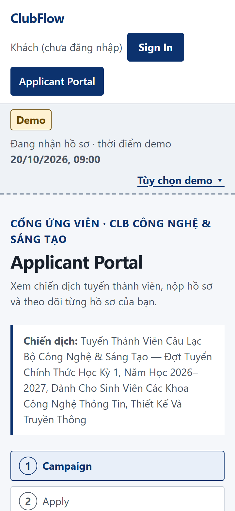


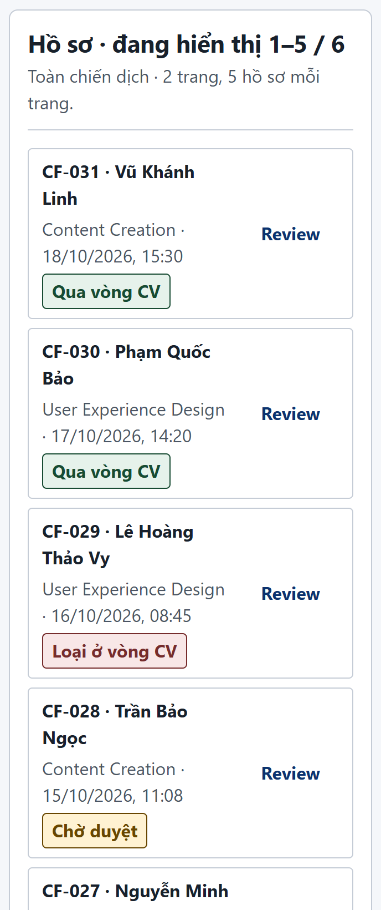

</div>

<div class="mobile-row">

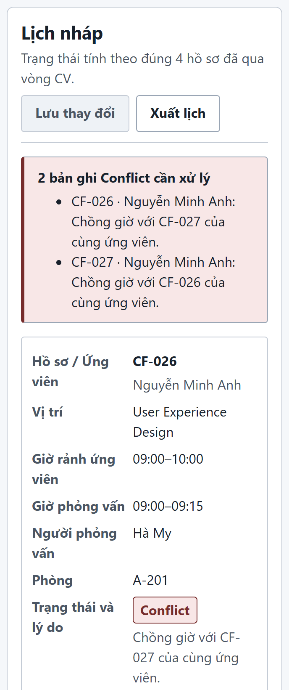

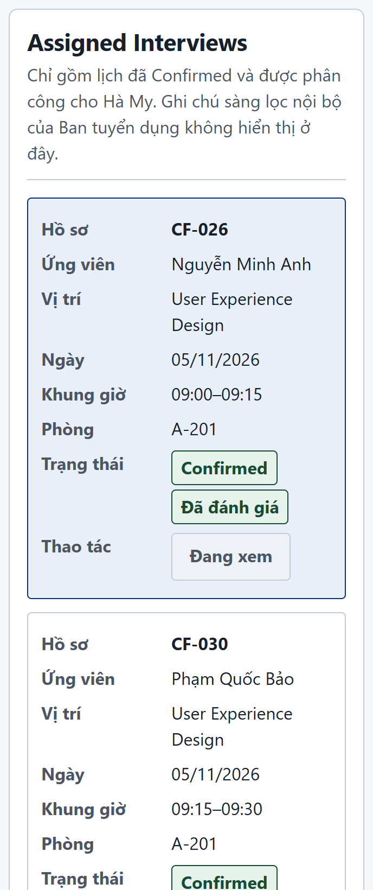

</div>

<p class="meta">Chụp bằng Edge headless với viewport CSS 360 × 780, deviceScaleFactor 2 (ảnh 720 px điểm ảnh = 360 px CSS). Đã kiểm tra <code>innerWidth = 360</code>, <code>scrollWidth = 360</code> (không cuộn ngang). Đây là mô phỏng viewport, không phải thiết bị thật. A.1: <code>/</code> Khách “Đang nhận hồ sơ”; A.2: <code>/?tab=mine</code> Nguyễn Minh Anh “confirmed”; A.3: <code>/executive/review</code> Executive “Đã đóng đơn”; A.4: <code>/executive/scheduling</code> Executive “Đã đóng đơn”; A.5: <code>/interviewer</code> Hà My “confirmed”. Các ảnh cắt theo thẻ nội dung (cao tối đa 820 px CSS).</p>

## Phụ lục B — Cách tạo lại ảnh chụp

Ảnh được chụp bằng một script Node.js tạm (không thêm dependency vào dự án) điều khiển Microsoft Edge headless qua Chrome DevTools Protocol: đặt `sessionStorage['clubflow.demoSession'] = { accountId, scenarioId }` trước khi ứng dụng tải, mở route, thao tác bằng click/điền form trong DOM, rồi chụp theo vùng phần tử. Mỗi ảnh được kiểm tra lại tài khoản trên header và kịch bản trên thanh Demo. Toàn bộ dữ liệu là hư cấu; CV là tệp tạo trong bộ nhớ trình duyệt.
