<section class="cover">
<div class="cover-band">CLUBFLOW · TÀI LIỆU KỸ THUẬT</div>
<h1 class="cover-title">Hướng dẫn giao diện prototype<br>và tích hợp backend</h1>
<p class="cover-sub">Walkthrough có ảnh chụp từ ứng dụng React đang chạy, sơ đồ điều hướng,
ma trận màn hình → service → API và checklist tích hợp.</p>
<table class="cover-meta">
<tr><th>Phạm vi</th><td>Frontend React (UI-first prototype, dữ liệu mock) và kế hoạch nối với backend Express + PostgreSQL</td></tr>
<tr><th>Đối tượng đọc</th><td>Nhóm sinh viên phát triển ClubFlow, đặc biệt là thành viên làm API và cơ sở dữ liệu</td></tr>
<tr><th>Nguồn sự thật</th><td>Mã nguồn hiện tại trong <code>frontend/src</code>, <code>docs/frontend/INTEGRATION.md</code>, <code>docs/requirements/</code>, <code>specs/001-frontend-ui/</code></td></tr>
<tr><th>Ảnh chụp</th><td>Chụp mới ngày 15/11/2026 từ <code>http://localhost:3000</code> (Vite dev server) bằng Microsoft Edge headless; 1280 px và 360 px CSS</td></tr>
<tr><th>Nhánh mã</th><td><code>chore/clubflow-rebrand</code> (commit <code>1c95c31</code>; mã nguồn giống <code>4204e80</code>)</td></tr>
</table>
<div class="cover-note"><strong>Lưu ý quan trọng.</strong> Giao diện React và các tương tác đã được xây dựng, nhưng mọi dữ liệu
đều là dữ liệu hư cấu trong bộ nhớ trình duyệt. Chưa có API nghiệp vụ, chưa có xác thực thật, chưa lưu trữ bền vững.
Tài liệu này phân biệt rõ phần nào là thật, phần nào là mô phỏng.</div>
</section>

<section class="toc-page">
<h2 class="toc-title">Mục lục</h2>
<!--TOC-->
</section>

# Chương 1 — Giới thiệu ClubFlow {#ch1}

## 1.1 Mục đích và bài toán

ClubFlow là ứng dụng web hỗ trợ một câu lạc bộ sinh viên chạy **một đợt tuyển thành viên** từ đầu đến cuối: Ban tuyển dụng (Executive) tạo và công bố chiến dịch, sinh viên (Applicant) nộp hồ sơ cho từng vị trí, Ban tuyển dụng sàng lọc CV, xếp lịch phỏng vấn không xung đột, người phỏng vấn (Interviewer) gửi đánh giá, và cuối cùng Ban tuyển dụng ghi nhận, công bố kết quả Pass/Fail cho từng hồ sơ.

Bài toán thực tế mà ClubFlow giải quyết là các đợt tuyển thường được quản lý bằng biểu mẫu, bảng tính và tin nhắn rời rạc. Điều đó gây ra các lỗi điển hình: đếm nhầm số hồ sơ và số ứng viên, một sinh viên bị xếp hai buổi phỏng vấn trùng giờ, người phỏng vấn thấy ghi chú nội bộ không dành cho họ, hoặc kết quả bị lộ trước khi công bố. Các quy tắc nghiệp vụ BR-01…BR-14 trong `docs/requirements/BUSINESS_RULES.md` mô tả chính xác những ràng buộc này.

## 1.2 Phạm vi prototype hiện tại

Frontend hiện là một **prototype React được chuẩn bị để tích hợp backend** (feature `specs/001-frontend-ui`, tasks T001–T070 đã hoàn thành). Năm màn hình chính đều có thể sử dụng với dữ liệu demo; mọi lệnh gọi dữ liệu đi qua lớp `services`, nên khi có API thật chỉ cần thay thân hàm service.

| Thành phần | Trạng thái | Ghi chú |
|---|---|---|
| Giao diện React (5 màn hình, tab, hộp thoại) | **Đã triển khai** | Atomic Design, responsive 360 px → desktop |
| Tương tác mock (lọc, quyết định, xếp lịch, công bố…) | **Đã triển khai** | Chạy trên store trong bộ nhớ, mất khi tải lại trang |
| Dữ liệu và service mock | **Đã triển khai** | `frontend/src/mocks/`, thân hàm trong `frontend/src/services/` |
| `apiClient` (HTTP, Bearer token, ánh xạ lỗi) | **Đã triển khai, chưa dùng cho nghiệp vụ** | Chỉ `GET /health` đang gọi thật |
| Xác thực, phân quyền thật | **Chưa triển khai** | Demo Session chỉ chọn tài khoản hư cấu |
| API nghiệp vụ, lưu trữ PostgreSQL | **Chưa triển khai** | Backend mới có scaffold và `/api/health` |
| Quy tắc nghiệp vụ phía server (BR-01…BR-14) | **Chưa triển khai** | Mock chỉ mô phỏng để UI hiển thị đúng |

## 1.3 Công nghệ

| Lớp | Công nghệ (theo `AGENTS.md`) |
|---|---|
| Frontend | React, Vite, React Router, Atomic Design, Vitest, React Testing Library, ESLint |
| Backend | Node.js, Express, PostgreSQL (`pg`), JWT, Multer, Cloudinary, Vitest |
| Phát triển | Docker (PostgreSQL), GitHub Spec Kit, Jira; một file `.env` duy nhất ở thư mục gốc |

## 1.4 Cái gì là mock, cái gì là thật

- **Thật:** mã React, định tuyến, component, kiểm tra hợp lệ phía client (`utils/validation.js`), `apiClient`, kiểm tra sức khỏe API ở footer (`useApiHealth` → `GET /api/health`, hiển thị *API connected* / *API unavailable*).
- **Mock:** tài khoản và đăng nhập (`DemoSessionContext`), kịch bản demo với đồng hồ cố định, toàn bộ dữ liệu chiến dịch/hồ sơ/lịch/đánh giá/kết quả, kiểm tra quyền và khóa BR-14 trong `mocks/guards.js`, tính trạng thái lịch trong `mocks/derive.js`.
- **Thanh Demo** dưới header chỉ tồn tại cho mục đích trình diễn; phải gỡ hoặc ẩn trong bản production (chương 13).

## 1.5 Kiến trúc hiện tại và kiến trúc mục tiêu

<div class="diagram">
<div class="dg-title">Hiện tại (prototype)</div>
<div class="flow">
<div class="box page">React Pages<small>pages/*.jsx</small></div><div class="arr">→</div>
<div class="box hook">Hooks<small>hooks/*.js</small></div><div class="arr">→</div>
<div class="box svc">Services (thân mock)<small>services/*.js</small></div><div class="arr">→</div>
<div class="box mock">Mock store trong bộ nhớ<small>mocks/store.js · fixtures · scenarios</small></div>
</div>
<div class="dg-title">Mục tiêu (sau tích hợp)</div>
<div class="flow">
<div class="box page">React Pages</div><div class="arr">→</div>
<div class="box hook">Hooks</div><div class="arr">→</div>
<div class="box svc">Services (thân gọi API)</div><div class="arr">→</div>
<div class="box api">apiClient<small>services/apiClient.js</small></div><div class="arr">→</div>
<div class="box be">Express backend<small>Route → Validator → Controller → Service → Repository</small></div><div class="arr">→</div>
<div class="box db">PostgreSQL</div>
</div>
<div class="dg-legend"><span class="sw stable"></span>Giữ nguyên: Pages, Hooks, chữ ký hàm service &nbsp; <span class="sw change"></span>Thay đổi: thân hàm service, DemoSessionContext → auth provider &nbsp; <span class="sw new"></span>Mới: API backend, CSDL</div>
</div>

Lớp thay đổi khi tích hợp là **thân các hàm trong `frontend/src/services/`** (từ đọc `mocks/store.js` sang gọi `apiClient`) và **`DemoSessionContext`** (sang provider xác thực thật). Pages, hooks, component và chữ ký hàm service được giữ ổn định; nếu API trả dữ liệu khác hình dạng, service phải ánh xạ lại để trang không phải sửa.

# Chương 2 — Tổng quan các màn hình {#ch2}

## 2.1 Danh mục màn hình

Định tuyến được khai báo trong `frontend/src/routes/AppRoutes.jsx` và `routes/paths.js`. Tab là **tham số truy vấn** `?tab=` trên cùng một route, không phải route riêng.

| Màn hình (`<h1>`) | URL | Vai trò | Mục đích chính | Thao tác chính | Liên quan | Trạng thái |
|---|---|---|---|---|---|---|
| Applicant Portal | `/` (`?tab=campaign∣apply∣mine∣notifications`) | Khách, Ứng viên | Xem chiến dịch công khai, nộp hồ sơ, theo dõi hồ sơ, thông báo | Apply Now, Submit Application, Đánh dấu tất cả đã đọc | — | UI + mock |
| Create Recruitment Campaign | `/executive/campaign` | Ban tuyển dụng | Soạn, xem trước, công bố chiến dịch; quản lý vị trí | Lưu bản nháp, Xem trước, Công bố chiến dịch, Lưu thay đổi | Application Review | UI + mock |
| Application Review — CV Screening | `/executive/review?tab=screening` | Ban tuyển dụng | Thống kê, tìm/lọc, xem chi tiết, Shortlist/Loại, xuất CSV | Review, Lưu ghi chú, Loại hồ sơ, Shortlist Candidate, Xuất CSV | Campaign, Scheduling | UI + mock |
| Application Review — Final Results | `/executive/review?tab=results` | Ban tuyển dụng | Xem đánh giá, ghi nhận Pass/Fail, công bố | View Assessment, Record Pass/Fail, Publish Results | Scheduling | UI + mock |
| Interview Scheduling | `/executive/scheduling` | Ban tuyển dụng | Lịch nháp, xử lý Conflict/Unassigned, xác nhận, xuất lịch | Tạo lại lịch nháp, Giải quyết/Sửa/+ Gán khung giờ, Lưu thay đổi, Duyệt & xác nhận lịch, Xuất lịch | Application Review | UI + mock |
| Interviewer Workspace | `/interviewer` | Người phỏng vấn | Xem buổi được phân công, chi tiết ứng viên, gửi đánh giá | Chọn, Submit Assessment | — | UI + mock |
| Không tìm thấy trang | mọi URL khác | Tất cả | Thông báo 404 phía client | — | — | UI |

## 2.2 Màn hình, tab, hộp thoại, panel và trạng thái

- **Màn hình (screen):** một route có `<h1>` riêng (6 route ở trên).
- **Tab:** phần con của một màn hình, chọn bằng `?tab=` (Applicant Portal có 4 tab; Application Review có 2 tab *A CV Screening* và *B Final Results*). URL thay đổi nên có thể chia sẻ/tải lại.
- **Hộp thoại (dialog, `organisms/Modal`, `ConfirmDialog`):** lớp phủ có focus trap, Esc để đóng: Sign In, Xem trước chiến dịch, xác nhận Công bố/Loại hồ sơ/Publish Results/Tạo lại lịch/Xác nhận lịch, sửa một hàng lịch.
- **Panel chi tiết (`ApplicationDetail`, `InterviewDetailCard`):** không phải drawer trượt; hiện **bên cạnh danh sách** trên desktop và xếp bên dưới trên màn hình hẹp.
- **Trạng thái UI:** loading (spinner `AsyncContent`), lỗi + *Thử lại*, rỗng (`EmptyState`), hạn chế quyền (`RoleGate`), chỉ đọc (sau xác nhận lịch).

## 2.3 Điều khiển dùng chung

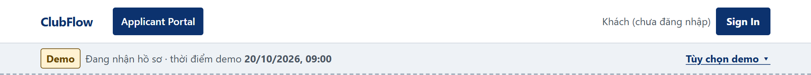

<p class="meta">Route <code>/</code> · Khách · Kịch bản “Đang nhận hồ sơ” · 1280 px</p>


<p class="meta">Route <code>/</code> · Khách · “Đang nhận hồ sơ” · 1280 px. Năm kịch bản: <em>Chiến dịch còn là bản nháp</em> (05/10/2026 09:00), <em>Đã công bố, chưa mở đơn</em> (10/10), <em>Đang nhận hồ sơ</em> (20/10), <em>Đã đóng đơn · duyệt hồ sơ và xếp lịch</em> (31/10, mặc định), <em>Lịch đã xác nhận · sau phỏng vấn</em> (05/11 13:00).</p>

<div class="two">


</div>

<p class="meta">Hình 2.3: <code>/</code> · Khách · “Đang nhận hồ sơ”. Hình 2.4: <code>/executive/review</code> · Nguyễn Minh Anh (Ứng viên) · “Đã đóng đơn”. RoleGate chỉ định hình giao diện, <strong>không phải kiểm soát truy cập</strong>.</p>


<p class="meta">Route <code>/executive/campaign</code> · Ban tuyển dụng · “Đã đóng đơn” · 1280 px</p>

Tài khoản demo (`mocks/fixtures.js`): Ban tuyển dụng `exec-recruitment`; người phỏng vấn `iv-hamy` (Hà My, User Experience Design) và `iv-giahuy` (Gia Huy, Content Creation); ứng viên `ap-minhanh`, `ap-quocbao`, `ap-khanhlinh`, `ap-baongoc`, `ap-thaovy`, `ap-haidang`. Tất cả đều hư cấu.

# Chương 3 — Sơ đồ điều hướng {#ch3}

## 3.1 Liên kết điều hướng thực tế theo vai trò

Header chỉ hiện các mục trong `NAV_BY_ROLE` (`routes/navigation.js`). Sau khi đăng nhập demo, ứng dụng **tự chuyển** tới trang chủ của vai trò (`HOME_BY_ROLE`); ứng viên đang ở `/` thì ở lại. Sign Out luôn quay về `/`. Ngoài hai trường hợp này, **không có thao tác nào tự chuyển trang**: các nút “Mở …”, “Tiếp tục tới …”, “← Về …” là liên kết người dùng bấm.

<div class="diagram nav">
<div class="lane"><div class="lane-h">Khách</div>
<div class="flow wrap"><div class="box page">/ · tab Campaign</div><div class="arr">→ Apply Now / Sign In →</div><div class="box dlg">Hộp thoại Sign In</div><div class="arr">→ chọn vai trò →</div><div class="box auto">Tự chuyển tới trang chủ vai trò</div></div></div>
<div class="lane"><div class="lane-h">Ứng viên</div>
<div class="flow wrap"><div class="box page">/ ?tab=campaign</div><div class="arr">⇄ tab</div><div class="box page">?tab=apply</div><div class="arr">⇄ tab</div><div class="box page">?tab=mine</div><div class="arr">⇄ tab</div><div class="box page">?tab=notifications</div></div>
<div class="note">Gửi hồ sơ thành công: <b>ở lại tab Apply</b>, hiện thông báo; người dùng tự mở tab My Applications.</div></div>
<div class="lane"><div class="lane-h">Ban tuyển dụng</div>
<div class="flow wrap"><div class="box page">Chiến dịch<small>/executive/campaign</small></div><div class="arr">“Mở Application Review →”</div><div class="box page">Duyệt hồ sơ<small>?tab=screening ⇄ ?tab=results</small></div><div class="arr">“Tiếp tục tới Interview Scheduling →”</div><div class="box page">Xếp lịch<small>/executive/scheduling</small></div></div>
<div class="note">Ngược lại: “← Về hồ sơ” (Scheduling → Review), “← Về chiến dịch” (Review → Campaign). Header luôn có 4 mục; “Trang công khai” mở <code>/</code>. Liên kết “Mở Application Review →” chỉ hiện khi chiến dịch đã công bố.</div></div>
<div class="lane"><div class="lane-h">Người phỏng vấn</div>
<div class="flow wrap"><div class="box page">Interviewer Workspace<small>/interviewer</small></div><div class="arr">“Chọn” một buổi →</div><div class="box page">Chi tiết + Interview Assessment<small>cùng trang</small></div></div></div>
<div class="lane"><div class="lane-h">Đổi vai trò (demo)</div>
<div class="flow wrap"><div class="box page">Bất kỳ trang</div><div class="arr">Sign Out →</div><div class="box auto">/ (Khách)</div><div class="arr">Sign In →</div><div class="box dlg">chọn tài khoản khác</div><div class="arr">→</div><div class="box auto">trang chủ vai trò mới</div></div>
<div class="note">Mở URL không đúng vai trò → RoleGate với nút “Sign In” hoặc “Đổi tài khoản demo”.</div></div>
</div>

## 3.2 Hộp thoại theo màn hình

| Màn hình | Nút mở hộp thoại | Hộp thoại | Sau khi xác nhận |
|---|---|---|---|
| Header (mọi trang) | Sign In | Sign In (demo) | Tự chuyển tới trang chủ vai trò |
| Campaign | Xem trước / Xem toàn bộ bản xem trước | Xem trước chiến dịch | Đóng, ở lại trang |
| Campaign | Công bố chiến dịch | Công bố chiến dịch? | Ở lại; hiện “Đã công bố chiến dịch (mô phỏng)” |
| Review · Screening | Loại hồ sơ | Loại hồ sơ CF-xxx? | Ở lại; panel chi tiết cập nhật |
| Review · Results | Publish Results | Công bố kết quả? | Ở lại; “Đã công bố …” |
| Scheduling | Tạo lại lịch nháp | Tạo lại lịch nháp? (nút “Thay thế lịch nháp”) | Ở lại; lịch nháp được thay |
| Scheduling | Giải quyết / Sửa / + Gán khung giờ | Sửa phân công / Gán khung giờ · CF-xxx | Ở lại; trạng thái hàng tính lại |
| Scheduling | Duyệt & xác nhận lịch | Xác nhận lịch phỏng vấn? | Ở lại; lịch chuyển Confirmed, chỉ đọc |

## 3.3 Phụ thuộc quy trình (không phải liên kết)

Các bước sau là **điều kiện nghiệp vụ**, không phải nút điều hướng: chiến dịch phải công bố thì ứng viên mới nộp được; hồ sơ phải *Qua vòng CV* mới vào lịch; lịch phải *Confirmed* thì ứng viên và người phỏng vấn mới thấy buổi phỏng vấn; phải có đánh giá mới ghi nhận được Pass/Fail; phải công bố thì ứng viên mới thấy kết quả. Trong prototype, việc chuyển giữa các giai đoạn thời gian được mô phỏng bằng **Kịch bản** trên thanh Demo.

# Chương 4 — Campaign Management {#ch4}

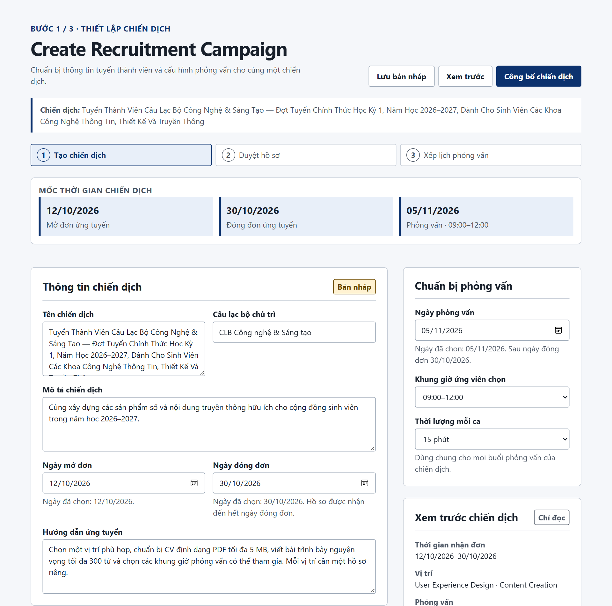{.tall}

<p class="meta">Route <code>/executive/campaign</code> · Ban tuyển dụng · “Chiến dịch còn là bản nháp” · 1280 px</p>

## 4.1 Thông tin chung

| Mục | Nội dung |
|---|---|
| Route / vai trò | `/executive/campaign` · Ban tuyển dụng (RoleGate `executive`) |
| Mục đích | Bước 1/3: soạn thông tin chiến dịch, ban–vị trí–chỉ tiêu, cấu hình phỏng vấn; xem trước; công bố |
| File | `pages/CampaignManagementPage.jsx`; organisms `CampaignDetailsCard`, `PositionsEditor`, `InterviewSetupCard`, `CampaignPreview`, `ConfirmDialog`; molecules `StepIndicator`, `Timeline` |
| Hook / service | `hooks/useCampaign.js` → `campaignService.getCampaign()`, `saveDraft(draft)`, `publish(draft)`, `removePosition(positionId)` |
| Dữ liệu mock | `mocks/fixtures.js` (`BASE.campaign`, `departments`, `positions`, `slots`), trạng thái theo `mocks/scenarios.js` |

**Bố cục:** tiêu đề với các nút hành động; `StepIndicator` 3 bước (Tạo chiến dịch → Duyệt hồ sơ → Xếp lịch phỏng vấn); mốc thời gian (mở đơn, đóng đơn, phỏng vấn); cột trái *Thông tin chiến dịch* và *Ban và vị trí tuyển*; cột phải *Chuẩn bị phỏng vấn* và *Xem trước chiến dịch* (chỉ đọc).

**Trường hiển thị:** Tên chiến dịch, Câu lạc bộ chủ trì, Mô tả chiến dịch, Ngày mở đơn, Ngày đóng đơn, Hướng dẫn ứng tuyển; mỗi vị trí: Ban (Department), Tên vị trí (Position), Chỉ tiêu, Mô tả công việc, Yêu cầu; phỏng vấn: Ngày phỏng vấn, Khung giờ ứng viên chọn (09:00–12:00 / 13:00–17:00), Thời lượng mỗi ca (15/20/30 phút).

<div class="two">

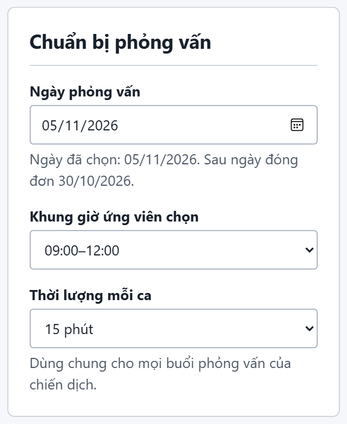


</div>

<p class="meta">Hình 4.2: “bản nháp”. Hình 4.3: “Đã đóng đơn” — mỗi vị trí ghi “3 hồ sơ đang liên kết với vị trí này”; trong kịch bản này ngày, khung giờ và thời lượng cũng bị khóa vì đã có hồ sơ chọn khung giờ (giả định giao diện, chờ Q-03).</p>

## 4.2 Hành động

- **Lưu bản nháp** (`saveDraft`): lưu mà không công bố. Sau khi công bố nút đổi thành **Lưu thay đổi**.
- **Xem trước** (hộp thoại `CampaignPreview`): nội dung ứng viên sẽ thấy.
- **Công bố chiến dịch** (`publish(draft)`): kiểm tra BR-01, mở hộp thoại xác nhận, rồi đổi trạng thái sang *Đã công bố*.
- **+ Thêm vị trí / Xóa vị trí** (`removePosition`): xóa bị chặn khi vị trí có hồ sơ (BR-04).

<div class="two">

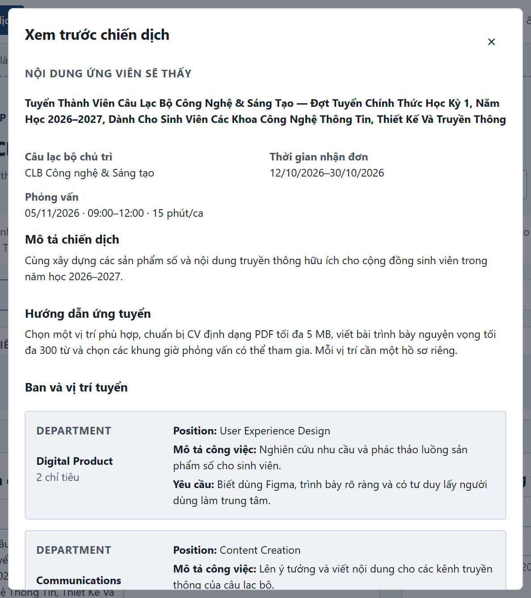


</div>

## 4.3 Kiểm tra hợp lệ

{.tall}

<p class="meta">Route <code>/executive/campaign</code> · Ban tuyển dụng · “bản nháp” · 1280 px. Hai trường đã được xóa trống trước khi bấm.</p>

Phía client, `utils/validation.js` kiểm tra trường bắt buộc, ngày mở trước ngày đóng, ngày phỏng vấn sau ngày đóng, ít nhất một vị trí và chỉ tiêu là số nguyên dương (BR-01). Đây chỉ là **phản hồi nhanh**; backend **bắt buộc** kiểm tra lại toàn bộ trong service khi công bố, vì request có thể bỏ qua UI.

## 4.4 Trạng thái quan trọng


<p class="meta">Cùng phiên làm việc từ Hình 4.5 · Ban tuyển dụng · “bản nháp” → đã công bố trong bộ nhớ demo · 1280 px</p>

{.tall}

<p class="meta">Route <code>/executive/campaign</code> · Ban tuyển dụng · “Lịch đã xác nhận · sau phỏng vấn” · 1280 px</p>

Lưu ý thực tế trong UI: **công bố không tự khóa cấu hình**; trạng thái chỉ đọc chỉ áp dụng sau khi lịch phỏng vấn được xác nhận. Những trường nào được sửa sau công bố nhưng trước xác nhận là câu hỏi mở **Q-03**.

## 4.5 Cách truy cập và điều hướng

**Điểm bắt đầu:** Khách ở `/`. **Bước 1:** bấm *Sign In* ở header, chọn “Ban tuyển dụng · CLB Công nghệ & Sáng tạo”, bấm *Sign In (demo)* → ứng dụng **tự chuyển** tới `/executive/campaign`. **Bước 2:** sửa trường, bấm *Lưu bản nháp* hoặc *Xem trước*. **Bước 3:** bấm *Công bố chiến dịch* → hộp thoại → *Công bố chiến dịch*. **Bước 4:** bấm *Mở Application Review →* hoặc mục *Duyệt hồ sơ* trên header (thủ công). Hành động làm thay đổi trạng thái: *Công bố chiến dịch*, *Xóa vị trí*, *Lưu*.

## 4.6 Trách nhiệm backend

Lưu bản nháp và chiến dịch đã công bố; kiểm tra BR-01 khi công bố; chỉ trả chiến dịch đã công bố cho khách (BR-02); chặn xóa vị trí có hồ sơ bằng ràng buộc khóa ngoại và kiểm tra service (BR-04); từ chối mọi thay đổi sau xác nhận lịch (BR-14); `getCampaign()` chỉ dành cho Executive.

# Chương 5 — Application Review {#ch5}

{.tall}

<p class="meta">Route <code>/executive/review?tab=screening</code> · Ban tuyển dụng · “Đã đóng đơn · duyệt hồ sơ và xếp lịch” · 1280 px</p>

## 5.1 Tab A — CV Screening

| Mục | Nội dung |
|---|---|
| File | `pages/ApplicationReviewPage.jsx` (`ScreeningPanel`); organisms `ApplicationFilters`, `ApplicationList`, `ApplicationDetail`; molecules `StatCard`, `Pagination` |
| Hook | `useApplications(query)` → `applicationService.list(query)` + `getStats(query)`; `useApplicationDetail(id)` → `get(id)`; ngữ cảnh chiến dịch từ `useCampaign()` (tải một lần ở cấp trang) |
| Hành động | `applicationActions.saveNote`, `setScreening`, `exportCsv` |

**Thống kê:** *Tổng hồ sơ* 6, *Ứng viên riêng biệt* 5, *Qua vòng CV* 4, *Chờ duyệt + Loại* 1 + 1. Hồ sơ (application) và ứng viên (applicant) là hai thực thể khác nhau (BR-06): Nguyễn Minh Anh nộp **CF-026** (User Experience Design) và **CF-027** (Content Creation), nên 6 hồ sơ nhưng chỉ 5 người.

**Tìm kiếm, lọc, sắp xếp, phân trang:** tìm theo tên hoặc mã, không phân biệt dấu; lọc theo Vị trí và Trạng thái; sắp xếp *Mới nhất trước / Cũ nhất trước*; 5 hồ sơ mỗi trang. Khi lọc, tiêu đề ghi rõ “Theo bộ lọc” để không lẫn với số liệu toàn chiến dịch.


<p class="meta">Route <code>/executive/review?tab=screening</code> · Ban tuyển dụng · “Đã đóng đơn” · 1280 px</p>

**Chi tiết hồ sơ:** bấm *Review* trên một hàng → panel chi tiết bên cạnh danh sách: vị trí, thời gian nộp/duyệt, khung giờ có thể tham gia, mã số sinh viên, email, khoa, năm (snapshot lúc nộp), liên kết *Mở CV mẫu hư cấu (PDF)*, bài trình bày nguyện vọng (SOP), **Ghi chú nội bộ · chỉ Ban tuyển dụng nhìn thấy** với nút *Lưu ghi chú*, và hai nút *Loại hồ sơ* / *Shortlist Candidate*. Mọi hồ sơ dùng chung một file CV hư cấu `/demo/fictional-sample-cv.pdf`.

<div class="two">


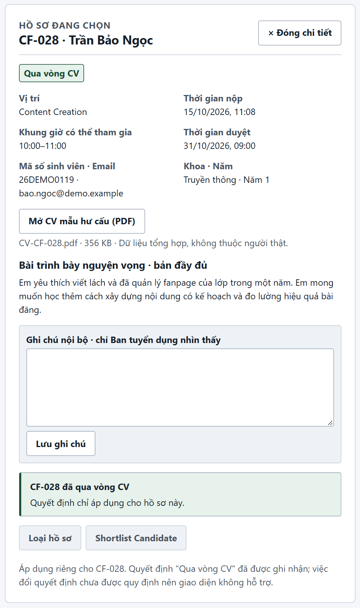

</div>

<p class="meta">Route <code>/executive/review?tab=screening</code> · Ban tuyển dụng · “Đã đóng đơn” · 1280 px. Thay đổi chỉ tồn tại trong bộ nhớ demo.</p>

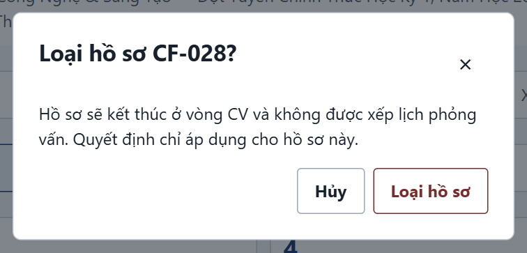{.narrow}

**Quyết định theo từng hồ sơ (BR-07):** Shortlist hoặc Loại chỉ đổi hồ sơ đang chọn. Prototype chỉ cho quyết định hồ sơ đang *Chờ duyệt* (việc đảo quyết định chưa được nguồn yêu cầu xác định). Sau khi lịch được xác nhận, quyết định bị khóa (BR-14).

**Xuất CSV** (`exportCsv(query)`): theo bộ lọc hiện tại, chỉ các cột được phép (mã hồ sơ, ứng viên, MSSV, email, vị trí, thời gian nộp, trạng thái), **không** có ghi chú nội bộ và CV (BR-09). File được tạo trong trình duyệt (`utils/csv.js` → `downloadText`).

{.tall}

<p class="meta">Route <code>/executive/review?tab=screening</code> · Ban tuyển dụng · “Đã đóng đơn” · 1280 px</p>

## 5.2 Tab B — Final Results

{.tall}

<p class="meta">Route <code>/executive/review?tab=results</code> · Ban tuyển dụng · “Lịch đã xác nhận · sau phỏng vấn” · 1280 px</p>

| Mục | Nội dung |
|---|---|
| File | `ApplicationReviewPage.jsx` (`ResultsPanel`); organisms `FinalResultsTable`, `FinalDecisionPanel`, `PublishResultsCard` |
| Hook | `useFinalResults()` → `resultService.list()`; `useAssessment(applicationId, enabled)` → `getAssessment(applicationId)`; `resultActions.record`, `publishRecorded` |

Bảng chỉ gồm hồ sơ *Qua vòng CV* có lịch *Confirmed*. Mỗi hàng: phỏng vấn, trạng thái đánh giá (*Đã gửi / Chờ đánh giá*), người phỏng vấn, quyết định (*Pass / Fail / Chưa ghi nhận*), công bố (*Đã công bố / Chưa công bố*). **View Assessment** mở rộng ngay trong panel (không phải hộp thoại). **Record Pass / Record Fail** cần đánh giá đã gửi và bị khóa sau khi công bố. **Publish Results** công bố mọi kết quả đã ghi nhận nhưng chưa công bố và tạo một thông báo trong ứng dụng cho mỗi hồ sơ.

<div class="two">


</div>

{.narrow}

**Qua vòng CV khác với Pass (BR-08):** *Qua vòng CV* chỉ nghĩa là đủ điều kiện xếp lịch; lịch *Confirmed* chỉ là cuộc hẹn; **Pass/Fail là quyết định cuối riêng của từng hồ sơ**. Cùng một ứng viên có thể Pass ở CF-026 và Fail ở CF-027. Kết quả chưa công bố không bao giờ được gửi tới ứng viên.

## 5.3 Cách truy cập và điều hướng

**Điểm bắt đầu:** Ban tuyển dụng ở Campaign. **Bước 1:** bấm *Duyệt hồ sơ* trên header (hoặc *Mở Application Review →*). **Bước 2:** tab *A CV Screening* mở mặc định. **Bước 3:** lọc/tìm, bấm *Review* trên một hồ sơ. **Bước 4:** *Shortlist Candidate* hoặc *Loại hồ sơ* (hộp thoại). **Bước 5:** bấm *Tiếp tục tới Interview Scheduling →* (thủ công). Sau phỏng vấn: mở tab *B Final Results*, chọn *Mở* trên một hàng, *View Assessment*, *Record Pass/Fail*, rồi *Publish Results*.

## 5.4 Trách nhiệm backend

Lọc, sắp xếp, phân trang phía server; đếm hồ sơ và ứng viên riêng (BR-06); `setScreening` chỉ đổi một hồ sơ và bị khóa sau xác nhận (BR-07, BR-14); ghi chú riêng tư chỉ Executive đọc; CSV theo bộ lọc với trường được phép (BR-09); CV qua endpoint có kiểm tra quyền; `record` cần đánh giá đã gửi và không đổi sau công bố; `publishRecorded` tạo thông báo trong cùng giao dịch.

# Chương 6 — Interview Scheduling {#ch6}

{.tall}

<p class="meta">Route <code>/executive/scheduling</code> · Ban tuyển dụng · “Đã đóng đơn · duyệt hồ sơ và xếp lịch” · 1280 px</p>

## 6.1 Thông tin chung

| Mục | Nội dung |
|---|---|
| File | `pages/InterviewSchedulingPage.jsx`; organisms `ScheduleSettingsCard`, `InterviewerAssignmentsCard`, `ScheduleTable`, `ScheduleRowDialog`, `ConfirmationChecklist`, `ConfirmDialog` |
| Hook | `useSchedule()` → `scheduleService.getSchedule()` + `campaignService.getCampaign()` |
| Service | `generateDraft()`, `updateSettings({ slotMinutes, roomIds })`, `updateRow(applicationId, { start, interviewerId, roomId })`, `saveDraft()`, `confirm()`, `exportTimetable()` |
| Đầu vào | 4 hồ sơ *Qua vòng CV*; ngày 05/11/2026, khung 09:00–12:00; ca 15/20/30 phút; phòng A-201, B-105; Hà My (UX, rảnh 09:00–10:30), Gia Huy (Content, rảnh 09:00–11:00); giờ rảnh ứng viên |

## 6.2 Trạng thái hàng lịch

- **Proposed:** phù hợp giờ rảnh, người phỏng vấn và phòng.
- **Conflict:** chồng giờ với hồ sơ khác cùng **ứng viên**, cùng **người phỏng vấn** hoặc cùng **phòng** (BR-11).
- **Unassigned:** không tìm được tổ hợp hợp lệ, kèm lý do; hồ sơ **vẫn** Qua vòng CV, không bị loại (BR-12).
- **Confirmed:** sau khi xác nhận; chỉ đọc (BR-14).


<p class="meta">Route <code>/executive/scheduling</code> · Ban tuyển dụng · “Đã đóng đơn” · 1280 px</p>

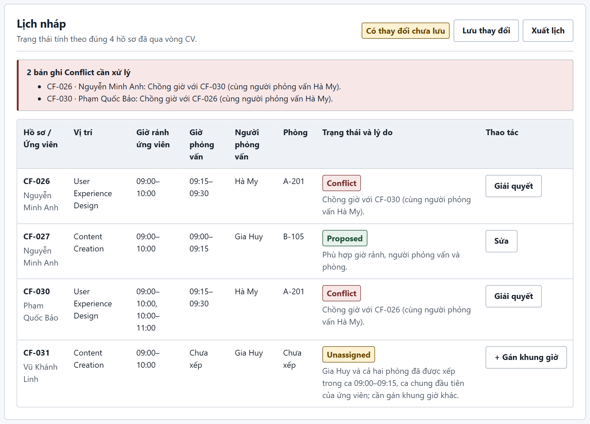

<p class="meta">Route <code>/executive/scheduling</code> · Ban tuyển dụng · “Đã đóng đơn” · 1280 px</p>

## 6.3 Chỉnh tay, lưu, tạo lại

- **Giải quyết** (hàng Conflict), **Sửa** (hàng Proposed), **+ Gán khung giờ** (hàng Unassigned) mở `ScheduleRowDialog` với *Ca phỏng vấn*, *Người phỏng vấn* (chỉ người được phân công cho vị trí), *Phòng*, nút *Cập nhật ca*. Sau mỗi lần cập nhật, toàn bộ lịch nháp được tính lại.
- **Lưu thay đổi** (`saveDraft`) lưu lịch nháp; badge “Có thay đổi chưa lưu” nhắc người dùng.
- **Tạo lại lịch nháp** (`generateDraft`) luôn hỏi trước khi thay thế lịch hiện tại.
- **Xuất lịch** (`exportTimetable`) tải CSV trong trình duyệt; vẫn dùng được sau xác nhận.

<div class="two">

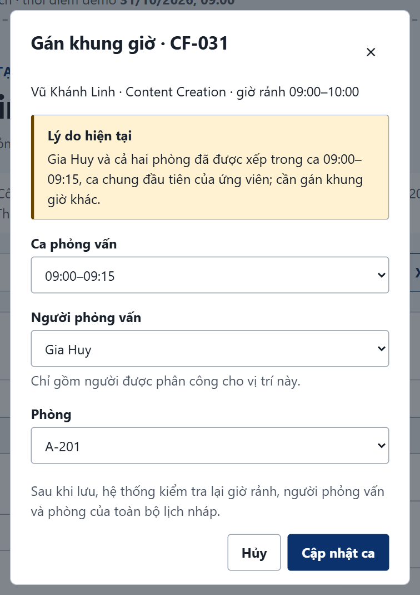

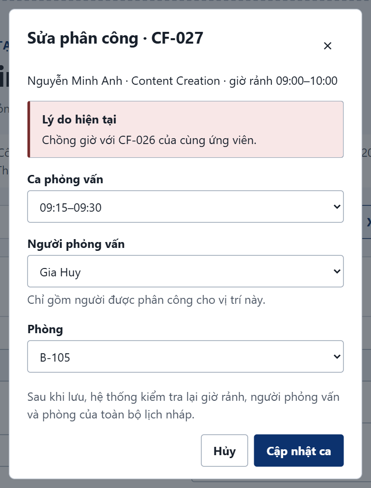

</div>

{.narrow}

## 6.4 Điều kiện xác nhận

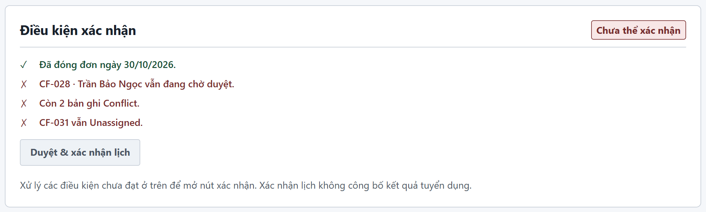

`ConfirmationChecklist` hiển thị bốn điều kiện của BR-13: đã đóng đơn, mọi hồ sơ đã được duyệt, không còn Conflict, mọi hồ sơ Qua vòng CV có đúng một ca. Khi không có hồ sơ nào Qua vòng CV, trang hiện trạng thái rỗng và bỏ qua bước xác nhận.

Một luồng thực tế đã chạy trong ứng dụng để có Hình 6.8–6.10: trong cùng một phiên, Loại hồ sơ CF-028 ở Application Review, bấm *Xếp lịch* trên header, chuyển CF-027 sang 09:15–09:30 (B-105) và CF-031 sang 09:30–09:45.

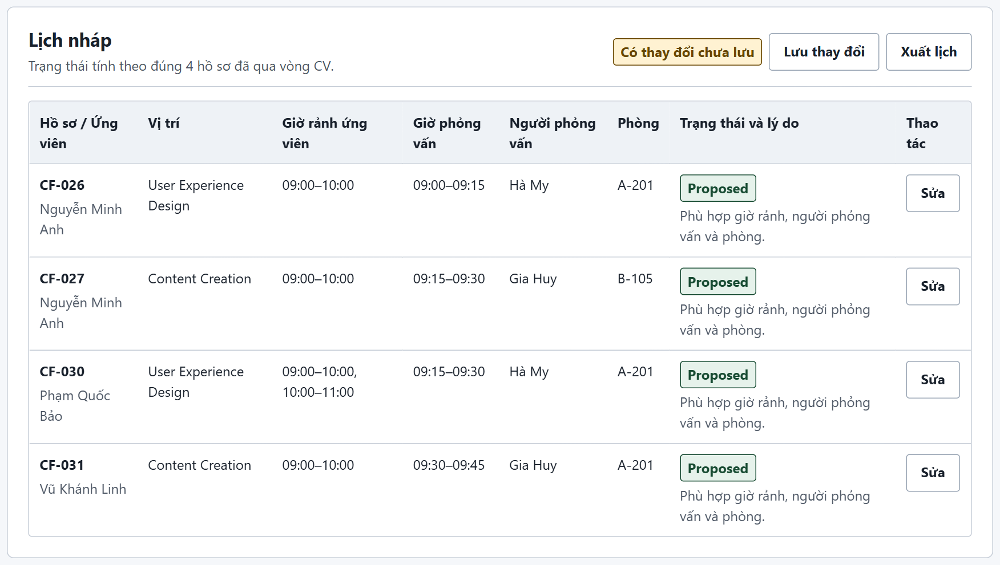

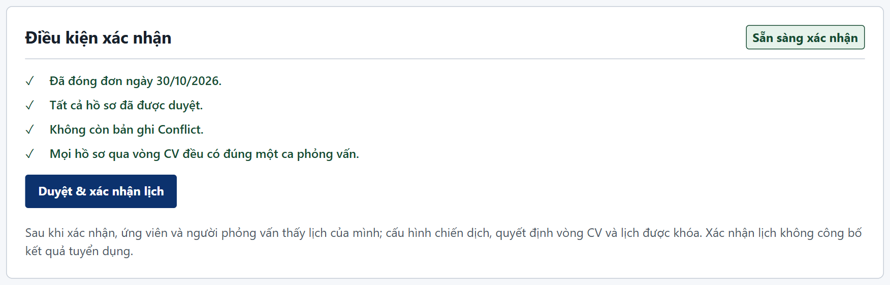

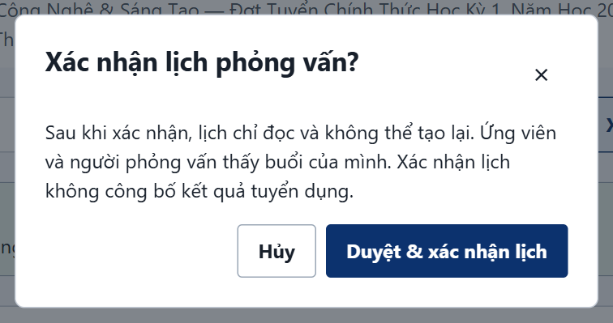{.narrow}

<p class="meta">Hình 6.8–6.10: <code>/executive/review</code> → <code>/executive/scheduling</code> · Ban tuyển dụng · “Đã đóng đơn” · 1280 px. Ảnh dừng ở hộp thoại; trạng thái sau xác nhận được minh họa bằng kịch bản “confirmed” (Hình 6.11).</p>


<p class="meta">Route <code>/executive/scheduling</code> · Ban tuyển dụng · “Lịch đã xác nhận · sau phỏng vấn” · 1280 px</p>

## 6.5 Vòng đời lịch và ranh giới mock / backend

<div class="diagram">
<div class="flow wrap"><div class="box page">Chưa có lịch</div><div class="arr">Tạo lịch nháp →</div><div class="box svc">Draft<small>Proposed / Conflict / Unassigned</small></div><div class="arr">chỉnh tay ⟲ · Lưu thay đổi ⟲ · Tạo lại (hỏi trước) ⟲</div><div class="box hook">Đủ điều kiện BR-13</div><div class="arr">Duyệt & xác nhận →</div><div class="box db">Confirmed<small>chỉ đọc, BR-14</small></div></div>
</div>

| Khía cạnh | Prototype hiện tại | Backend phải làm |
|---|---|---|
| Sinh lịch nháp | `generateDraft()` trả **lịch tham chiếu cố định** từ fixtures; **không có thuật toán first-fit trong React** | Thuật toán “first available valid combination” (slot + interviewer + room), thứ tự ổn định (Q-01) |
| Tính trạng thái | `mocks/derive.js` → `evaluateSchedule()` chạy lại sau mỗi chỉnh sửa để demo nhất quán (O(n²), chỉ là stand-in) | Kiểm tra BR-10/BR-11 sau mỗi chỉnh sửa; khoảng nửa mở `start1 < end2 && start2 < end1` |
| Kiểm tra form | Dialog chỉ đưa ra lựa chọn hợp lệ; service mock trả `fieldErrors` | Validator + service kiểm tra mọi request |
| Xác nhận | `confirm()` kiểm tra lại BR-13 trên store | Kiểm tra lại BR-13 trong **một giao dịch**, khóa dữ liệu liên quan, chống xác nhận đồng thời |
| Khóa sau xác nhận | `mocks/guards.js` → `assertNotLockedBySchedule` | Guard trên **mọi** đường ghi: chiến dịch, hồ sơ, quyết định CV, lịch |

## 6.6 Cách truy cập và điều hướng

**Điểm bắt đầu:** Ban tuyển dụng ở Application Review. **Bước 1:** bấm *Tiếp tục tới Interview Scheduling →* hoặc *Xếp lịch* trên header. **Bước 2:** xem danh sách Conflict (alert đỏ) và cột “Trạng thái và lý do”. **Bước 3:** bấm *Giải quyết* / *Sửa* / *+ Gán khung giờ* → hộp thoại → *Cập nhật ca*. **Bước 4:** *Lưu thay đổi*. **Bước 5:** khi checklist đạt, *Duyệt & xác nhận lịch* → hộp thoại → xác nhận. **Bước 6:** sau phỏng vấn, mở *Duyệt hồ sơ* → tab *Final Results* (thủ công). *← Về hồ sơ* quay lại Application Review.

# Chương 7 — Applicant Portal {#ch7}

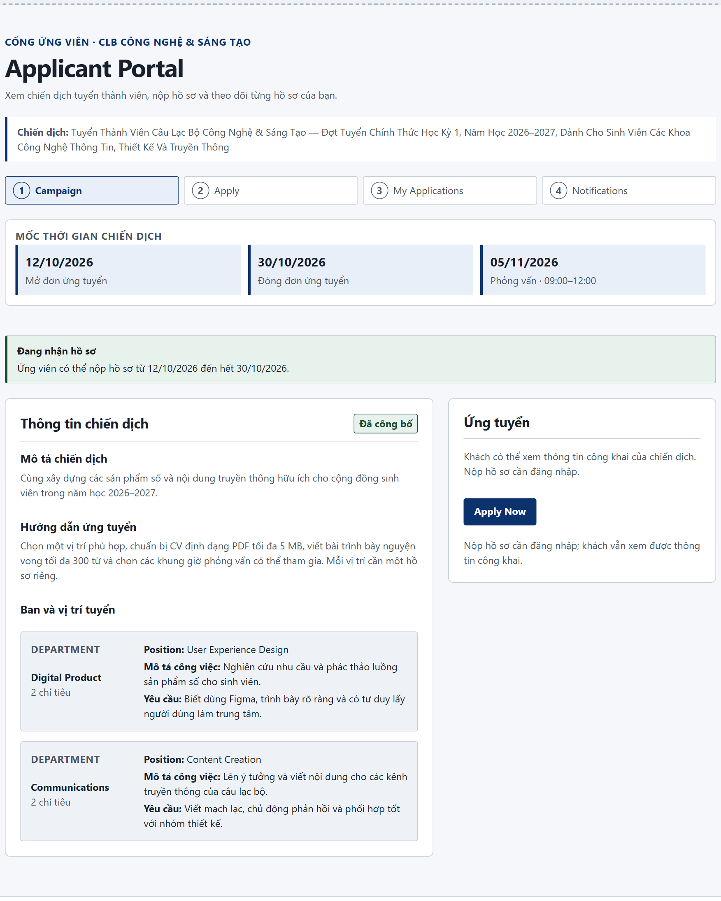{.tall}

<p class="meta">Route <code>/</code> · Khách · “Đang nhận hồ sơ” · 1280 px</p>

## 7.1 Thông tin chung

| Mục | Nội dung |
|---|---|
| File | `pages/ApplicantPortalPage.jsx`; organisms `PublicCampaignPanel`, `ApplicationForm`, `MyApplicationsTable`, `NotificationList`; molecules `FileField`, `ChoiceGroup`, `PositionCard`, `Tabs` |
| Hook | `useApplicantPortal(isApplicant)` → `portalService.getPublicCampaign()`, `listMyApplications()`, `listNotifications()` (ứng viên: tải song song) |
| Hành động | `portalService.submitApplication(formData)`, `markNotificationsRead()` |

**Xem công khai:** mốc thời gian, trạng thái nhận hồ sơ theo giai đoạn (chưa mở / đang nhận / đã đóng), mô tả, hướng dẫn, các ban và vị trí với chỉ tiêu. Chiến dịch bản nháp không bao giờ hiển thị (BR-02). Khách bấm *Apply Now* sẽ mở hộp thoại Sign In; các tab Apply, My Applications, Notifications hiện lời nhắc đăng nhập.

## 7.2 Nộp hồ sơ

{.tall}

<p class="meta">Route <code>/?tab=apply</code> · Trương Hải Đăng (Ứng viên) · “Đang nhận hồ sơ” · 1280 px</p>

Biểu mẫu cố định: *Vị trí ứng tuyển*; *Họ và tên*, *Mã số sinh viên* (chỉ đọc từ tài khoản); *Email liên hệ*, *Khoa* (có thể sửa và được lưu thành snapshot của hồ sơ); *CV (PDF, tối đa 5 MB)*; *Bài trình bày nguyện vọng* với bộ đếm “0 / 300 từ”; *Khung giờ phỏng vấn có thể tham gia* (09:00–10:00, 10:00–11:00, 11:00–12:00). Nút *Submit Application* nằm ở thẻ *Tóm tắt hồ sơ*.

<div class="two">


</div>

<p class="meta">Route <code>/?tab=apply</code> · Trương Hải Đăng · “Đang nhận hồ sơ” · 1280 px. File CV là tệp hư cấu tạo trong trình duyệt (<code>cv-hu-cau-6mb.pdf</code>).</p>

<div class="two">

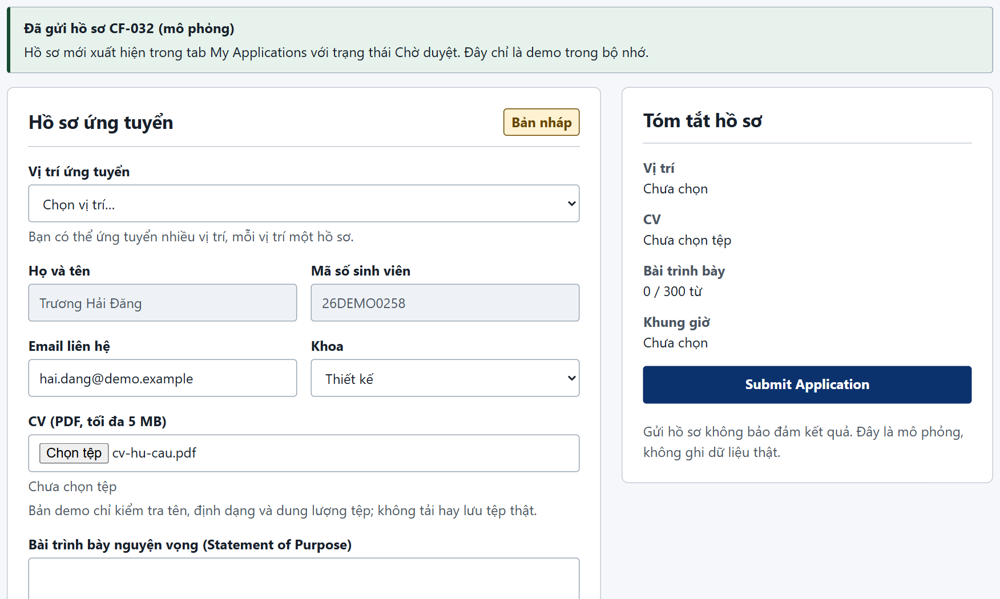


</div>

Prototype chỉ giữ **tên và kích thước** file CV; không có file nào được tải lên. Xác thực thật, upload file và lưu trữ bền vững đều cần backend.

## 7.3 My Applications và Notifications

{.tall}

<p class="meta">Route <code>/?tab=mine</code> · Nguyễn Minh Anh · “Lịch đã xác nhận · sau phỏng vấn” · 1280 px</p>

<div class="two">


</div>

Mỗi hồ sơ được xử lý độc lập. Buổi phỏng vấn chỉ hiện sau khi lịch được xác nhận; kết quả chỉ hiện sau khi công bố. Thông báo là thông báo trong ứng dụng, không có email/SMS/push. Nếu *Đánh dấu tất cả đã đọc* thất bại, trang hiện cảnh báo lỗi.

## 7.4 Cách truy cập và điều hướng

**Điểm bắt đầu:** Khách ở `/`. **Bước 1:** xem tab *Campaign*. **Bước 2:** *Apply Now* → Sign In → chọn một ứng viên → ở lại `/` (đã đăng nhập). **Bước 3:** mở tab *Apply*, điền và *Submit Application* (thay đổi trạng thái). **Bước 4:** mở tab *My Applications* thủ công để thấy hồ sơ “Chờ duyệt”. **Bước 5:** khi có kết quả công bố, tab *Notifications* có số đếm; *Đánh dấu tất cả đã đọc*.

# Chương 8 — Interviewer Workspace {#ch8}

{.tall}

<p class="meta">Route <code>/interviewer</code> · Hà My (Người phỏng vấn) · “Lịch đã xác nhận · sau phỏng vấn” · 1280 px</p>

## 8.1 Thông tin chung

| Mục | Nội dung |
|---|---|
| File | `pages/InterviewerWorkspacePage.jsx`; organisms `AssignedInterviewsTable`, `InterviewDetailCard`, `AssessmentForm` |
| Hook | `useAssignedInterviews()` → `interviewerService.listAssignedInterviews()` (kèm `campaignName`, `interviewDate`); `useInterviewDetail(id)` → `getInterview(id)`; `interviewerActions.submitAssessment(interviewId, { recommendation, notes })` |

Danh sách chỉ gồm buổi **Confirmed** được phân công cho người đang đăng nhập (Hà My: CF-026, CF-030). Chi tiết gồm vị trí, khoa–năm (snapshot), buổi phỏng vấn, SOP, liên kết CV hư cấu. **Ghi chú nội bộ của Ban tuyển dụng không bao giờ hiển thị**; trang này cũng không gọi `getCampaign()` (chỉ dành cho Executive).

<div class="two">

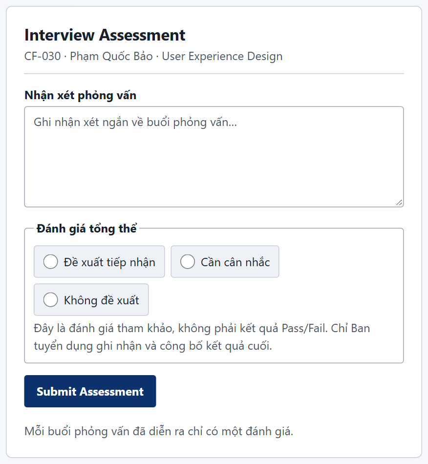


</div>

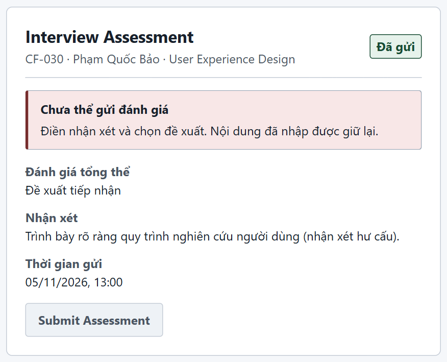{.narrow}

## 8.2 Trạng thái

- **Đã gửi:** chỉ đọc (Hình 8.1, 8.4).
- **Chưa diễn ra:** buổi phỏng vấn sắp tới bị khóa (“Chưa thể đánh giá”), được kiểm thử tự động.
- **Rỗng:** lịch chưa xác nhận → “Chưa có buổi phỏng vấn nào được phân công cho bạn” (Hình 8.5).
- **Hạn chế:** vai trò khác mở `/interviewer` → RoleGate.

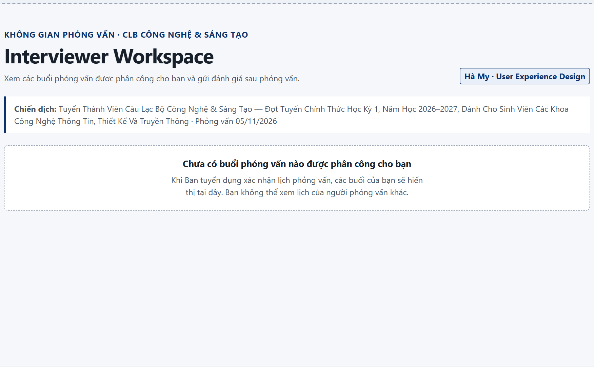

<p class="meta">Route <code>/interviewer</code> · Hà My · “Đã đóng đơn · duyệt hồ sơ và xếp lịch” · 1280 px</p>

**Ranh giới phân quyền:** người phỏng vấn chỉ truy cập buổi được phân công và thông tin ứng viên được phép; CV phải qua endpoint kiểm tra phân công; đánh giá là **tham khảo** (*Đề xuất tiếp nhận / Cần cân nhắc / Không đề xuất*), quyết định Pass/Fail thuộc Ban tuyển dụng. Các trường đánh giá còn là câu hỏi mở **Q-04**.

## 8.3 Cách truy cập và điều hướng

**Điểm bắt đầu:** Khách ở `/`. **Bước 1:** Sign In → “Hà My” → **tự chuyển** tới `/interviewer`. **Bước 2:** bấm *Chọn* trên một buổi (tên nút đọc là “Chọn CF-030 · Phạm Quốc Bảo”). **Bước 3:** điền *Nhận xét phỏng vấn*, chọn *Đánh giá tổng thể*, *Submit Assessment* (thay đổi trạng thái). Không có liên kết sang màn hình khác; người phỏng vấn không thấy menu Executive.

# Chương 9 — Quy trình tuyển dụng hoàn chỉnh {#ch9}

<div class="diagram">
<div class="flow wrap steps">
<div class="box page">1 · Executive soạn chiến dịch</div><div class="arr">→</div>
<div class="box page">2 · Công bố</div><div class="arr">→</div>
<div class="box mock">3 · Applicant xem & nộp hồ sơ</div><div class="arr">→</div>
<div class="box page">4–5 · Sàng lọc: Shortlist / Loại</div><div class="arr">→</div>
<div class="box page">6 · Lịch nháp</div><div class="arr">→</div>
<div class="box page">7 · Xác nhận lịch</div><div class="arr">→</div>
<div class="box hook">8–9 · Phỏng vấn & đánh giá</div><div class="arr">→</div>
<div class="box page">10 · Record Pass/Fail</div><div class="arr">→</div>
<div class="box page">11 · Publish Results</div><div class="arr">→</div>
<div class="box mock">12 · Applicant nhận kết quả</div>
</div>
<div class="dg-legend"><span class="sw stable"></span>Executive &nbsp;<span class="sw new"></span>Applicant &nbsp;<span class="sw change"></span>Interviewer · Tất cả bước hiện chỉ chạy trên dữ liệu mock</div>
</div>

<div class="wide-table">

| # | Vai trò | Màn hình | Thao tác UI | Thực thể | Service | Backend cần làm | BR | Bước tiếp |
|---|---|---|---|---|---|---|---|---|
| 1 | Executive | Campaign | Sửa trường, Lưu bản nháp | Campaign, Position | `campaignService.saveDraft(draft)` | Lưu nháp | BR-04 | Xem trước |
| 2 | Executive | Campaign | Công bố chiến dịch | Campaign | `campaignService.publish(draft)` | Kiểm tra, chuyển Published | BR-01, BR-02 | Ứng viên thấy chiến dịch |
| 3 | Applicant | Applicant Portal | Apply → Submit Application | Application, CV | `portalService.submitApplication(formData)` | Lưu hồ sơ + snapshot, upload CV, cửa sổ nộp, duy nhất | BR-02, BR-03, BR-05 | Chờ duyệt |
| 4 | Executive | Review · Screening | Review, Lưu ghi chú | Application, note | `applicationService.get(id)`, `saveNote(id, note)` | Đọc chi tiết, ghi chú riêng | BR-06, BR-09 | Quyết định |
| 5 | Executive | Review · Screening | Shortlist Candidate / Loại hồ sơ | Application.screeningStatus | `applicationService.setScreening(id, status)` | Đổi một hồ sơ; xóa ca nếu loại | BR-07, BR-14 | Xếp lịch |
| 6 | Executive | Scheduling | Tạo lại / chỉnh tay / Lưu | Interview (draft) | `generateDraft()`, `updateRow(...)`, `saveDraft()` | First-fit, phát hiện xung đột | BR-10…BR-12 | Kiểm tra điều kiện |
| 7 | Executive | Scheduling | Duyệt & xác nhận lịch | Schedule, Interview | `scheduleService.confirm()` | Kiểm tra lại trong giao dịch, khóa | BR-13, BR-14 | Thông tin buổi hiện cho người liên quan |
| 8 | Interviewer | Interviewer Workspace | Chọn buổi | Interview | `interviewerService.listAssignedInterviews()`, `getInterview(id)` | Chỉ buổi được phân công | BR-14 | Phỏng vấn (ngoài hệ thống) |
| 9 | Interviewer | Interviewer Workspace | Submit Assessment | Assessment | `interviewerService.submitAssessment(id, data)` | Một đánh giá/buổi đã diễn ra | Q-04 | Executive xem |
| 10 | Executive | Review · Results | View Assessment, Record Pass/Fail | FinalResult | `resultService.getAssessment(id)`, `record(id, decision)` | Cần đánh giá, chưa công bố | BR-08 | Công bố |
| 11 | Executive | Review · Results | Publish Results | FinalResult, Notification | `resultService.publishRecorded()` | Công bố + tạo thông báo (giao dịch) | BR-08 | Ứng viên thấy |
| 12 | Applicant | Applicant Portal | My Applications, Notifications | FinalResult, Notification | `listMyApplications()`, `listNotifications()`, `markNotificationsRead()` | Chỉ dữ liệu của chính mình, chỉ kết quả đã công bố | BR-08 | Kết thúc |

</div>

# Chương 10 — Kiến trúc frontend {#ch10}

## 10.1 Cấu trúc thư mục thực tế

| Đường dẫn | Vai trò |
|---|---|
| `frontend/src/main.jsx`, `App.jsx` | Điểm vào; `App` bọc `BrowserRouter` + `DemoSessionProvider` + `AppRoutes` |
| `routes/AppRoutes.jsx`, `paths.js`, `navigation.js`, `RoleGate.jsx` | Route, tab query, menu theo vai trò, cổng giao diện theo vai trò |
| `layouts/AppLayout.jsx` | Skip link, `AppHeader`, `DemoBar`, `<main>`, footer kiểm tra API, hộp thoại Sign In |
| `pages/*.jsx` | 5 màn hình + `NotFoundPage`; giữ trạng thái UI, gọi hooks |
| `components/atoms` → `molecules` → `organisms` → `templates` | Atomic Design (2 atoms, 14 molecules, 28 organisms, 1 template `MainTemplate`) |
| `hooks/*.js` | `useServiceData` (tải dữ liệu, loading/error/reload), `useAction` (mutation), hook theo màn hình |
| `services/*.js` | Ranh giới dữ liệu: `campaignService`, `applicationService`, `resultService`, `scheduleService`, `portalService`, `interviewerService`, `demoSessionService`, `healthService`, `apiClient`, `uiError` |
| `mocks/fixtures.js`, `scenarios.js`, `store.js`, `derive.js`, `guards.js` | Dữ liệu hư cấu, 5 kịch bản, store trong bộ nhớ + `mockRequest`, suy diễn trạng thái lịch, guard demo |
| `contexts/DemoSessionContext.jsx`, `demoSession.js` | Phiên demo (tài khoản, kịch bản, mạng, `dataVersion`); lưu `sessionStorage` khóa `clubflow.demoSession` |
| `constants/labels.js`, `utils/*.js`, `styles/*.css` | Nhãn tiếng Việt, định dạng/validate/CSV, design tokens |
| `tests/` | 18 file Vitest + RTL, 166 test (lần chạy `npm run verify` gần nhất) |

## 10.2 Sơ đồ phụ thuộc

<div class="diagram">
<div class="flow wrap"><div class="box page">routes · layouts</div><div class="arr">→</div><div class="box page">pages</div><div class="arr">→</div><div class="box hook">hooks</div><div class="arr">→</div><div class="box svc">services</div><div class="arr">→</div><div class="box mock">mocks (hiện tại)</div></div>
<div class="flow wrap"><div class="box page">pages</div><div class="arr">→</div><div class="box page">templates → organisms → molecules → atoms</div><div class="arr">✕ không gọi service</div></div>
<div class="flow wrap"><div class="box svc">services</div><div class="arr">→</div><div class="box api">apiClient (khi tích hợp)</div><div class="arr">→</div><div class="box be">/api/*</div></div>
</div>

Quy tắc (`AGENTS.md`, `frontend/AGENTS.md`): component cấp thấp không import cấp cao; atoms/molecules không gọi API; mọi truy cập backend qua `services` và `apiClient`; không thêm Redux. Component chỉ nhận props và callback; không component nào import `mocks/`.

## 10.3 Nơi backend developer cần sửa

1. **Thân hàm trong `services/*.js`** — thay `mockRequest()` + đọc `getState()` bằng `apiClient(...)`, ánh xạ kết quả về đúng hình dạng hiện có.
2. **`contexts/DemoSessionContext.jsx`** — thay bằng auth provider có cùng các trường `useDemoSession()` mà trang dùng.
3. **`layouts/AppLayout.jsx`** — gỡ hoặc ẩn `DemoBar` trong bản production.
4. **`.env` / `.env.example`** — `VITE_API_URL` (mặc định `http://localhost:5000/api`).

Không cần sửa pages, organisms hay hooks nếu service giữ nguyên chữ ký và hình dạng dữ liệu. Hook `useServiceData` đã xử lý loading, lỗi, tải lại theo tài khoản và bỏ phản hồi cũ.

# Chương 11 — Ánh xạ tích hợp backend {#ch11}

Bảng sau liệt kê mọi hàm service mà trang dùng, đọc trực tiếp từ mã nguồn. **Endpoint HTTP chưa được thống nhất** cho bất kỳ hàm nghiệp vụ nào (`docs/api/README.md` mới có `GET /api/health`). Cột “Trạng thái” = *Mock* nghĩa là thân hàm đang đọc `mocks/store.js`. Cột endpoint không được đưa vào bảng vì cho mọi hàng, trừ “Kiểm tra API”, giá trị đều là: **Endpoint chưa được thống nhất**.

<div class="landscape">

| Màn hình · thao tác | Page / component · Hook | Service method | Request → Response | Backend cần · Quyền · BR | Mock hiện tại · Trạng thái |
|---|---|---|---|---|---|
| Đăng nhập (UI-8) | `/login` · `SignInPage` / `SignInForm` · `useSignIn`, `useDemoSession` | `authService.signIn({ email, password })`, `signOut()`, `getCurrentUser()`; đổi tài khoản nhanh trong thanh Demo: `demoSessionService.signIn(accountId)` | email + mật khẩu demo hư cấu → account `{ id, role, displayName, email, … }` | Đăng nhập thật bằng tài khoản tạo sẵn, JWT; không đăng ký | Xác thực mô phỏng trong bộ nhớ, không có token · **Mock, phải thay** |
| Hồ sơ cá nhân (UI-8) | `/profile` · `ProfilePage` · `useProfile` | `profileService.getProfile()`, `updateProfile({ displayName, email })` | hồ sơ tài khoản hiện tại | Chỉ hồ sơ của chính người dùng theo token; email duy nhất | Lưu trong bộ nhớ, mất khi tải lại/đổi kịch bản · **Mock, phải thay** |
| Kiểm tra API | footer `StatusBadge` · `useApiHealth` | `healthService.getHealth()` | — → `{ status, … }` | `GET /api/health` (đã có) | **Thật** |
| Campaign · tải | `CampaignManagementPage` · `useCampaign` | `campaignService.getCampaign()` | — → `{ campaign, phase, positions[], slots[], locked, hasApplications }` | Chỉ Executive; drafts không công khai · BR-02 | Mock (guard Executive) |
| Campaign · Lưu bản nháp / Lưu thay đổi | như trên | `campaignService.saveDraft(draft)` | draft → cùng view | Executive; khóa sau xác nhận · BR-14 | Mock |
| Campaign · Công bố | như trên · `ConfirmDialog` | `campaignService.publish(draft)` | draft → view, hoặc `UiError('validation', fieldErrors)` | Kiểm tra BR-01 phía server | Mock |
| Campaign · Xóa vị trí | `PositionsEditor` | `campaignService.removePosition(positionId)` | id → view, hoặc `UiError('conflict')` | BR-04 (FK, không cascade) | Mock |
| Ban / vị trí công khai | `PublicCampaignPanel` · `useApplicantPortal` | `portalService.getPublicCampaign()` | — → `{ campaign∣null, phase, window, positions[], slots[] }` | Chỉ chiến dịch Published · BR-02 | Mock |
| Nộp hồ sơ + CV | `ApplicationForm` · `useApplicantPortal` | `portalService.submitApplication(formData)` | FormData `positionId, email, faculty, sop, slotIds[], cv` → hồ sơ, hoặc `validation` / `conflict` + `details.existingApplicationId` | Applicant; cửa sổ nộp, duy nhất (cả đồng thời), PDF ≤ 5 MB, SOP ≤ 300 từ, lưu snapshot · BR-02/03/05 | Mock (chỉ giữ tên + kích thước file) |
| Hồ sơ của tôi | `MyApplicationsTable` | `portalService.listMyApplications()` | — → hồ sơ của mình; `interview` chỉ khi Confirmed; `result` chỉ khi đã công bố | Sở hữu lấy từ token · BR-08 | Mock |
| Thông báo | `NotificationList` | `listNotifications()`, `markNotificationsRead()` | — → thông báo của mình / `null` | Chỉ của mình | Mock |
| Danh sách hồ sơ | `ScreeningPanel` · `useApplications` | `applicationService.list(query)`, `getStats(query)` | `{ search, positionId, status, sort, page, pageSize }` → `{ items[], total, page, pageSize, pageCount }`; `{ campaign, filtered, isFiltered }` | Executive; lọc/phân trang phía server · BR-06 | Mock |
| Chi tiết hồ sơ, CV | `ApplicationDetail` · `useApplicationDetail` | `applicationService.get(id)` | id → chi tiết gồm `student` (snapshot), `sop`, `cv`, `privateNote`, `siblingIds`, `locked` | Executive; CV qua URL có kiểm quyền (Q-07) | Mock (một PDF hư cấu chung) |
| Ghi chú nội bộ | `ApplicationDetail` | `applicationService.saveNote(id, note)` | id, text → chi tiết | Chỉ Executive | Mock |
| Shortlist / Loại | `ApplicationDetail` · `applicationActions` | `applicationService.setScreening(id, status)` | id, `shortlisted∣rejected` → chi tiết | Một hồ sơ; khóa sau xác nhận · BR-07/14 | Mock |
| Xuất CSV hồ sơ | `ApplicationFilters` | `applicationService.exportCsv(query)` | filters → `{ fileName, content, rowCount }` | Theo bộ lọc, trường được phép · BR-09 | Mock (tạo CSV trong trình duyệt) |
| Lịch · tải | `InterviewSchedulingPage` · `useSchedule` | `scheduleService.getSchedule()` | — → settings, rooms, assignments, `rows[]` (status + reasons), `summary`, `conditions[]`, `canConfirm`, `zeroShortlisted` | Executive; tính trạng thái BR-10/11 | Mock (`evaluateSchedule`) |
| Lịch · tạo nháp | `ScheduleSettingsCard` | `scheduleService.generateDraft()` | — → lịch | First-fit phía server (Q-01) | Mock (lịch cố định) |
| Lịch · cấu hình | `ScheduleSettingsCard` | `scheduleService.updateSettings({ slotMinutes, roomIds })` | → lịch | Một thời lượng chung · BR-10 | Mock |
| Lịch · phân công người phỏng vấn | `InterviewerAssignmentsCard` (chỉ hiển thị) | trong `getSchedule()` | `assignments[]` | Cần API quản lý phân công + giờ rảnh | **Chưa có thao tác sửa trong UI** |
| Lịch · sửa hàng | `ScheduleRowDialog` | `scheduleService.updateRow(applicationId, { start, interviewerId, roomId })` | → lịch, hoặc `validation` + `fieldErrors` | Kiểm tra lại BR-10/11 | Mock |
| Lịch · lưu | `ScheduleTable` | `scheduleService.saveDraft()` | → lịch | Lưu nháp | Mock |
| Lịch · xác nhận | `ConfirmationChecklist` · `ConfirmDialog` | `scheduleService.confirm()` | → lịch, hoặc `conflict` + `details.conditions` | BR-13 trong giao dịch, rồi khóa BR-14 | Mock |
| Xuất lịch | `ScheduleTable` | `scheduleService.exportTimetable()` | → `{ fileName, content, rowCount }` | Executive, cả sau xác nhận | Mock |
| Buổi được phân công | `AssignedInterviewsTable` · `useAssignedInterviews` | `interviewerService.listAssignedInterviews()` | → `{ scheduleConfirmed, campaignName, interviewDate, interviews[] }` | Chỉ buổi Confirmed của mình | Mock |
| Chi tiết buổi | `InterviewDetailCard` · `useInterviewDetail` | `interviewerService.getInterview(id)` | → chi tiết, **không** có `privateNote` | Kiểm tra phân công; CV có kiểm quyền | Mock |
| Gửi đánh giá | `AssessmentForm` · `interviewerActions` | `interviewerService.submitAssessment(id, { recommendation, notes })` | → assessment, hoặc `validation` / `conflict` | Một đánh giá/buổi đã xong (Q-04) | Mock |
| Kết quả cuối | `FinalResultsTable` · `useFinalResults` | `resultService.list()` | → `{ scheduleConfirmed, interviewDate, rejectedIds[], rows[] }` | Executive | Mock |
| Xem đánh giá | `FinalDecisionPanel` · `useAssessment` | `resultService.getAssessment(applicationId)` | → assessment hoặc `null` | Executive hoặc người phỏng vấn được phân công | Mock |
| Record Pass/Fail | `FinalDecisionPanel` · `resultActions` | `resultService.record(applicationId, 'pass'∣'fail')` | → hàng | Cần đánh giá; không sửa sau công bố · BR-08 | Mock |
| Publish Results + thông báo | `PublishResultsCard` | `resultService.publishRecorded()` | → `{ publishedIds[] }` | Công bố + tạo thông báo trong một giao dịch | Mock |

</div>

## 11.1 Quy ước endpoint đề xuất (PROPOSED — chưa triển khai, chưa được duyệt)

Các đường dẫn dưới đây chỉ là **gợi ý** để nhóm thảo luận khi viết API spec trong `docs/api/`. Không có endpoint nào trong số này tồn tại.

| PROPOSED | Dùng cho |
|---|---|
| `POST /api/auth/login`, `GET /api/auth/me` | `signIn`, khôi phục phiên |
| `GET/PUT /api/campaigns/current`, `POST /api/campaigns/:id/publish`, `DELETE /api/positions/:id` | Campaign |
| `GET /api/public/campaign` | `getPublicCampaign` |
| `POST /api/applications` (multipart), `GET /api/me/applications` | Nộp hồ sơ, hồ sơ của tôi |
| `GET /api/applications`, `GET /api/applications/stats`, `GET /api/applications/:id`, `PATCH /api/applications/:id/note`, `PATCH /api/applications/:id/screening`, `GET /api/applications/export.csv` | Screening |
| `GET /api/applications/:id/cv` (stream có kiểm quyền) | CV (Q-07) |
| `GET /api/schedule`, `POST /api/schedule/draft`, `PATCH /api/schedule/settings`, `PATCH /api/schedule/rows/:applicationId`, `PUT /api/schedule`, `POST /api/schedule/confirm`, `GET /api/schedule/export.csv` | Scheduling |
| `GET /api/me/interviews`, `GET /api/interviews/:id`, `POST /api/interviews/:id/assessment` | Interviewer |
| `GET /api/results`, `GET /api/results/:applicationId/assessment`, `PUT /api/results/:applicationId`, `POST /api/results/publish` | Final Results |
| `GET /api/me/notifications`, `POST /api/me/notifications/read` | Thông báo |

# Chương 12 — Trách nhiệm cơ sở dữ liệu và logic nghiệp vụ {#ch12}

Chưa có lược đồ CSDL được duyệt (`database/migrations/` mới có README). Phần này chỉ mô tả **thực thể khái niệm** theo `specs/001-frontend-ui/data-model.md` và trách nhiệm phía server.

**Thực thể khái niệm:** Account (role), Campaign, Department, Position, AvailabilitySlot, Application (kèm `studentInfo` snapshot, CV, SOP, slot đã chọn, `screeningStatus`, ghi chú riêng), Room, InterviewerAssignment (vị trí + giờ rảnh), Interview (≤ 1 mỗi hồ sơ), Assessment (≤ 1 mỗi buổi), FinalResult, Notification.

| Trách nhiệm | Kiểm tra UI (đã có) | Kiểm tra backend (bắt buộc) | Ràng buộc CSDL (gợi ý) |
|---|---|---|---|
| Xác thực, JWT | — (demo) | Đăng nhập, phát/kiểm JWT (`utils/jwt.js`, `auth.middleware.js` đã có scaffold) | — |
| Phân quyền theo vai trò/sở hữu | RoleGate, nút ẩn/khóa | Mọi endpoint kiểm vai trò + sở hữu/phân công | — |
| Vòng đời chiến dịch | Form validation BR-01 | BR-01 khi công bố; BR-02 hiển thị/cửa sổ nộp | `status` enum; `opens_at < closes_at` (CHECK) |
| Hồ sơ duy nhất | Cảnh báo khi chọn lại vị trí | BR-05, cả request đồng thời | UNIQUE `(applicant_id, campaign_id, position_id)` |
| Chỉ tiêu | Hiển thị | BR-03: không chặn nộp theo chỉ tiêu | `quota > 0` (CHECK) |
| Giữ liên kết vị trí | Chặn xóa có hồ sơ | BR-04 trong service | FK không cascade |
| Upload và quyền CV | PDF, ≤ 5 MB phía client | Kiểm loại/kích thước lại; chỉ Executive hoặc người phỏng vấn được phân công xem; không trả `secure_url` công khai (Q-07) | Bảng metadata file |
| Lưu quyết định CV | Chỉ hồ sơ Chờ duyệt | BR-07 một hồ sơ; khóa BR-14 | `screening_status` enum |
| Sinh lịch | (lịch cố định) | First-fit ổn định (Q-01) | — |
| Phát hiện xung đột | `evaluateSchedule` (demo) | BR-10/BR-11, khoảng nửa mở; theo **người**, kể cả khác vị trí | UNIQUE `interview.application_id` |
| Xác nhận lịch | Checklist, nút khóa | BR-13 trong giao dịch (`db/transaction.js` → `withTransaction`) | Khóa hàng khi xác nhận |
| Khóa trạng thái | Form chỉ đọc | BR-14 trên mọi đường ghi | — |
| Quyền người phỏng vấn | Chỉ thấy buổi của mình | Lọc theo phân công; không trả ghi chú riêng | — |
| Lưu đánh giá | Validation, khóa sau gửi | Một đánh giá/buổi đã xong (Q-04) | UNIQUE `assessment.interview_id` |
| Công bố kết quả, thông báo | Hộp thoại xác nhận | Công bố + tạo thông báo cùng giao dịch; ẩn kết quả chưa công bố | `published_at` nullable |

Scaffold backend hiện có: `routes/health.routes.js` → `controllers/health.controller.js` → `services/health.service.js` → `repositories/health.repository.js` → `db/pool.js`; `middleware/errorHandler.js` trả `{ error: message }`; `middleware/upload.middleware.js` (Multer, nhận JPEG/PNG/WebP/PDF — endpoint CV phải giới hạn chỉ PDF); `services/cloudinary.service.js`. Các phần này cần được giữ và dùng khi triển khai API.

# Chương 13 — Thay mock service bằng API thật {#ch13}

## 13.1 Luồng gọi hiện tại

Ví dụ `Application Review → useApplications(query) → applicationService.list(query)`:

```js
// frontend/src/services/applicationService.js — hiện tại (rút gọn)
export async function list(query = {}) {
  await mockRequest();                 // độ trễ / lỗi mô phỏng; huỷ nếu đổi tài khoản/kịch bản
  requireRole('executive');            // guard demo — KHÔNG phải bảo mật
  const items = filtered(getState(), query);
  const pageSize = query.pageSize ?? DEFAULT_PAGE_SIZE;
  // … phân trang trên mảng trong bộ nhớ
  return clone({ items: items.slice(/* … */), total: items.length, page, pageSize, pageCount });
}
```

## 13.2 Sau khi tích hợp

```js
// frontend/src/services/applicationService.js — sau tích hợp (VÍ DỤ)
import { apiClient } from './apiClient.js';

// PLACEHOLDER: đường dẫn thật phải lấy từ API spec trong docs/api/ — chưa được thống nhất.
const APPLICATIONS_PATH = '/applications';

export async function list(query = {}) {
  const data = await apiClient(APPLICATIONS_PATH, { query });
  // Ánh xạ nếu API trả khác hình dạng — trang không phải sửa.
  return { items: data.items, total: data.total, page: data.page,
           pageSize: data.pageSize, pageCount: data.pageCount };
}
```

## 13.3 `apiClient` đã có sẵn

- Base URL từ `VITE_API_URL`; `query` được mã hoá thành query string (mảng → lặp tham số).
- Body JSON được serialize; **`FormData` gửi nguyên trạng** để trình duyệt tự đặt boundary (dùng cho CV).
- `setAuthTokenProvider(fn)` → mọi request kèm `Authorization: Bearer <token>`.
- 204/rỗng → `null`. Lỗi → `UiError { kind, message, fieldErrors?, details? }`: 400/422 → `validation`, 401/403 → `forbidden`, 404 → `notFound`, 409 → `conflict`, lỗi mạng → `network`. `details` luôn có `status`; khóa trong `details` của backend được đặt ngay cạnh (ví dụ `error.details.conditions`).

Backend nên trả lỗi dạng `{ error, fieldErrors?, details? }`. Tên trường lỗi UI đang dùng: chiến dịch `name, hostClub, description, instructions, opensOn, closesOn, interviewDate, positions, position:<id>:<field>`; hồ sơ `positionId, email, faculty, cv, sop, slotIds`; hàng lịch `start, interviewerId, roomId`; đánh giá `notes, recommendation`.

## 13.4 Loading, lỗi, xác thực, phân quyền

- **Loading/lỗi:** không cần sửa — `useServiceData` trả `status` và `AsyncContent` hiển thị spinner hoặc lỗi + *Thử lại*; `useAction().run()` trả `{ ok, value }` hoặc `{ ok: false, error }`.
- **Xác thực:** thay `DemoSessionProvider` bằng provider thật cung cấp cùng các trường `account`, `accountId`, `role`, `signIn`, `signOut`, `status`, và giữ `dataVersion` cố định; gọi `setAuthTokenProvider(() => token)` một lần.
- **Phân quyền:** backend quyết định mọi quyền. `RoleGate` và nút bị khoá chỉ là tiện ích UI.
- **Thanh Demo:** gỡ `<DemoBar … />` khỏi `layouts/AppLayout.jsx` hoặc chỉ render trong build demo; form đăng nhập `/login` (UI-8, hiện là mô phỏng qua `authService`) phải gọi API đăng nhập thật (không có đăng ký/khôi phục mật khẩu).

## 13.5 Cập nhật kiểm thử

- Giữ các test trang và component hiện có — chúng kiểm hành vi quan sát được và vẫn hợp lệ khi service đổi thân hàm.
- **Không xoá test mock sớm**: `tests/services/mockServices.test.js` vẫn kiểm guard demo cho tới khi service tương ứng được chuyển xong; khi chuyển, thay bằng test service dùng `fetch` giả (xem `tests/services/apiClient.test.js`).
- Thêm test tích hợp backend (Vitest + PostgreSQL) cho từng endpoint, đặc biệt test phân quyền gọi trực tiếp endpoint.

# Chương 14 — Kiểm thử và nghiệm thu {#ch14}

## 14.1 Đang có và đang đạt

| Loại | Hiện có | Kết quả gần nhất |
|---|---|---|
| Component (RTL) | `Button`, `Modal`, `Tabs`, `ScheduleRowDialog` | Đạt |
| Trang (RTL, render toàn app trong StrictMode) | 6 file `tests/pages/*` | Đạt |
| Service mock và `apiClient` | `mockServices.test.js`, `apiClient.test.js` | Đạt |
| Accessibility tự động | `tests/a11y/screens.a11y.test.jsx` (một `<h1>`, landmark, tên truy cập, id duy nhất) | Đạt |
| Khác | routes, layout, labels, fixtures, utils | Đạt |
| **Tổng frontend** | 18 file, 166 test | `npm run verify` exit 0 |
| Backend | 5 file, 18 test (unit + integration scaffold) | Đạt |
| Responsive | Ma trận trình duyệt UI-5 (117 kiểm tra, 360–1600 px, chữ 200 %) | Đạt (ghi trong `quickstart.md`) |

## 14.2 Cần xây dựng khi tích hợp

- **API integration tests** cho từng endpoint (request/response, mã lỗi).
- **Authorization tests**: gọi trực tiếp endpoint và file CV bằng vai trò sai, tài khoản không sở hữu, người phỏng vấn không được phân công.
- **Database integration tests**: ràng buộc UNIQUE/FK/CHECK, giao dịch xác nhận lịch và công bố kết quả, request đồng thời (BR-05, BR-13).
- **End-to-end workflow**: đi hết 12 bước của chương 9 trên backend thật.
- **Responsive, zoom (125/150/200 %), bàn phím và trình đọc màn hình** trên trình duyệt thật — chưa từng chạy zoom thật hay kiểm tra bàn phím thủ công.

**Chưa có tích hợp backend nào được kiểm thử.** Mọi kết quả ở 14.1 đều chạy trên mock.

## 14.3 Checklist chuyển từ mock sang backend

<div class="check">

- [ ] Endpoint của service đã có trong API spec và được nhóm duyệt
- [ ] Thân hàm service gọi `apiClient`, trả đúng hình dạng cũ
- [ ] Lỗi backend dùng `{ error, fieldErrors?, details? }` với tên trường như mục 13.3
- [ ] Endpoint kiểm vai trò và sở hữu/phân công; test gọi trực tiếp đã có
- [ ] Ràng buộc CSDL và giao dịch cho quy tắc liên quan
- [ ] Test trang liên quan vẫn đạt; test service mới cho phiên bản API
- [ ] Kiểm tra tay trên trình duyệt: loading, lỗi, rỗng, chỉ đọc
- [ ] `npm run verify` đạt; ghi `AI-LOG.md` nếu có hỗ trợ AI

</div>

# Chương 15 — Checklist bàn giao và câu hỏi mở {#ch15}

## 15.1 Checklist bàn giao

<div class="check">

- [ ] Thống nhất định nghĩa endpoint (`docs/api/`) cho mọi hàng ở chương 11
- [ ] Thống nhất schema request/response (giữ hình dạng service hiện có hoặc ánh xạ trong service)
- [ ] Thống nhất hợp đồng xác thực (đăng nhập, JWT, hết hạn, `GET /me`)
- [ ] Thống nhất định dạng lỗi `{ error, fieldErrors?, details? }`
- [ ] Viết migration và repository cho các thực thể ở chương 12
- [ ] Triển khai quy tắc BR-01…BR-14 phía server
- [ ] Bảo mật file CV (Q-07): endpoint có kiểm quyền, chỉ PDF
- [ ] Nối từng service với `apiClient`
- [ ] Thay `DemoSessionContext`, gỡ thanh Demo khỏi production
- [ ] Kiểm thử phân quyền gọi trực tiếp endpoint và file
- [ ] Kiểm thử toàn bộ vòng đời tuyển dụng trên backend thật
- [ ] QA end-to-end, responsive, zoom, bàn phím trên trình duyệt thật

</div>

## 15.2 Câu hỏi mở cho Product Owner (Q-01…Q-07)

Nguồn: `docs/requirements/DECISIONS_AND_OPEN_QUESTIONS.md` (dòng 38–44). Tài liệu ghi rõ: chưa có giải đáp công khai nào; không được đánh dấu *Approved* khi chưa có quyết định.

| Mã | Câu hỏi (tóm tắt) | Ảnh hưởng tới |
|---|---|---|
| Q-01 | Thứ tự chính xác của thuật toán “first available” (hồ sơ, slot, người phỏng vấn, phòng)? | Sinh lịch xác định, test |
| Q-02 | Biểu diễn ngày giờ, múi giờ, độ chính xác của mở/đóng đơn? | Ranh giới `open <= now < close` |
| Q-03 | Trường nào được sửa sau Published nhưng trước Confirmed? | Khoá cấu hình chiến dịch |
| Q-04 | Trường của đánh giá phỏng vấn; có được sửa trước quyết định cuối? | `AssessmentForm`, lưu trữ |
| Q-05 | Hình thức và vị trí thông báo trong ứng dụng đủ yêu cầu? | Tab Notifications |
| Q-06 | Ứng viên có được sửa hồ sơ, người phỏng vấn có được sửa giờ rảnh/đánh giá? | Quyền bổ sung |
| Q-07 | Chiến lược lưu trữ và phân phối CV riêng tư? | Upload, endpoint CV |

## Phụ lục A — Giao diện 360 px

<div class="mobile-row">


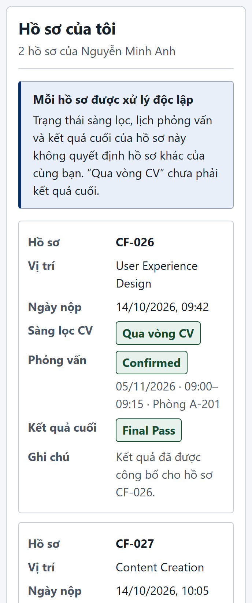


</div>

<div class="mobile-row">


</div>

<p class="meta">Chụp bằng Edge headless với viewport CSS 360 × 780, deviceScaleFactor 2 (ảnh 720 px điểm ảnh = 360 px CSS). Đã kiểm tra <code>innerWidth = 360</code>, <code>scrollWidth = 360</code> (không cuộn ngang). Đây là mô phỏng viewport, không phải thiết bị thật. A.1: <code>/</code> Khách “Đang nhận hồ sơ”; A.2: <code>/?tab=mine</code> Nguyễn Minh Anh “confirmed”; A.3: <code>/executive/review</code> Executive “Đã đóng đơn”; A.4: <code>/executive/scheduling</code> Executive “Đã đóng đơn”; A.5: <code>/interviewer</code> Hà My “confirmed”. Các ảnh cắt theo thẻ nội dung (cao tối đa 820 px CSS).</p>

## Phụ lục B — Cách tạo lại ảnh chụp

Ảnh được chụp bằng một script Node.js tạm (không thêm dependency vào dự án) điều khiển Microsoft Edge headless qua Chrome DevTools Protocol: đặt `sessionStorage['clubflow.demoSession'] = { accountId, scenarioId }` trước khi ứng dụng tải, mở route, thao tác bằng click/điền form trong DOM, rồi chụp theo vùng phần tử. Mỗi ảnh được kiểm tra lại tài khoản trên header và kịch bản trên thanh Demo. Toàn bộ dữ liệu là hư cấu; CV là tệp tạo trong bộ nhớ trình duyệt.
