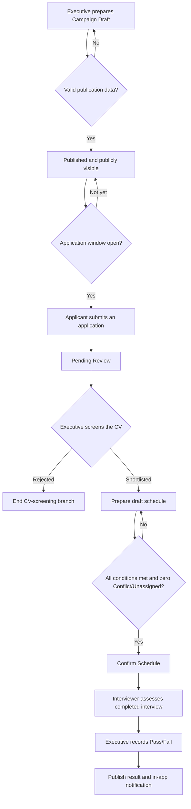

# ClubFlow — Workflows, States & Exceptions

**Sources:** Brief §§3–4; Business v1.1 §§2–6.  
**Warning:** Do not collapse `CV status`, `schedule status`, and `final result` into one business-status field. States not prescribed in the sources are marked *proposed conceptual milestones*, not mandatory enums.

## 1. End-to-end recruitment workflow



**Interpretation:** `Shortlisted` makes an application *eligible for a draft interview*, not a `Confirmed` schedule or final `Pass`. Confirming the schedule does not publish recruitment outcomes. If there are **zero shortlisted applications**, skip schedule confirmation (BR-13). Each application is independent even if one student applies for several positions.

## 2. Campaign lifecycle

| Stage / milestone | Entry condition | Next step | Read/write permissions |
|---|---|---|---|
| `Draft` (explicit source term) | Executive saves a draft | Satisfy BR-01 and publish | Executive only; configuration editable |
| `Published` (explicit source term) | Valid publication | Submission period and recruitment processing | Publicly visible; submissions only when `open <= now < close` |
| `Applications closed` (*time milestone*, not necessarily an enum) | Closing time reached | Complete screening and scheduling | No new submissions; Executive can continue permitted review/scheduling work |
| `Schedule confirmed` (*business milestone*) | BR-13 satisfied and shortlisted records exist | Interview assessments and outcomes | Lock campaign configuration, application content, screening decisions, and schedule |
| `Recruitment completed` (*concept defined by Business §2*) | Submissions closed, all applications reviewed, results published for those who advanced | Campaign no longer active | Records remain accessible according to authorization |

**Do not infer:** The sources do not prescribe all stored database enums (e.g., `OPEN`, `CLOSED`, `COMPLETED`) or detailed edit permissions for each campaign field between publication and confirmation. Design those later while respecting the source constraints.

## 3. Application CV-screening lifecycle

```text
Valid submission -> Pending Review -> Shortlisted
                                \-> Rejected (ends at CV screening)
```

- `Pending Review`: Valid application received and awaiting screening.
- `Shortlisted`: Eligible for scheduling, not accepted as a member.
- `Rejected`: Removed during CV screening and does not proceed to interview scheduling.
- Apply decisions **by application ID**, not by applicant ID.
- After schedule confirmation, CV-screening decisions cannot be edited (BR-14).
- The sources do not settle whether an Executive may reverse a screening decision before confirmation. If that is needed, record a decision rather than assuming it is permitted.

## 4. Interview scheduling lifecycle

Statuses for **each eligible application** in the draft:

| Source label | Meaning | Consequence |
|---|---|---|
| `Proposed` | Valid draft interview assignment | Not yet effective for Applicant/Interviewer |
| `Unassigned` | No valid combination available | Show reason; application remains Shortlisted |
| `Conflict` | An assignment violates a scheduling constraint | Identify related interviews and conflicting resource; block confirmation |
| `Confirmed` | Executive has approved the schedule | Authorized users can view it; read-only, no edits/regeneration |

**Generate draft:** The Executive selects the one interview date, window, common duration, interviewer–position assignments, interviewer availability, and rooms. The generator sequentially selects the **first valid combination**. The exact tie-break order among slots, interviewers, and rooms is **not prescribed**. After manual changes or regeneration, revalidate people, time, and room. Regeneration must warn and ask before replacing an existing draft. `Save Changes` saves the draft only.

**Conflict:** Interviews in the same campaign conflict if their times overlap **and** they share an applicant, interviewer, or room. Compare applicants by person/account, not merely by application. Adjacent sessions are allowed.

**Confirm:** Allowed only when applications are closed, no application remains Pending Review, every Shortlisted application has exactly one valid interview, and there are no Conflict/Unassigned records. Otherwise keep the draft and show outstanding items. With no Shortlisted applications, skip confirmation.

## 5. Assessment and final result lifecycle

These milestones are **separate** from CV screening and scheduling:

1. After the interview has occurred, its assigned Interviewer submits at most one assessment for the relevant interview/application.
2. The Executive reviews the assessment and records `Pass` or `Fail` for that application.
3. The Executive **publishes** the decision.
4. The Applicant sees only the published decision and receives an **in-app** notification.

`Pass` and `Fail` are explicit source values. `Not decided`, `decided but unpublished`, and `published` are only **analytical concepts**; choose a data representation later without inventing another approval workflow.

**Rejected CV branch:** Applications rejected at CV screening display their screening result and terminate there. Do not create interviews, assessments, or post-interview final decisions for them.

## 6. End-to-end example: one student applies for two positions

- Student A applies for Content (A01) and Communications (A02) in the same campaign.
- The Executive shortlists A01 and A02 independently.
- A01 must be assigned a qualified interviewer for Content; A02 a qualified interviewer for Communications.
- If both are scheduled at 09:00–09:20, this is a **Conflict because the applicant is the same person**, despite different interviewers and rooms.
- Moving A02 to 09:20–09:40 resolves this overlap if availability and room constraints permit; adjacent slots are allowed.
- After confirmation, Student A sees two separate appointments at different times. Each application later receives its own assessment/result.

## 7. Required exception behavior

| Condition | Required response |
|---|---|
| Missing campaign field or invalid dates | Block publication, report specific errors, retain entered data |
| Invalid PDF/SOP/availability or late submission | Do not create application; explain why; retain valid input |
| Duplicate applicant/campaign/position | Open existing application; do not increment application count |
| Delete position with existing application | Block deletion, preserve references, explain why |
| No qualified interviewer, shared availability, or room | `Unassigned` with reason; keep `Shortlisted` |
| Schedule edit causes overlap | Mark Conflict; identify affected interviews; block confirmation |
| Remaining Pending Review, Conflict, or Unassigned | Block confirmation and keep draft intact |
| Open confirmed schedule | Read-only; disable editing/regeneration |
| Unauthorized access to notes, CVs, other users' results | Backend denies access or omits forbidden private fields |

## 8. Technical responsibility boundaries

The backend decides validity and write permissions. The frontend reflects states and meaningful validation/conflict messages. The database supports consistency, but the **specific schema is not decided in this documentation phase**. Filter role-scoped records on the server before returning a response. See [Business Rules](BUSINESS_RULES.md) and [Roles](ROLES_AND_PERMISSIONS.md).
